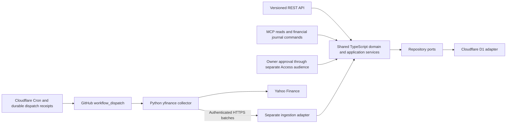

# PEA Tracker

PEA Tracker is an API-first portfolio backend for a single French PEA owner. It combines REST/MCP consultation, owner-approved financial journal commands, exact-decimal services, native D1 persistence, and a separate Python market-data collector. The real PEA is the priority; Trading Lab is a complementary, isolated future use. No brokerage orders are placed.

The source repository is public; tracked fixtures are synthetic. Production portfolio data, credentials and journals remain private and outside Git. The diagnostic Worker and historical PoCs remain separate from the financial reader.

## Project status

Latest release: [v1.1.3](aidd_docs/releases/v1.1.3.md), 23 November 2026. An explicit Access reconnection button helps recover after `invalid_token`, with a warning that other Access applications may be disconnected. It does not diagnose or fix the underlying authentication cause. V1.1.2 presentation/countdown and V1.1.1 tracking-safe navigation are preserved; the first real owner-approved MCP write/receipt/replay journey remains unvalidated.

V1.1.0 was published on 2026-11-21, after V1.0.0 on 2026-11-19. Financial management, EUR gains, estimated Modified Dietz returns and a partial venue calendar are deployed. Current reads use the separate operational reference at the close of 20 November, preserving historical V1. Journal writes are enabled with independent browser approval; the first real approval/write/receipt/replay journey is still not production-validated.

| Capability | Status |
| --- | --- |
| Instruments, opening positions and cash | Operational through the protected financial read Worker and remote D1 |
| Quotations and exact-decimal valuation | Operational; explicit provider provenance and freshness warnings |
| REST/MCP consultation | Historical V1 preserved; separate V1.1 projected holdings, cash, PRU, gains and journal reads |
| Python/yfinance ingestion | Operational, through a dedicated Cloudflare Access machine policy |
| Automation | Cloudflare Cron and Durable Object receipts → GitHub workflow_dispatch → Python → ingestion |
| V1 monitoring | Hourly 07:09–20:09 Paris; closing check observed successful on 20 November |
| V1.1 calendar | 19 XPAR instruments assigned to known full-day closures for 2026–2027; individual continuous/fixing modes unqualified, intraday phases and ALXP remain unknown |
| V1.1 financial management | EUR trades, cash movements, fees, dividends, reversals, exact weighted PRU and realized/unrealized gains implemented and deployed; real write journey not yet production-validated |
| Financial MCP commands | 18 tools: 11 reads/diagnostics, six preparations, one confirmation; independent browser approval, separate server permissions, expiry and idempotent receipts |
| Global performance | Broker closing market-value reference selected for 20 November; economic gain in EUR and estimated, non-annualized Modified Dietz percentage adjusted for dated external flows; explicit unavailable statuses on missing inputs |
| Diagnostic Workers | Separate historical PoCs, not the production financial read endpoint |

See [V1.1.0 release notes](aidd_docs/releases/v1.1.0.md), [V1.1 validation and RETEX](aidd_docs/releases/v1.1.0-validation.md) and [historical V1 acceptance](aidd_docs/releases/v1.0.0-validation.md).

## Architecture



The application uses TypeScript, Hono and Cloudflare Workers. REST and MCP adapters call the same business services; financial rules and persistence logic are not duplicated in transport adapters. The repository includes native D1 persistence and migrations, exercised against Wrangler local D1. The Python collector is an independent provider adapter: it normalizes quotes and sends them to the ingestion API; it does not access D1 or calculate portfolio results.

Financial values use exact decimal representations. Valuation selects an explicit provider and quote type, preserves quote provenance and freshness warnings, distinguishes complete totals from partial subtotals, and performs no implicit currency conversion. See the [approved financial backend PRD](aidd_docs/tasks/2026_11/2026_11_08-financial-backend-prd.md) and the [architecture baseline](aidd_docs/INSTALL.md).

Historical tools `get_opening_state`, `get_positions` and `get_portfolio_valuation` retain V1 semantics. `get_current_portfolio`, `get_current_portfolio_valuation` and `get_transaction_journal` use the separately selected operational reference and subsequent journal. The operational start was imported under authorization from a verified broker export, without reconstructing intermediate trades or altering V1. Declared PRU and independently evidenced cash remain traceable; historic fee treatment remains unknown. Quote reads across instruments do not form an atomic market snapshot.

Six `prepare_*` tools persist expiring immutable proposals without changing journal balances. `confirm_financial_operation` records only an exact proposal already approved by the owner on the protected browser page. A model-supplied Boolean or tool annotation grants no approval. See the [financial MCP contract](aidd_docs/tasks/2026_11/2026_11_21_financial-mcp/contract.md) and [operational evidence](aidd_docs/tasks/2026_11/2026_11_21_operational-start/production.md).

## Local development

### Requirements

- Node.js 22.12 or newer and npm.
- Python 3.14 and uv 0.10.4 for collector development.
- Docker Compose is optional; it is used for local development and tests, not production.

Install dependencies and run the TypeScript checks:

```sh
npm ci
npm run check
npm run build
```

`npm run check` runs TypeScript typechecking and the Vitest suite, including API contracts, local D1, REST/MCP adapters and diagnostics. `npm run build` creates a Wrangler dry-run bundle; it does not deploy. Start the diagnostic-only local Worker with `npm run dev`, then check `http://127.0.0.1:8787/api/v1/health` or use the MCP smoke script:

```sh
node scripts/smoke-mcp.mjs
```

The financial REST routes are exercised through explicit loopback-only test harnesses with synthetic principals and local repositories. Their setup, including local D1 migration commands, is documented in the relevant [AIDD slice contracts](aidd_docs/tasks/2026_11/).

### Python collector

The collector uses a locked dependency set and offline synthetic tests. From the repository root:

```sh
uv sync --project collector --frozen
collector/.venv/bin/python -m pea_collector.checks --
collector/.venv/bin/python -m pea_collector.qualify --offline --
```

The tests do not require Yahoo access or credentials. Live qualification is a separate network operation and does not prove provider data rights or full instrument coverage. See the [collector guide](collector/README.md).

Two dispatch-only GitHub workflows retain protected environments, source/branch gates, concurrency, pinned actions and provider/coverage/security approvals. Cloudflare schedules collection weekdays 07:17–19:47 Europe/Paris. Monitoring runs hourly 07:09–20:09; the closing check requires each final due slot. The scheduler has no financial D1 binding or public HTTP endpoint. Secrets are never stored in this public repository.

## Security and deployment boundaries

- Financial REST/MCP and ingestion use separate Workers and Access policies. Exact-owner MCP identity may receive `portfolio:write`; browser consent alone receives `portfolio:approve` under a distinct signed audience. Neither grants quotation ingestion or technical administration. Existing machine authorization grants quotation ingestion only.
- Financial approval binds the normalized operation, portfolio, owner, opening anchor, journal version and unique key. It expires after five minutes and is consumed once. If consumption precedes an unsuccessful/ambiguous append, reconcile the journal before preparing again; never rearm the approval or blindly duplicate a write.
- Access JWTs require verified RS256 signatures, issuer, audience, temporal claims and the exact owner or allowlisted machine identity for their respective paths. The former five-minute total-lifetime cap was removed; mere token presence never authorizes a request. Offline revocation remains bounded by assertion expiry.
- No holdings, credentials, mappings, private journals or financial dumps belong in source, release assets or public logs. Remote changes require scoped owner approval.
- The default diagnostic Worker remains distinct from the production financial read/ingestion entrypoints.

## Engineering practices

This project uses API-first design, hexagonal boundaries, shared REST/MCP services, D1 migrations and restart-safe persistence, exact-decimal calculations, JWT/JWKS authorization, Cloudflare Access integration, Python provider isolation, cross-language HTTP tests, and least-privilege GitHub Actions automation. Reference financial calculations belong to the PEA Tracker domain. ChatGPT interprets results and may provide separate, explicitly indicative simulations.

## AI-assisted development with AIDD

AIDD Framework organizes planning and delivery; it is a development workflow, not a PEA Tracker runtime dependency. Available Context, PM and Dev skills support memory, decisions, requirements, feasibility studies and approved delivery. Use only relevant installed workflows after reading their instructions. Do not run context hooks or broaden a documentation task into memory synchronization without approval. Human approval remains required for staging, commits and remote changes.

## Delivery limits and roadmap

The [V1 acceptance record](aidd_docs/releases/v1.0.0-validation.md) preserves the successful production collection/monitoring evidence and resolved incidents. No new production checks were run for this documentation milestone.

The [roadmap](aidd_docs/roadmap.md) separates the delivered financial foundation from remaining work:

- **V1.1.0 delivered:** journal, cash, fees/dividends, exact cost/PRU/gains, protected financial MCP, separate operational opening, broker market-value reference and Modified Dietz. Operational positions/PRU are distinct from the explicitly selected market valuation used for performance. No earlier trades or prices were reconstructed.
- **V1.1 limits:** first real owner-approved write/replay acceptance, individual continuous/fixing modes, ALXP and unestablished intraday phases remain open. Monitoring depends on GitHub; advanced/independent alerting is not delivered. Returns remain estimates with source/freshness caveats, not reconstructed pre-reference history or exact TWR.
- **V2.0:** multi-portfolio isolation and shared market data; multi-provider support.
- **V2.1:** OHLCV, watchlists and deterministic indicators.
- **V2.2:** Trading Lab decision journal; evaluate TradingView Paper Trading before any optional internal simulation.
- **V2.3:** periodic performance, TWR/XIRR if appropriate, portfolio allocation, advanced analysis and optional interfaces.

Small Trading Lab increments remain conditional on feasibility and preserving the real PEA priority. Exports, deletion and restoration retain existing requirements and unresolved evidence. Historical performance remains unavailable when source history is insufficient. Release authorization and operational write acceptance are separate; no fictitious transaction may be inserted into the real PEA to close a checklist.

## Project documentation

- [AIDD guidelines](aidd_docs/GUIDELINES.md)
- [Architecture baseline](aidd_docs/INSTALL.md)
- [Roadmap and validated scope decisions](aidd_docs/roadmap.md)
- [Approved financial backend PRD](aidd_docs/tasks/2026_11/2026_11_08-financial-backend-prd.md)
- [OpenAPI contract](aidd_docs/api/openapi.json)
- [V1.1 financial OpenAPI contract](aidd_docs/api/transactions.openapi.json)
- [Collector guide](collector/README.md)
- [Collector implementation and evidence](aidd_docs/tasks/2026_11/2026_11_11_collector/plan.md)
- [Quotation and freshness contract](aidd_docs/tasks/2026_11/2026_11_11_quotations/contract.md)
- [Valuation contract](aidd_docs/tasks/2026_11/2026_11_11_valuation/contract.md)
- [OAuth interoperability evidence](aidd_docs/tasks/2026_11/2026_11_08_oauth-authentication/interop-evidence.md)
