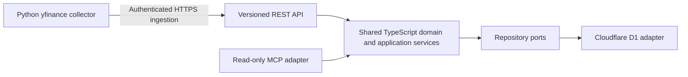

# PEA Tracker

PEA Tracker is an API-first portfolio backend for a single French PEA owner. It combines a versioned REST API, read-only MCP tools for AI clients, exact-decimal financial services, durable local D1 adapters, and a separate Python market-data collector.

The repository is public and uses synthetic data only. Local implementation and tests do not mean that financial features are available from the main deployed Worker.

## Project status

| Capability | Status |
| --- | --- |
| Instruments, dated opening state and positions | Implemented and tested locally with synthetic fixtures and local D1 |
| Market quotations, freshness and portfolio valuation | Implemented and tested locally; missing, stale and partial inputs are reported explicitly |
| REST and MCP business capabilities | Shared TypeScript services and adapters are implemented locally; MCP is read-only |
| Python/yfinance collector and machine-authenticated ingestion | Implemented and tested locally; no live scheduled collection is enabled |
| Main Cloudflare Worker (`pea-tracker-dev`) | Diagnostic endpoints only: REST health and MCP `ping` |
| Cloudflare Access MCP PoC (`pea-tracker-oauth-poc`) | Separate deployed PoC; owner-reported ChatGPT OAuth connection and synthetic `list_instruments` call succeeded |
| Remote financial API, remote D1 and real portfolio data | Not enabled |

The Access PoC currently proves only the reported ChatGPT connection and `list_instruments` read on synthetic data. `get_instrument`, hosted negative authorization/PKCE cases, token renewal and revocation remain unverified. The PoC does not expose REST administration or quotation ingestion. See [OAuth interoperability evidence](aidd_docs/tasks/2026_11/2026_11_08_oauth-authentication/interop-evidence.md).

## Architecture



The application uses TypeScript, Hono and Cloudflare Workers. REST and MCP adapters call the same business services; financial rules and persistence logic are not duplicated in transport adapters. The repository includes native D1 persistence and migrations, exercised against Wrangler local D1. The Python collector is an independent provider adapter: it normalizes quotes and sends them to the ingestion API; it does not access D1 or calculate portfolio results.

Financial values use exact decimal representations. Valuation selects an explicit provider and quote type, preserves quote provenance and freshness warnings, distinguishes complete totals from partial subtotals, and performs no implicit currency conversion. See the [approved financial backend PRD](aidd_docs/tasks/2026_11/2026_11_08-financial-backend-prd.md) and the [architecture baseline](aidd_docs/INSTALL.md).

## Local development

### Requirements

- Node.js 22.12 or newer and npm.
- Python 3.14 and uv 0.10.4 for collector development.
- Docker Compose is optional; it is used for local development and tests, not production.

Install dependencies and run the TypeScript checks:

```sh
npm ci
npm run check
npm run build
```

`npm run check` runs TypeScript typechecking and the Vitest suite, including API contracts, local D1, REST/MCP adapters and diagnostics. `npm run build` creates a Wrangler dry-run bundle; it does not deploy. Start the diagnostic-only local Worker with `npm run dev`, then check `http://127.0.0.1:8787/api/v1/health` or use the MCP smoke script:

```sh
node scripts/smoke-mcp.mjs
```

The financial REST routes are exercised through explicit loopback-only test harnesses with synthetic principals and local repositories. Their setup, including local D1 migration commands, is documented in the relevant [AIDD slice contracts](aidd_docs/tasks/2026_11/).

### Python collector

The collector uses a locked dependency set and offline synthetic tests. From the repository root:

```sh
uv sync --project collector --frozen
collector/.venv/bin/python -m pea_collector.checks --
collector/.venv/bin/python -m pea_collector.qualify --offline --
```

The tests do not require Yahoo access or credentials. Live qualification is a separate network operation and does not prove provider data rights or full instrument coverage. See the [collector guide](collector/README.md).

Two GitHub Actions workflows are prepared for manual runs. Their schedules remain commented out; hosted ingestion requires separately approved Cloudflare Access service credentials, a protected GitHub Environment, provider/coverage approval and recovery/monitoring checks. Secrets are not stored in this public repository. See the [machine-ingestion runbook](aidd_docs/tasks/2026_11/2026_11_11_remote-ingestion/contract.md).

## Security and deployment boundaries

- The main Worker remains diagnostic-only. Local financial route fixtures are not deployment authentication.
- The separately deployed MCP PoC uses Cloudflare Access and synthetic in-memory data. Its limited ChatGPT result is not production readiness or evidence for REST administration, collector access, or personal-data use.
- Financial REST/MCP routes and machine ingestion are separate capabilities. MCP is read-only; collector authorization is limited to quotation ingestion in the local composition.
- Remote D1, production financial routes, live collector credentials and scheduled collection are not configured or activated by this repository state.
- Do not add real holdings, tokens, credentials or private account identifiers to code, fixtures, logs, issues or artifacts. The release gates include approved authentication, authorization, financial correctness, provider terms, privacy, monitoring, backup and tested restoration.

## Engineering practices

This project demonstrates API-first design, hexagonal boundaries, shared REST/MCP services, D1 migrations and restart-safe persistence, exact-decimal calculations, JWT/JWKS authorization, Cloudflare Access integration, Python provider isolation, cross-language HTTP tests, and least-privilege GitHub Actions preparation.

## AI-assisted development with AIDD

AIDD Framework organizes planning and delivery; it is a development workflow, not a PEA Tracker runtime dependency. We use its capabilities selectively: Context retrieves project decisions, PM shapes product requirements, Dev implements approved slices, QA validates behavior, VCS reviews changes, and Refine is used when an unresolved rule blocks implementation. Orchestrator and Codex sub-agents are considered for work with genuinely independent or cross-component tasks, not used by default. Documented architecture decisions, automated tests and diff reviews support delivery; human approval remains required for commits and remote changes such as deployments.

## Remaining V1 work

Remaining V1 work is bounded by the approved PRD: specify and implement purchases, sales, fees and cash movements after the accounting conventions are approved; then define allocation rules and historical-performance methodology. Historical performance must remain explicitly unavailable when source history is incomplete. Dividends and advanced corporate actions are not prerequisites for the current slices.

## Project documentation

- [AIDD guidelines](aidd_docs/GUIDELINES.md)
- [Architecture baseline](aidd_docs/INSTALL.md)
- [Approved financial backend PRD](aidd_docs/tasks/2026_11/2026_11_08-financial-backend-prd.md)
- [OpenAPI contract](aidd_docs/api/openapi.json)
- [Collector guide](collector/README.md)
- [Collector implementation and evidence](aidd_docs/tasks/2026_11/2026_11_11_collector/plan.md)
- [Quotation and freshness contract](aidd_docs/tasks/2026_11/2026_11_11_quotations/contract.md)
- [Valuation contract](aidd_docs/tasks/2026_11/2026_11_11_valuation/contract.md)
- [OAuth interoperability evidence](aidd_docs/tasks/2026_11/2026_11_08_oauth-authentication/interop-evidence.md)
