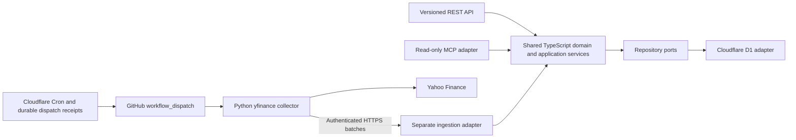

# PEA Tracker

PEA Tracker is an API-first portfolio backend for a single French PEA owner. It combines a versioned REST API, read-only MCP tools for AI clients, exact-decimal financial services, native D1 persistence, and a separate Python market-data collector. The real PEA is the priority; Trading Lab is a complementary, isolated future use.

The source repository is public; tracked fixtures are synthetic. Production portfolio data, credentials and journals remain private and outside Git. The diagnostic Worker and historical PoCs remain separate from the financial reader.

## Project status

V1.0.0 was published on 2026-11-19, functionally accepted with minor reservations. This branch continues V1.1 development; local implementation does not authorize production activation.

| Capability | Status |
| --- | --- |
| Instruments, opening positions and cash | Operational through the protected financial read Worker and remote D1 |
| Quotations and exact-decimal valuation | Operational; explicit provider provenance and freshness warnings |
| REST and read-only MCP | Shared domain/application services and separate transport adapters |
| Python/yfinance ingestion | Operational, through a dedicated Cloudflare Access machine policy |
| Automation | Cloudflare Cron and Durable Object receipts → GitHub workflow_dispatch → Python → ingestion |
| V1 monitoring | Hourly 07:09–20:09 Paris; explicit final-slot check at 20:09 |
| V1.1 calendar | Bounded XPAR continuous-core adapter implemented and tested locally; no production assignment/activation |
| V1.1 financial management | Transaction ledger, calculated PRU and performance rules remain under study |
| Diagnostic Workers | Separate historical PoCs, not the production financial read endpoint |

See [V1 acceptance and RETEX](aidd_docs/releases/v1.0.0-validation.md) and [release notes](aidd_docs/releases/v1.0.0.md).

## Architecture



The application uses TypeScript, Hono and Cloudflare Workers. REST and MCP adapters call the same business services; financial rules and persistence logic are not duplicated in transport adapters. The repository includes native D1 persistence and migrations, exercised against Wrangler local D1. The Python collector is an independent provider adapter: it normalizes quotes and sends them to the ingestion API; it does not access D1 or calculate portfolio results.

Financial values use exact decimal representations. Valuation selects an explicit provider and quote type, preserves quote provenance and freshness warnings, distinguishes complete totals from partial subtotals, and performs no implicit currency conversion. See the [approved financial backend PRD](aidd_docs/tasks/2026_11/2026_11_08-financial-backend-prd.md) and the [architecture baseline](aidd_docs/INSTALL.md).

Current reads cover the instrument catalogue, opening state, positions, quotation status/history and valuation through REST and MCP. MCP tools include `list_instruments`, `get_instrument`, `get_opening_state`, `get_positions`, `get_quotation_status`, `list_quotations` and `get_portfolio_valuation`. Declared PRU is not a reconstructed historical cost. There is no transaction ledger, calculated PRU/gain/return engine or persisted valuation snapshot. Quote reads across instruments do not form an atomic market snapshot.

## Local development

### Requirements

- Node.js 22.12 or newer and npm.
- Python 3.14 and uv 0.10.4 for collector development.
- Docker Compose is optional; it is used for local development and tests, not production.

Install dependencies and run the TypeScript checks:

```sh
npm ci
npm run check
npm run build
```

`npm run check` runs TypeScript typechecking and the Vitest suite, including API contracts, local D1, REST/MCP adapters and diagnostics. `npm run build` creates a Wrangler dry-run bundle; it does not deploy. Start the diagnostic-only local Worker with `npm run dev`, then check `http://127.0.0.1:8787/api/v1/health` or use the MCP smoke script:

```sh
node scripts/smoke-mcp.mjs
```

The financial REST routes are exercised through explicit loopback-only test harnesses with synthetic principals and local repositories. Their setup, including local D1 migration commands, is documented in the relevant [AIDD slice contracts](aidd_docs/tasks/2026_11/).

### Python collector

The collector uses a locked dependency set and offline synthetic tests. From the repository root:

```sh
uv sync --project collector --frozen
collector/.venv/bin/python -m pea_collector.checks --
collector/.venv/bin/python -m pea_collector.qualify --offline --
```

The tests do not require Yahoo access or credentials. Live qualification is a separate network operation and does not prove provider data rights or full instrument coverage. See the [collector guide](collector/README.md).

Two dispatch-only GitHub workflows retain protected environments, source/branch gates, concurrency, pinned actions and provider/coverage/security approvals. Cloudflare schedules collection weekdays 07:17–19:47 Europe/Paris. Monitoring runs hourly 07:09–20:09; the closing check requires each final due slot. The scheduler has no financial D1 binding or public HTTP endpoint. Secrets are never stored in this public repository.

## Security and deployment boundaries

- Financial REST/read-only MCP and ingestion use separate Workers and Access policies. Machine authorization grants quotation ingestion only.
- Access JWTs require verified RS256 signatures, issuer, audience, valid temporal claims and the allowlisted machine identity. The former five-minute total-lifetime cap was removed; mere token presence never authorizes a request. Offline revocation remains bounded by assertion expiry.
- No holdings, credentials, mappings, private journals or financial dumps belong in source, release assets or public logs. Remote changes require scoped owner approval.
- The default diagnostic Worker remains distinct from the production financial read/ingestion entrypoints.

## Engineering practices

This project uses API-first design, hexagonal boundaries, shared REST/MCP services, D1 migrations and restart-safe persistence, exact-decimal calculations, JWT/JWKS authorization, Cloudflare Access integration, Python provider isolation, cross-language HTTP tests, and least-privilege GitHub Actions automation. Reference financial calculations belong to the PEA Tracker domain. ChatGPT interprets results and may provide separate, explicitly indicative simulations.

## AI-assisted development with AIDD

AIDD Framework organizes planning and delivery; it is a development workflow, not a PEA Tracker runtime dependency. Available Context, PM and Dev skills support memory, decisions, requirements, feasibility studies and approved delivery. Use only relevant installed workflows after reading their instructions. Do not run context hooks or broaden a documentation task into memory synchronization without approval. Human approval remains required for staging, commits and remote changes.

## V1 completion and roadmap

Confirm the first scheduled collector cycle on 16 November 2026: successful `Run collector`, advancing successful-fetch timestamps and appropriate market dates. No tag or release has been created; consider `v1.0.0` only after this operational check and explicit authorization.

The [roadmap](aidd_docs/roadmap.md) is the scope reference. Future features are planned or under study, not developed or feasibility-approved:

- **V1.1:** calendar/freshness, transactions and cash, invested capital, PRU, realized/unrealized gains, study of an explicit simple return, useful monitoring. Financial formulas remain unapproved.
- **V2.0:** multi-portfolio isolation and shared market data; multi-provider support.
- **V2.1:** OHLCV, watchlists and deterministic indicators.
- **V2.2:** Trading Lab decision journal; evaluate TradingView Paper Trading before any optional internal simulation.
- **V2.3:** periodic performance, TWR/XIRR if appropriate, portfolio allocation, advanced analysis and optional interfaces.

Small Trading Lab increments remain conditional on feasibility and preserving the real PEA priority. Exports, deletion and restoration retain existing requirements and unresolved evidence; no delivery version is assigned here. Historical performance remains unavailable when source history is insufficient. The PRD and AIDD memories await a separately approved synchronization lot; historical V1 contracts remain unchanged.

## Project documentation

- [AIDD guidelines](aidd_docs/GUIDELINES.md)
- [Architecture baseline](aidd_docs/INSTALL.md)
- [Roadmap and validated scope decisions](aidd_docs/roadmap.md)
- [Approved financial backend PRD](aidd_docs/tasks/2026_11/2026_11_08-financial-backend-prd.md)
- [OpenAPI contract](aidd_docs/api/openapi.json)
- [Collector guide](collector/README.md)
- [Collector implementation and evidence](aidd_docs/tasks/2026_11/2026_11_11_collector/plan.md)
- [Quotation and freshness contract](aidd_docs/tasks/2026_11/2026_11_11_quotations/contract.md)
- [Valuation contract](aidd_docs/tasks/2026_11/2026_11_11_valuation/contract.md)
- [OAuth interoperability evidence](aidd_docs/tasks/2026_11/2026_11_08_oauth-authentication/interop-evidence.md)
