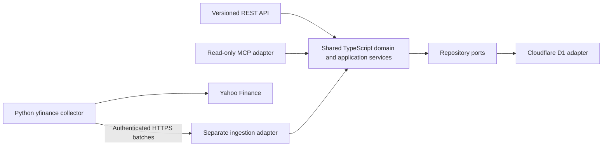

# PEA Tracker

PEA Tracker is an API-first portfolio backend for a single French PEA owner. It combines a versioned REST API, read-only MCP tools for AI clients, exact-decimal financial services, native D1 persistence, and a separate Python market-data collector. The real PEA is the priority; Trading Lab is a complementary, isolated future use.

The repository is public; tracked examples and tests use synthetic data only. Real portfolio data remains private in the separately authorized financial deployment. The diagnostic Worker and old PoCs are separate from the current financial reader.

## Project status

| Capability | Status |
| --- | --- |
| Instruments, dated opening state, positions and known cash | Developed; previously tested locally on synthetic Memory/native D1 fixtures; real reads validated in ChatGPT in the prior owner session |
| Stored quotations and exact EUR valuation | Developed and previously tested locally; real grouped valuation validated in ChatGPT, including timestamps, coverage and warnings |
| Calendar-aware freshness | Rules developed and tested with synthetic context; actual reader reports `unknown` because no real calendar adapter is integrated |
| Financial reader (`pea-tracker-financial-read`) | Owner-only REST/MCP on native D1; shared services; no administrative or ingestion routes |
| Ingestion (`pea-tracker-quotes-ingestion`) and Python/yfinance | Developed and previously tested locally; hosted ingestion previously verified and persistent bounded ingestion deployed with owner authorization |
| GitHub Actions collection and monitoring | Schedules published on `main`; first complete scheduled cycle on Monday 16 November 2026 remains to be confirmed |
| Diagnostic DEV and OAuth PoCs | Separate historical entrypoints; not required for current financial consultation |
| V1.1 financial management | Planned, under study; no development started or blanket feasibility approval |

Status as of 14 November 2026: developed capabilities and prior local test evidence are distinct from prior operational observations supplied in the owner handover. No new tests or authenticated remote checks were performed for this documentation update. Successful ChatGPT reads do not prove every REST route, OAuth lifecycle case or recovery gate. See the [current V1 runbook](aidd_docs/tasks/2026_11/2026_11_14_live-quotations-read/runbook.md).

## Architecture



The application uses TypeScript, Hono and Cloudflare Workers. REST and MCP adapters call the same business services; financial rules and persistence logic are not duplicated in transport adapters. The repository includes native D1 persistence and migrations, exercised against Wrangler local D1. The Python collector is an independent provider adapter: it normalizes quotes and sends them to the ingestion API; it does not access D1 or calculate portfolio results.

Financial values use exact decimal representations. Valuation selects an explicit provider and quote type, preserves quote provenance and freshness warnings, distinguishes complete totals from partial subtotals, and performs no implicit currency conversion. See the [approved financial backend PRD](aidd_docs/tasks/2026_11/2026_11_08-financial-backend-prd.md) and the [architecture baseline](aidd_docs/INSTALL.md).

Current reads cover the instrument catalogue, opening state, positions, quotation status/history and valuation through REST and MCP. MCP tools include `list_instruments`, `get_instrument`, `get_opening_state`, `get_positions`, `get_quotation_status`, `list_quotations` and `get_portfolio_valuation`. Declared PRU is not a reconstructed historical cost. There is no transaction ledger, calculated PRU/gain/return engine or persisted valuation snapshot. Quote reads across instruments do not form an atomic market snapshot.

## Local development

### Requirements

- Node.js 22.12 or newer and npm.
- Python 3.14 and uv 0.10.4 for collector development.
- Docker Compose is optional; it is used for local development and tests, not production.

Install dependencies and run the TypeScript checks:

```sh
npm ci
npm run check
npm run build
```

`npm run check` runs TypeScript typechecking and the Vitest suite, including API contracts, local D1, REST/MCP adapters and diagnostics. `npm run build` creates a Wrangler dry-run bundle; it does not deploy. Start the diagnostic-only local Worker with `npm run dev`, then check `http://127.0.0.1:8787/api/v1/health` or use the MCP smoke script:

```sh
node scripts/smoke-mcp.mjs
```

The financial REST routes are exercised through explicit loopback-only test harnesses with synthetic principals and local repositories. Their setup, including local D1 migration commands, is documented in the relevant [AIDD slice contracts](aidd_docs/tasks/2026_11/).

### Python collector

The collector uses a locked dependency set and offline synthetic tests. From the repository root:

```sh
uv sync --project collector --frozen
collector/.venv/bin/python -m pea_collector.checks --
collector/.venv/bin/python -m pea_collector.qualify --offline --
```

The tests do not require Yahoo access or credentials. Live qualification is a separate network operation and does not prove provider data rights or full instrument coverage. See the [collector guide](collector/README.md).

Both GitHub Actions workflows support manual dispatch and published weekday schedules: collection `17,47 6-18 * * 1-5`, monitoring `9 * * * 1-5` (UTC). Collection is configured for 30 minutes in a broad weekday window, not an exchange calendar. The monitor counts successful actual live steps and shares GitHub's availability; no external heartbeat is configured. Publication and dashboard settings do not prove successful scheduled execution. Secrets remain outside this public repository; see the [collector guide](collector/README.md) and [V1 runbook](aidd_docs/tasks/2026_11/2026_11_14_live-quotations-read/runbook.md).

## Security and deployment boundaries

- The financial reader uses owner-only Cloudflare Access/Managed OAuth; machine ingestion uses separate Access Service Auth and provider/instrument grants. MCP stays strictly read-only; administration is separately authorized and absent from the financial reader.
- Local synthetic harnesses are not deployment authentication. Historical diagnostic/PoC success is not evidence for financial correctness or complete security/recovery readiness.
- The collector has no D1 or portfolio access. Collection does not run inside a REST/MCP valuation request.
- Remote changes, migrations, deployments and paid services require explicit authorization. Future capabilities need their own applicable acceptance evidence; no gate is closed by updating documentation.
- Do not add real holdings, tokens, credentials or private account identifiers to code, fixtures, logs, issues or artifacts. The release gates include approved authentication, authorization, financial correctness, provider terms, privacy, monitoring, backup and tested restoration.

## Engineering practices

This project uses API-first design, hexagonal boundaries, shared REST/MCP services, D1 migrations and restart-safe persistence, exact-decimal calculations, JWT/JWKS authorization, Cloudflare Access integration, Python provider isolation, cross-language HTTP tests, and least-privilege GitHub Actions automation. Reference financial calculations belong to the PEA Tracker domain. ChatGPT interprets results and may provide separate, explicitly indicative simulations.

## AI-assisted development with AIDD

AIDD Framework organizes planning and delivery; it is a development workflow, not a PEA Tracker runtime dependency. Available Context, PM and Dev skills support memory, decisions, requirements, feasibility studies and approved delivery. Use only relevant installed workflows after reading their instructions. Do not run context hooks or broaden a documentation task into memory synchronization without approval. Human approval remains required for staging, commits and remote changes.

## V1 completion and roadmap

Confirm the first scheduled collector cycle on 16 November 2026: successful `Run collector`, advancing successful-fetch timestamps and appropriate market dates. No tag or release has been created; consider `v1.0.0` only after this operational check and explicit authorization.

The [roadmap](aidd_docs/roadmap.md) is the scope reference. Future features are planned or under study, not developed or feasibility-approved:

- **V1.1:** calendar/freshness, transactions and cash, invested capital, PRU, realized/unrealized gains, study of an explicit simple return, useful monitoring. Financial formulas remain unapproved.
- **V2.0:** multi-portfolio isolation and shared market data; multi-provider support.
- **V2.1:** OHLCV, watchlists and deterministic indicators.
- **V2.2:** Trading Lab decision journal; evaluate TradingView Paper Trading before any optional internal simulation.
- **V2.3:** periodic performance, TWR/XIRR if appropriate, portfolio allocation, advanced analysis and optional interfaces.

Small Trading Lab increments remain conditional on feasibility and preserving the real PEA priority. Exports, deletion and restoration retain existing requirements and unresolved evidence; no delivery version is assigned here. Historical performance remains unavailable when source history is insufficient. The PRD and AIDD memories await a separately approved synchronization lot; historical V1 contracts remain unchanged.

## Project documentation

- [AIDD guidelines](aidd_docs/GUIDELINES.md)
- [Architecture baseline](aidd_docs/INSTALL.md)
- [Roadmap and validated scope decisions](aidd_docs/roadmap.md)
- [Approved financial backend PRD](aidd_docs/tasks/2026_11/2026_11_08-financial-backend-prd.md)
- [OpenAPI contract](aidd_docs/api/openapi.json)
- [Collector guide](collector/README.md)
- [Collector implementation and evidence](aidd_docs/tasks/2026_11/2026_11_11_collector/plan.md)
- [Quotation and freshness contract](aidd_docs/tasks/2026_11/2026_11_11_quotations/contract.md)
- [Valuation contract](aidd_docs/tasks/2026_11/2026_11_11_valuation/contract.md)
- [OAuth interoperability evidence](aidd_docs/tasks/2026_11/2026_11_08_oauth-authentication/interop-evidence.md)
