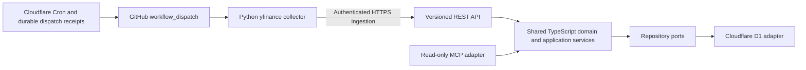

# PEA Tracker

PEA Tracker is an API-first portfolio backend for a single French PEA owner. It combines a versioned REST API, read-only MCP tools for AI clients, exact-decimal financial services, durable local D1 adapters, and a separate Python market-data collector.

The source repository is public; tracked fixtures are synthetic. Production portfolio data, credentials and journals remain private and outside Git.

## Project status

V1 was functionally accepted with minor reservations on 2026-11-19. Release publication remains subject to owner approval.

| Capability | Status |
| --- | --- |
| Instruments, opening positions and cash | Operational through the protected financial read Worker and remote D1 |
| Quotations and exact-decimal valuation | Operational; explicit provider provenance and freshness warnings |
| REST and read-only MCP | Shared domain/application services and separate transport adapters |
| Python/yfinance ingestion | Operational, through a dedicated Cloudflare Access machine policy |
| Automation | Cloudflare Cron and Durable Object receipts → GitHub workflow_dispatch → Python → ingestion |
| Monitoring closure candidate | Hourly 07:09–20:09 Paris; explicit final-slot check at 20:09 |
| Diagnostic Workers | Separate historical PoCs, not the production financial read endpoint |

See [V1 acceptance and RETEX](aidd_docs/releases/v1.0.0-validation.md) and [release notes](aidd_docs/releases/v1.0.0.md).

## Architecture



The application uses TypeScript, Hono and Cloudflare Workers. REST and MCP adapters call the same business services; financial rules and persistence logic are not duplicated in transport adapters. The repository includes native D1 persistence and migrations, exercised against Wrangler local D1. The Python collector is an independent provider adapter: it normalizes quotes and sends them to the ingestion API; it does not access D1 or calculate portfolio results.

Financial values use exact decimal representations. Valuation selects an explicit provider and quote type, preserves quote provenance and freshness warnings, distinguishes complete totals from partial subtotals, and performs no implicit currency conversion. See the [approved financial backend PRD](aidd_docs/tasks/2026_11/2026_11_08-financial-backend-prd.md) and the [architecture baseline](aidd_docs/INSTALL.md).

## Local development

### Requirements

- Node.js 22.12 or newer and npm.
- Python 3.14 and uv 0.10.4 for collector development.
- Docker Compose is optional; it is used for local development and tests, not production.

Install dependencies and run the TypeScript checks:

```sh
npm ci
npm run check
npm run build
```

`npm run check` runs TypeScript typechecking and the Vitest suite, including API contracts, local D1, REST/MCP adapters and diagnostics. `npm run build` creates a Wrangler dry-run bundle; it does not deploy. Start the diagnostic-only local Worker with `npm run dev`, then check `http://127.0.0.1:8787/api/v1/health` or use the MCP smoke script:

```sh
node scripts/smoke-mcp.mjs
```

The financial REST routes are exercised through explicit loopback-only test harnesses with synthetic principals and local repositories. Their setup, including local D1 migration commands, is documented in the relevant [AIDD slice contracts](aidd_docs/tasks/2026_11/).

### Python collector

The collector uses a locked dependency set and offline synthetic tests. From the repository root:

```sh
uv sync --project collector --frozen
collector/.venv/bin/python -m pea_collector.checks --
collector/.venv/bin/python -m pea_collector.qualify --offline --
```

The tests do not require Yahoo access or credentials. Live qualification is a separate network operation and does not prove provider data rights or full instrument coverage. See the [collector guide](collector/README.md).

Two dispatch-only GitHub workflows retain protected environments, source/branch gates, concurrency, pinned actions and provider/coverage/security approvals. Cloudflare schedules collection weekdays 07:17–19:47 Europe/Paris. Monitoring runs hourly 07:09–20:09; the closing check requires each final due slot. The scheduler has no financial D1 binding or public HTTP endpoint. Secrets are never stored in this public repository.

## Security and deployment boundaries

- Financial REST/read-only MCP and ingestion use separate Workers and Access policies. Machine authorization grants quotation ingestion only.
- Access JWTs require verified RS256 signatures, issuer, audience, valid temporal claims and the allowlisted machine identity. The former five-minute total-lifetime cap was removed; mere token presence never authorizes a request. Offline revocation remains bounded by assertion expiry.
- No holdings, credentials, mappings, private journals or financial dumps belong in source, release assets or public logs. Remote changes require scoped owner approval.
- The default diagnostic Worker remains distinct from the production financial read/ingestion entrypoints.

## Engineering practices

This project demonstrates API-first design, hexagonal boundaries, shared REST/MCP services, D1 migrations and restart-safe persistence, exact-decimal calculations, JWT/JWKS authorization, Cloudflare Access integration, Python provider isolation, cross-language HTTP tests, and least-privilege GitHub Actions preparation.

## AI-assisted development with AIDD

AIDD Framework organizes planning and delivery; it is a development workflow, not a PEA Tracker runtime dependency. We use its capabilities selectively: Context retrieves project decisions, PM shapes product requirements, Dev implements approved slices, QA validates behavior, VCS reviews changes, and Refine is used when an unresolved rule blocks implementation. Orchestrator and Codex sub-agents are considered for work with genuinely independent or cross-component tasks, not used by default. Documented architecture decisions, automated tests and diff reviews support delivery; human approval remains required for commits and remote changes such as deployments.

## Remaining V1 work

Remaining V1 work is bounded by the approved PRD: specify and implement purchases, sales, fees and cash movements after the accounting conventions are approved; then define allocation rules and historical-performance methodology. Historical performance must remain explicitly unavailable when source history is incomplete. Dividends and advanced corporate actions are not prerequisites for the current slices.

## Project documentation

- [AIDD guidelines](aidd_docs/GUIDELINES.md)
- [Architecture baseline](aidd_docs/INSTALL.md)
- [Approved financial backend PRD](aidd_docs/tasks/2026_11/2026_11_08-financial-backend-prd.md)
- [OpenAPI contract](aidd_docs/api/openapi.json)
- [Collector guide](collector/README.md)
- [Collector implementation and evidence](aidd_docs/tasks/2026_11/2026_11_11_collector/plan.md)
- [Quotation and freshness contract](aidd_docs/tasks/2026_11/2026_11_11_quotations/contract.md)
- [Valuation contract](aidd_docs/tasks/2026_11/2026_11_11_valuation/contract.md)
- [OAuth interoperability evidence](aidd_docs/tasks/2026_11/2026_11_08_oauth-authentication/interop-evidence.md)
