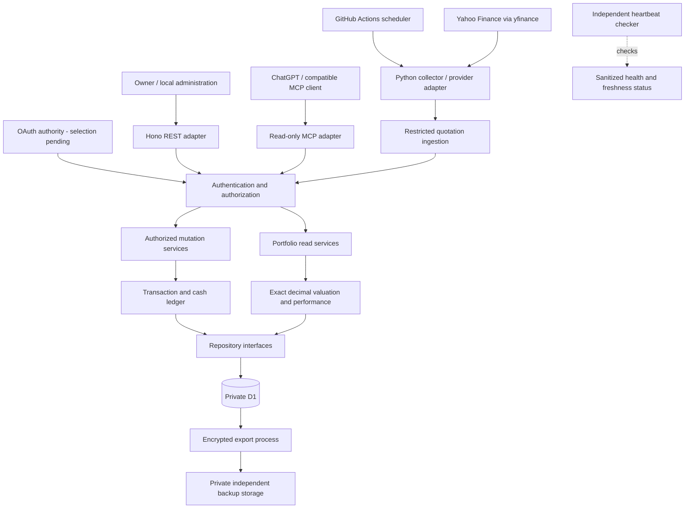

# INSTALL.md — PEA Tracker

Architecture decision and future installation guide.

Status: **approved API-first architecture and financial backend product baseline; diagnostic REST/MCP and synthetic local instrument slice implemented**.
Decision date: 2026-11-06. Source checks: 2026-11-06.
This document records discovery blocks 1–3 and the selected infrastructure direction.
The owner approved this baseline with staged proof-of-concept and production gates.
Authentication selection and runtime validation remain open. Installation instructions
are future work, not authorization to install, provision, spend or deploy.

## Vision

PEA Tracker is an API-first financial application that maintains a private investment
portfolio, collects market quotations, and exposes reusable REST capabilities with
read-only MCP as its AI-facing adapter.
It replaces manual screenshots with reproducible, timestamped portfolio analysis.

V1 serves one owner with approximately 20 stocks and ETFs held in a French PEA at
Bourse Direct. The source is public and reusable; holdings, credentials and financial
history remain private. Portfolio operations use REST or local tooling, without a
mandatory dashboard. There is no broker integration, brokerage credential storage,
order execution, native mobile application or speculative multi-tenancy.

### Discovery baseline

| Area | Agreed requirement |
| --- | --- |
| Features | Instruments, quantities, PRU, cash, transactions, valuations, unrealized gains/losses, allocation and historical performance |
| Inputs | Manual entry; optional validated CSV import/export; replaceable quotation provider |
| Interfaces | HTTPS REST, separately authorized administration, remote Streamable HTTP MCP; future responsive dashboard |
| Users | One active owner; possible independently hosted copies within six months |
| Volume | 20–100 REST/MCP requests/day; approximately 18 collection cycles and 360 instrument observations/trading day |
| Freshness | Under 45 minutes target; warning above 45; stale above 60 during expected market coverage |
| History | All recorded transactions and snapshots until explicit deletion; at least 12 months of quotations |
| Performance | Ordinary warm read p95 below one second, excluding provider retrieval and AI processing; engineering target, not SLA |
| Offline and SEO | Neither required for V1; local synthetic fixtures supported |
| Privacy | Confidential financial information; owner export/deletion; validated regional settings and recovery |
| Skills | Advanced PHP/JavaScript/SQL; strict TypeScript adopted; working Python knowledge, currently Python 3.14 |
| Tooling | Vitest, pytest, official SDKs, minimal maintained dependencies; Codex with possible Claude Code |
| Hosting | Managed/serverless preferred; no permanent paid VPS; workers.dev acceptable |
| Budget | €0 recurring infrastructure target; any expense needs explicit prior approval |
| Maintenance | Automated normal operation; approximately 1–2 hours/month after stabilization |
| Workflow | AIDD Context/PM/Dev; future shared AGENTS.md and referencing CLAUDE.md; workspace-write/on-request restrictions |

## Decisions

| Decision | Choice | Why / trade-off |
| --- | --- | --- |
| Architecture | Modular serverless backend with one shared business layer | Small workload; avoids service proliferation while retaining adapters |
| API contract | Versioned REST under `/api/v1`, documented with OpenAPI | Reusable financial capabilities independent of AI client or transport |
| Front-end | No portfolio UI in V1 | API-first scope; OAuth login/consent may need minimal browser pages |
| Back-end | Cloudflare Workers, Hono, strict TypeScript | Familiar JavaScript ecosystem, managed runtime; CPU budget must be measured |
| Database | Cloudflare D1 with prepared SQL and versioned migrations | Relational data at small scale; SQLite and platform constraints accepted conditionally |
| Auth | Unresolved: Workers OAuth Provider versus Auth0 | Compare full ownership, security, cost and maintenance before selection |
| Hosting | Workers Free, D1 Free, workers.dev | Target €0; no automatic paid fallback |
| Collection | Python/yfinance on GitHub Actions | Reuses successful local approach; unofficial source and scheduling limitations accepted for validation |
| Financial representation | Canonical decimal strings and arbitrary-precision decimal arithmetic | Avoid binary floating-point monetary arithmetic end to end |
| AI access | Read-only MCP tools calling read services | No mutation tools; administrative authorization is independent |
| Product growth | Modular domain/repository boundaries, one owner | Future extension possible without implementing tenant infrastructure |

Candidate A is the validated architecture foundation, not evidence that CPU, OAuth interoperability,
data quality, recovery or security acceptance gates have passed. Supabase/Postgres
remains a fallback if a demonstrated limitation cannot be resolved within scope.

## Stack summary

| Component | Preferred choice | Version/plan policy |
| --- | --- | --- |
| Runtime and routing | Workers + Hono + TypeScript strict | Select supported stable compatible versions during implementation; pin lockfile and compatibility date |
| MCP | Official TypeScript SDK; bounded stateless Streamable HTTP | Verify current Web-standard transport and Workers compatibility before pinning |
| Persistence | D1/SQLite; explicit SQL repository adapters | Free plan; synthetic local D1 during development |
| Collection | Python + yfinance; provider interface | Validate Python 3.14 dependency compatibility in CI before pinning |
| Decimal engine | Maintained arbitrary-precision TypeScript library; Python decimal | Select library after precision and CPU evaluation |
| Tests | Vitest, pytest | Domain, adapter, contract and recovery coverage |
| Automation | GitHub Actions standard Linux runners | Public repository; separate CI, collection and approval-controlled deployment |
| Authentication | Workers OAuth Provider or Auth0 | Selection gate; Workers KV required if Provider route is selected |

The local diagnostic increment pins its package versions and validation commands in
the root README and package manifest. This does not validate future portfolio or OAuth
components. Standard GitHub-hosted runners in public
repositories are free; cache/artifact allowances are separate. Never use public
workflow artifacts for financial dumps. [GitHub billing](https://docs.github.com/en/billing/concepts/product-billing/github-actions).

## Architecture

PEA Tracker is one evolving application in one GitHub repository and shared codebase.
REST health and MCP ping are its first features; the same application will grow to
include D1, portfolio management, market data and OAuth. The delivery stages below
describe maturity and data-access gates, not separate projects or disposable servers.

### Confirmed API-first decision — 2026-11-06

The owner confirmed the following architecture; this approval covers documentation,
not implementation or release:

- Define reusable REST contracts under `/api/v1` with OpenAPI. Keep the Streamable
  HTTP MCP endpoint at `/mcp`; MCP is an AI-facing adapter of this application.
- Implement financial rules in shared TypeScript application/domain services.
  REST and MCP call these services directly within the Worker; neither adapter owns
  financial calculations, duplicates repository logic, nor calls the other over HTTP.
- Application services depend on repository interfaces; D1 access belongs in its
  adapter. Authorization is checked at adapter and application-service boundaries.
- Preserve separate policies for MCP reads, REST administration and quotation
  ingestion. A common service implementation does not imply a common permission grant.
- Keep one Worker codebase and the existing named development/production environments.
  Do not introduce a second MCP product, speculative tenancy or a required dashboard.
- Keep capability contracts independent of Hono/MCP objects. A future extracted MCP
  service could use an HTTP client for the versioned REST API, with explicit credential
  and audience handling; no internal network hop or client abstraction is needed now.

Consequences: REST contracts become a reviewable product boundary; MCP can offer
task-oriented read tools over the same capabilities. API evolution and contract tests
add maintenance, but avoid divergent financial results and enable future clients.

The owner approved the [financial backend PRD](tasks/2026_11/2026_11_08-financial-backend-prd.md)
on 2026-11-08. Cost basis/PRU, unrealized gains and total portfolio performance are
distinct concepts. Weighted-average cost basis is preferred; fee treatment and other
accounting conventions still require explicit approval before dependent calculations.
Dated opening state must not fabricate prior transactions. Incomplete source history
means unavailable historical performance, not an inferred or zero return.

Deliver incremental vertical slices: the [Financial Instruments plan](tasks/2026_11/2026_11_08_financial-instruments/plan.md)
and [OpenAPI contract](api/openapi.json) implement the approved synthetic catalog slice. Instrument
metadata does not depend on advanced performance, dividend or corporate-action rules.
In-memory storage supports isolated synthetic acceptance. The approved
[D1 increment](tasks/2026_11/2026_11_08_d1-instruments/plan.md) adds a native binding
adapter and two versioned SQL migrations, exercised only with Wrangler local D1
and the separate loopback HTTP harness. No remote D1 service is provisioned.
The default Worker retains only health/ping until an approved auth integration permits
private routes; OAuth choice remains open. No fixture auth or instrument repository is
instantiated by the deployment entrypoint. No real data or cloud change is authorized.

The earlier [financial backend design proposal](tasks/2026_11/2026_11_06_financial-backend/design.md)
provides the broader resource/MCP/auth roadmap. Its technical proposals remain under
review where not refined by the approved PRD and implemented first slice.

The connected MCP diagnostic returned `ok`, service `pea-tracker`, version `0.1.0`
at `2026-11-06T22:25:54.342Z` during this conversation. This updates the earlier
local-only connectivity evidence, not OAuth, financial correctness or runtime CPU gates.

Use one Wrangler configuration with named `dev` and `production` environments,
explicitly targeting `pea-tracker-dev` and `pea-tracker` respectively. They share
`src/index.ts` and application modules; only deployment settings and future resource
bindings differ. The default name matches development. Development workers.dev
exposure is prepared; production exposure and preview URLs remain disabled. No cloud
resources or deployment are authorized by this configuration. Future D1 resources,
variables and secrets must be defined independently per environment. See the root
README for local dry-run commands and deployment approval requirements.



The diagram shows possible authorization paths; policy restricts MCP to read services,
the collector to quotation ingestion and the owner to explicitly granted administration.
All three require verified credentials. Domain services depend on repository interfaces,
not Hono, MCP or D1. Adapters map requests, authorization and errors; financial rules
have one implementation shared by REST and MCP.

### Domain and persistence boundaries

- Instruments: stable internal identity, ISIN where available, provider symbols,
  exchange/calendar, quotation currency and price-unit conversion. Do not assume
  that every ETF trades in EUR or that a provider's unit equals one currency unit.
- Ledger: trades, fees, dividends, deposits, withdrawals and corporate actions.
  Store effective timestamps and record timestamps. Corrections append reversals
  or superseding entries with provenance; never silently overwrite history.
- Opening positions: explicitly dated initial quantities, cost basis and cash when
  complete history is unavailable. Do not fabricate earlier transactions or returns.
- Quotations: market_timestamp, fetched_at, source, currency, unit, session,
  adjustment policy and collection outcome. Failed fetches do not advance successful
  freshness timestamps or replace the last usable price with zero.
- Snapshots: dated valuation inputs and calculation version; corrected history can
  produce a new revision while preserving the original record and audit provenance.
- Repositories: bounded parameterized queries, foreign keys, unique ingestion keys,
  pagination and indexes on instrument/time and ledger effective time. Avoid full
  historical scans for routine reads. Commit related ledger/cash changes atomically
  using a validated D1-supported batch strategy; prove rollback on partial failure.

### Exact decimal contract

These are application design decisions, to be verified with fixtures before release:

| Value | Storage / JSON | Input scale limit |
| --- | --- | --- |
| Posted cash, fees, dividends and settled trade totals | Decimal TEXT / JSON string with currency | Currency minor-unit scale; EUR 2 |
| Quantities | Decimal TEXT / JSON string | Up to 12 fractional digits |
| Prices and PRU | Decimal TEXT / JSON string, currency and unit | Up to 12 fractional digits |
| FX rates if enabled | Decimal TEXT / JSON string with currency pair | Up to 18 fractional digits |
| Calculated values, ratios and percentages | Decimal strings with calculation metadata | Output scale explicitly declared per field |

Accept at most 30 significant digits per numeric input, plain decimal syntax only;
reject excess precision, nonfinite values and invalid signs instead of silently
rounding. Canonicalize negative zero. Preserve zero and null as different meanings.
CSV parsing must explicitly handle locale separators. Convert provider values through
a documented decimal boundary; this cannot recover precision already lost upstream.
Retain source precision/provenance rather than promising exact exchange source data.

Use at least 80 significant digits for intermediate arithmetic; exact sums/products
within validated bounds, explicit rounding for divisions and final outputs. Default
rounding is half-even; recorded broker cash totals are authoritative settled amounts,
not values recomputed from rounded prices. Preserve unrounded position values, sum
them, then round the aggregate for display. Python follows the same decimal context.
Do not use JS Number, Python float or SQLite REAL/SUM/CAST for financial arithmetic.
Do not pass monetary JSON values as numbers or large scaled integers through D1's
JavaScript boundary. [SQLite floating point](https://www.sqlite.org/floatingpoint.html),
[D1 conversions](https://developers.cloudflare.com/d1/worker-api/).

Example: quantity "3" multiplied by price "0.10" yields exact "0.30" EUR.
Tests must cover repeating division, negative corrections, precision bounds,
rounding ties, serialization, Python/TypeScript parity and restoration round trips.
Unsupported instruments, currencies or precision are reported explicitly.

The Product Requirements Document (PRD) must define portfolio accounting and detailed
performance methodology before the corresponding calculations are implemented:
cost basis, PRU, fee treatment, cash flows, time-weighted versus money-weighted returns,
corporate actions, FX and benchmarks. This architecture does not settle those rules;
implementation must not invent defaults. The decimal contract above remains mandatory.
Return unavailable/partial
coverage when history is insufficient. Never infer complete historical returns from
today's PRU or double-count dividends using adjusted prices plus cash distributions.

### Authentication evaluation and authorization

| Criterion | Cloudflare Workers OAuth Provider | Auth0 |
| --- | --- | --- |
| Model | Cloudflare-maintained OAuth framework operated by this project | Hosted identity and authorization service |
| State | Requires Workers KV and its quotas; runtime/service-binding design follows selected release | External tenant; issuer/JWKS configuration and service dependency |
| Owner identity | Framework does not remove login, consent, identity-provider and account-recovery decisions | Hosted login reduces identity lifecycle code; owner must be explicitly allowlisted |
| Operations | More auth lifecycle responsibility and local integration testing | Less hosted identity administration; additional provider configuration and lock-in |
| Cost | Potentially free within Workers/KV limits; measure token and refresh activity | Free plan plausible for one owner; verify required features and token quotas, not just MAU count |
| Decision | Evaluate, not selected | Evaluate, not selected |

The framework's documented integration uses KV and separate authorization/resource
roles; do not assume it is a turnkey identity provider or copy an older release's
deployment pattern. [Workers OAuth Provider](https://github.com/cloudflare/workers-oauth-provider).
Auth0 advertises a free plan, but that alone does not establish this project's
complete authentication cost. [Auth0 pricing](https://auth0.com/pricing).

Choose the lowest-maintenance secure option that passes interoperability, CPU and
cost tests. Prefer hosted identity over writing password storage/recovery. If Provider
needs an upstream identity service, include that dependency in its comparison.
Do not weaken authentication to retain €0; unresolved costs stop selection for review.

Required contract: discovery, authorization-code flow with PKCE S256, correct client
registration/redirect allowlists, resource-specific token audience, issuer, expiry,
signature/introspection, scopes, refresh and revocation. Public discovery metadata
contains no financial information. Validate the actual ChatGPT account's connector
access; its subscription is an external prerequisite, not free backend hosting.
[OpenAI MCP authentication](https://developers.openai.com/plugins/build/auth).

| Principal | Allowed | Explicitly denied |
| --- | --- | --- |
| Owner read client | portfolio:read and explicitly granted read operations | Administrative mutation without separate grant |
| MCP client | mcp:read / portfolio read services only | Ledger writes, imports, cash changes, ingestion, exports of secrets |
| Collector | quotes:ingest for permitted instruments, bounded batch and timestamps | Holdings, PRU, transactions, cash and administration |
| Administrator | Separate administrative credential/client with portfolio:admin | Implicit authorization inherited from an MCP read token |
| Backup automation | Narrow export/recovery credentials, isolated workflow | Access from untrusted pull requests or routine collector jobs |

Prefer a least-privilege short-lived collector credential where supported; otherwise
use a dedicated rotated ingestion secret held in GitHub/Workers secrets. The collector
never needs D1/Cloudflare account credentials or portfolio balances. Evaluate auth
provider machine-to-machine quotas separately from interactive OAuth.

Deny by default. Enforce permissions in routing and application-service entry points;
MCP POST transport is not permission to mutate. Expose only read tools; annotations
are descriptive, not security controls. Apply schema/body limits, parameterized SQL,
safe errors, bounded queries, and credential/IP abuse limits compatible with workers.dev.
Select and verify a persistent/platform rate-limiting mechanism; per-isolate memory
is insufficient. Fail closed on authorization uncertainty or exhausted protective quotas.

### CPU and latency validation

Workers Free currently documents 100,000 requests/day and 10 ms CPU per HTTP request;
waiting on network/database is distinct from CPU. These limits must be rechecked
before implementation. [Workers limits](https://developers.cloudflare.com/workers/platform/limits/).

After documentation approval, benchmark synthetic 20-instrument data and at least
90,000 historical observations, including indexes, snapshots and retained transactions.
Measure REST reads, MCP initialization/list/call, invalid tokens, JWKS cold/cache/rotation
paths, refresh, decimal calculations and bounded history responses. Test each auth
candidate with equivalent scope checks. Capture CPU p50/p95/p99/max, warm wall-time
p95, failures, D1 reads and memory; no tokens or financial payloads in benchmark logs.

Proposed acceptance: warm ordinary reads p95 <1 s; CPU p99 <=8 ms to leave headroom
and no limit failures in the defined workload. The 8 ms margin is a project target,
not a Cloudflare guarantee. Local timing is preliminary; production-like CPU evidence
requires a separately approved non-production deployment. No such deployment is
authorized now. Precompute expensive summaries at ingestion, bound queries and cache
public verification keys correctly; never cache authorization decisions indefinitely.
If limits still fail, document alternatives and any paid plan before requesting approval.

### Collection, freshness and recovery

Run approximately every 30 minutes around applicable exchange sessions, with an
exchange-aware calendar, holidays, early closes and DST. Offset cron minutes from
hour boundaries. Use bounded retries/backoff, timeouts, concurrency control and
idempotent ingestion. Validate all 20 instruments, currencies, units, timestamps,
adjustment settings and corporate actions before accepting the provider.

GitHub schedules may be delayed/dropped and public-repository schedules are disabled
after 60 days without activity. A cron is not a freshness guarantee. Use manual
workflow_dispatch for recovery and monitor disabled schedules explicitly.
[GitHub scheduling](https://docs.github.com/en/actions/reference/workflows-and-actions/events-that-trigger-workflows#schedule).
yfinance is unofficial and documents personal-use restrictions; code licensing does
not license market-data redistribution. Validate Yahoo terms and cloud-run reliability;
preserve a provider interface. [yfinance](https://github.com/ranaroussi/yfinance).

- Track scheduled expectation, last attempt, successful cycle and per-instrument
  observation separately. Provider data delay is different from ingestion delay.
- During market coverage, collection age above 45 minutes warns; above 60 is stale.
  Also return market data age, known provider delay and quote/trade timestamp semantics.
  Old trade time alone does not prove collector failure for an illiquid instrument.
- Outside hours, label latest completed/available session; distinguish a legitimate
  last-session quote from a missing completed session. Preserve stale/unavailable
  state if the expected session observation is absent.
- Return market_timestamp and fetched_at (null with unavailable status when no quote
  exists), session, source, currency and freshness reasons. Do not synthesize prices.
- Keep last usable observations on provider failure. Mark valuations partial/stale
  with missing instrument coverage; do not present an incomplete total as complete.
- On recovery, retry bounded gaps and deduplicate. Do not invent intraday observations
  that the provider cannot backfill; expose historical gaps.

Use workflow failure notifications plus an independent checker for missing heartbeats:
a job that never starts cannot report its own failure. Proposed checker: a separately
scheduled Worker, with no financial-data access, evaluating sanitized cycle status and
delivering deduplicated owner alerts through a private channel. It shares Cloudflare's
failure domain; add an external uptime/heartbeat service if needed. Alert channel,
delivery cost, outage coverage and free quotas remain deployment gates. Do not put
holdings, source watchlists or prices in public status responses, issues or workflow logs.
Recovery alerts close only after validated observations arrive. Repeated missing runs
trigger owner investigation, not autonomous infrastructure changes.

### Persistence, location and recovery policy

D1 Free currently permits 500 MB/database, 5 GB/account, 5 million rows read/day and
100,000 rows written/day. Approximate annual quotation volume is 90,000 rows at
250 trading days, before indexes/snapshots. Measure actual bytes and read amplification;
100 full scans of that history would exceed the read allowance. Set internal alerts
before quota exhaustion; any additional monitoring cost must be approved.
[D1 limits](https://developers.cloudflare.com/d1/platform/limits/),
[D1 pricing](https://developers.cloudflare.com/d1/platform/pricing/).

Propose EU jurisdiction at database creation, after verifying account support and
applicable privacy terms. It cannot be changed in place. Location hints alone are not
residency guarantees; Workers execution, OAuth, GitHub, backups and AI processing
must be assessed separately. [D1 location](https://developers.cloudflare.com/d1/configuration/data-location/).
Owner consent is required before enabling AI access to private portfolio data; audit
the client/service privacy settings without claiming all processing remains in the EU.

| Policy | Proposed V1 design; pending recovery proof |
| --- | --- |
| Primary retention | Transactions, correction records and snapshots until owner deletion; quotations at least 12 months; longer if capacity permits |
| Native recovery | D1 Free Time Travel: seven days; useful for recent mistakes, not an independent backup |
| Independent backup | Daily encrypted SQL export; additional export before destructive migrations/corrections |
| Backup retention | Rolling 30 daily copies; review footprint and deletion implications before activation |
| Destination | Private storage outside the Cloudflare account/provider, with independently held recovery key; destination/cost unresolved |
| Recovery objectives | Target independent-backup RPO <=24 h and owner-assisted RTO <=4 h; not guarantees until tested |
| Restore testing | Before deployment and quarterly; isolated target, row counts, integrity, decimal round trips, ledger balances and sample valuations |
| Backup monitoring | Success age, encryption/checksum and restore-test age; alert for missed exports independently of the backup workflow |

Native recovery windows depend on plan. [Time Travel](https://developers.cloudflare.com/d1/reference/time-travel/),
[D1 limits](https://developers.cloudflare.com/d1/platform/limits/).
Exports block other database requests; schedule outside market sessions, bound retry
behavior and measure impact. Restore imports have platform limitations; rehearse with
the actual versioned schema. [D1 export/import](https://developers.cloudflare.com/d1/best-practices/import-export-data/).

Automated backup execution may use isolated trusted automation with encrypted transfer,
but never upload plain or encrypted financial dumps as public repository artifacts.
Decryption keys must not depend solely on GitHub or Cloudflare. Native D1 recovery
does not restore OAuth/KV configuration; document separate credential reissuance and
re-consent after auth-state loss. Backup encryption, destination and successful restore
are release gates; an unfunded/unselected destination is not a completed backup strategy.

Deletion removes live owner data, derived snapshots and relevant audit identifiers,
revokes credentials, and schedules backup expiry within the documented retention.
Native Time Travel may retain deleted data until its window expires. Restores must
reapply an independently retained deletion manifest before serving data. Export before
deletion is offered to the owner. Backup and deletion policy must be disclosed together.
Use a minimal private audit trail (actor pseudonym, action, timestamp, outcome, request
ID and record reference), separate from diagnostic logs; retain no tokens or financial
payloads there. Proposed audit retention is 90 days, subject to owner privacy review.

### Delivery stages and remaining gates

Architecture approval validates the foundation, not runtime behavior. Separate the
following stages so connectivity can be proven before financial infrastructure exists.

| Stage | Scope | Required before entering / completing |
| --- | --- | --- |
| Initial diagnostic features | Synthetic, non-sensitive fixtures only; REST health, MCP initialization and ping within the evolving application | Bounded implementation authorization; protocol/transport correctness, isolated configuration, safe logs, no financial data or credentials; separate approval for any cloud resources or deployment |
| Authentication evaluation | Synthetic-data ChatGPT interoperability; compare Workers OAuth Provider and Auth0 | Verify security, owner restrictions, lifecycle, maintenance, CPU and full cost before selecting OAuth |
| Private-data production | Actual holdings, transactions, quotations tied to the owner and financial outputs | All applicable security, financial correctness, persistence, backup/restore, monitoring, privacy and release gates below; explicit production approval |

The initial MCP ping is an application feature that validates protocol connectivity,
not an authentication acceptance test. It may proceed without D1, a portfolio ledger,
financial calculations, production backups or the scheduled data pipeline. Any public
unauthenticated probe must be limited to a non-sensitive synthetic endpoint with no
private-data access; it never authorizes exposing private REST/MCP operations.
The owner subsequently authorized local diagnostic development. The connected MCP
ping was observed responding in this conversation; this is diagnostic connectivity
evidence only. The owner subsequently approved the Financial Instruments REST slice
with synthetic memory storage and an explicit loopback HTTP harness, followed by
the local-only D1 repository increment. Other financial features, new dependencies,
remote D1/cloud resources, deployment, plugin changes, real data,
staging, commits and pushes remain outside this authorization.

Production requirements become mandatory before the first real financial data is
introduced, even into a pilot or non-production environment. Do not treat environment
names as permission to bypass them. Public discovery metadata is the limited existing
exception; it must never expose financial information. OAuth remains open until both
candidates have been evaluated; a successful unauthenticated ping cannot select it.

### Production delivery controls

Public CI uses synthetic data, strict type checks, linting, Vitest/pytest, dependency
auditing, secret checks and migration checks. Pin third-party Actions by immutable
revision and keep permissions minimal. Never expose secrets to untrusted PR code.
Separate deployment, collection, backup and CI privileges. Deployment requires an
explicit owner approval enforced by a supported environment approval mechanism or
equivalent manual release procedure; pushing/merging alone must not deploy.

| Gate | Evidence required after documentation approval | Current state |
| --- | --- | --- |
| OAuth choice | Provider/Auth0 maintenance and complete cost comparison; actual client login, refresh/revoke, wrong audience/scope/owner denial | Open |
| Runtime | Both auth paths profiled; chosen stack meets CPU margin and warm latency target | Open |
| Financial rules | Exact decimal parity and invariant tests; PRD-approved accounting/performance methodology and corresponding specification | Open |
| Market data | All 20 instruments validated from cloud runner; stale/closed/illiquid/unavailable fixtures | Open |
| Scheduling and alerts | Missed/disabled/delayed job simulations; independent alert delivery and recovery proof | Open |
| Storage and recovery | Measured size/quota consumption; encryption, independent destination, successful isolated restore and deletion replay | Open |
| Security | Authorization separation, abuse limits, secret isolation, safe logs and audit retention checks | Open |
| Accounts and privacy | Cloudflare readiness, EU database configuration, provider terms and actual ChatGPT access verified | Open |
| Budget and release | Complete operating-cost inventory, approved any expense, explicit production release authorization | Open |

## Folder structure

Proposed structure only; these application directories and files do not yet exist.
Use a flat application source tree with modules rather than a speculative monorepo.

```text
pea-tracker/
├── aidd_docs/
│   ├── INSTALL.md
│   ├── memory/
│   └── specs/
├── src/
│   ├── index.ts
│   ├── domain/
│   │   ├── portfolio/
│   │   ├── ledger/
│   │   ├── market-data/
│   │   └── decimal/
│   ├── application/
│   │   ├── reads/
│   │   ├── administration/
│   │   └── ingestion/
│   ├── ports/
│   └── adapters/
│       ├── rest/
│       ├── mcp/
│       ├── auth/
│       └── d1/
├── collector/
│   ├── providers/
│   └── tests/
├── migrations/
├── tests/
│   ├── unit/
│   ├── integration/
│   └── fixtures/
├── ops/
│   ├── monitoring/
│   └── recovery/
├── .github/workflows/
├── AGENTS.md
├── CLAUDE.md
└── wrangler.jsonc
```

An optional authorization Worker/KV or hosted Auth0 integration is added only after
the auth decision. Shared domain services do not depend on that topology. AIDD memory
and tool wiring capture the approved baseline separately from implemented capabilities.

## Install steps

Future checklist, intentionally not executed:

1. Initialize persistent AIDD memory and shared Codex/Claude instructions from this approved baseline; preserve sandbox and on-request approval settings.
2. Approve a bounded synthetic-data MCP connectivity plan; select compatible stable tooling, with no requirement to build the portfolio or backup system first.
3. After development authorization, install pinned tooling and validate MCP initialization/ping locally with synthetic data; separately approve any cloud resources or deployment.
4. Evaluate both OAuth candidates with synthetic-data ChatGPT interoperability, security, maintenance, CPU and cost evidence before selection; approve any expense explicitly.
5. Define accounting/performance rules in the PRD and corresponding specifications before implementing financial calculations; retain exact decimal requirements.
6. Implement and validate the private-data security, persistence, collection, monitoring and independent recovery gates, using synthetic data until all real-data prerequisites pass.
7. Obtain explicit production approval before introducing real financial data or releasing production services; verify configuration, scoped secrets, rollback and recovery.

## Audit summary

Documentation-based parallel candidate audits preceded selection. Connected diagnostic
ping evidence now exists; deployed financial, authentication and CPU benchmark evidence
remains absent. This design incorporates their unresolved findings.

| Candidate | Verdict | Notes |
| --- | --- | --- |
| A: Workers + Hono + D1 + GitHub Actions | Selected, conditional | Fits headless/serverless scope; CPU, OAuth selection, independent recovery and decimal handling need evidence |
| B: Supabase Edge Functions + Postgres + GitHub Actions | Retained alternative | Strong relational primitives; OAuth beta, consent UI, pausing and free-backup limitations |

Supabase evaluation references: [MCP hosting](https://supabase.com/docs/guides/ai-tools/byo-mcp),
[OAuth](https://supabase.com/docs/guides/auth/oauth-server),
[billing](https://supabase.com/docs/guides/platform/billing-on-supabase),
[pausing](https://supabase.com/docs/guides/platform/free-project-pausing),
[backups](https://supabase.com/docs/guides/platform/backups).

The first increment adds local synthetic diagnostic functionality only. The owner approved Candidate A as the
architecture baseline and validated the architecture foundation with these refinements.
Technical POC and production gates are distinct; neither implementation nor deployment
is authorized by architecture approval alone; local diagnostic development was separately authorized.
