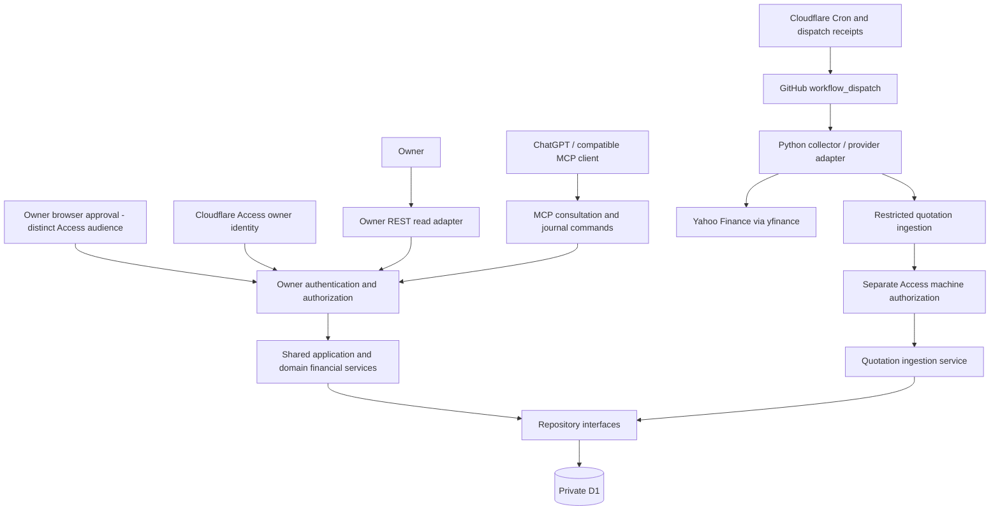

# INSTALL.md — PEA Tracker

Architecture baseline, current implementation and remaining validation requirements.

Current status (2026-11-21): V1.0.0 published and accepted with minor reservations. The V1.1 financial foundation and separate operational reference are now deployed; financial MCP writes are enabled with exact-owner authorization and independent browser consent. Actual transaction approval/write/replay is not yet production-validated. Calendar activation, advanced monitoring and global-return limits remain explicit in the [roadmap delivery matrix](roadmap.md). See [V1 acceptance](releases/v1.0.0-validation.md) and [V1.1 production evidence](tasks/2026_11/2026_11_21_operational-start/production.md). Earlier dated gates below are historical where superseded by these records.

Foundation approved 2026-11-06; documentation synchronized 2026-11-14 with the
owner handover and [roadmap scope decisions](roadmap.md). Historical V1 contracts
and their dated local evidence are preserved. No test or remote check was performed
for this documentation update; it grants no installation, resource, development,
deployment or spending authorization.

## Current state and evidence

| Status | Scope and limits |
| --- | --- |
| Developed / locally tested | V1 reads plus V1.1 journal, projected holdings/cash, fees/dividends, exact cost/PRU/gains, dated external flows, conditional monetary gain, protected MCP commands and independent browser approval |
| Tested locally | Prior synthetic domain, Memory/native D1, REST/OpenAPI/MCP, idempotency, concurrency, migration and restart checks recorded in slice contracts/plans; not rerun here |
| Deployed / verified | V1 preservation, operational-reference import, empty journal, published write flag, unchanged D1/owner/audiences, authenticated historical MCP reads and anonymous refusal; owner reports current reads in ChatGPT |
| Still to confirm | Real owner browser approval → exact financial write → unique receipt/replay → projected reads. No fictitious real-PEA transaction is permitted for acceptance |
| Remaining / planned | Qualified calendar activation, closing-monitor proof and additional alerts, evidenced initial market valuation/global return; V2.0–V2.3 remain future scope |

The financial reader is `pea-tracker-financial-read`; ingestion is
`pea-tracker-quotes-ingestion`. The root diagnostic composition and old OAuth PoCs
are separate. V1.0.0 is published; no V1.1 tag/release is claimed. Runtime profiling, independent
recovery and other unproven requirements below remain unproven; functional V1
reads are not evidence that every original production gate passed.

## Vision

PEA Tracker is an API-first financial application that maintains a private investment
portfolio, collects market quotations, and exposes reusable REST capabilities with
MCP as its AI-facing adapter, with financial journal commands behind explicit server
permissions and separate browser approval.
It replaces manual screenshots with reproducible, timestamped portfolio analysis.

V1 serves one owner with approximately 20 stocks and ETFs held in a French PEA at
Bourse Direct. The source is public and reusable; holdings, credentials and financial
history remain private. Portfolio operations use REST or local tooling, without a
mandatory dashboard. There is no broker integration, brokerage credential storage,
order execution, native mobile application or speculative multi-tenancy.

The real PEA remains the priority. Trading Lab is complementary and isolated;
small future increments are conditional on feasibility and no regression to V1.
Reference financial calculations belong to the PEA Tracker domain. ChatGPT
interprets results and may offer distinct, explicitly indicative simulations.
The [roadmap](roadmap.md) assigns V1.1 to capital invested, PRU, gains and study
of a simple explicit return; periodic performance, TWR/XIRR, allocation and advanced
analysis remain V2.3. No unapproved financial formula is implied.

### Discovery baseline

The table records original requirements/estimates, not delivered capabilities or
current measured load. Current collection uses a broader weekday window below.

| Area | Agreed requirement |
| --- | --- |
| Features | Instruments, quantities, PRU, cash, transactions, valuations, unrealized gains/losses, allocation and historical performance |
| Inputs | Manual entry; optional validated CSV import/export; replaceable quotation provider |
| Interfaces | HTTPS REST, separately authorized administration, remote Streamable HTTP MCP; future responsive dashboard |
| Users | One active owner; possible independently hosted copies within six months |
| Volume | 20–100 REST/MCP requests/day; approximately 18 collection cycles and 360 instrument observations/trading day |
| Freshness | Under 45 minutes target; warning above 45; stale above 60 during expected market coverage |
| History | All recorded transactions and snapshots until explicit deletion; at least 12 months of quotations |
| Performance | Ordinary warm read p95 below one second, excluding provider retrieval and AI processing; engineering target, not SLA |
| Offline and SEO | Neither required for V1; local synthetic fixtures supported |
| Privacy | Confidential financial information; owner export/deletion; validated regional settings and recovery |
| Skills | Advanced PHP/JavaScript/SQL; strict TypeScript adopted; working Python knowledge, currently Python 3.14 |
| Tooling | Vitest, pytest, official SDKs, minimal maintained dependencies; Codex with possible Claude Code |
| Hosting | Managed/serverless preferred; no permanent paid VPS; workers.dev acceptable |
| Budget | €0 recurring infrastructure target; any expense needs explicit prior approval |
| Maintenance | Automated normal operation; approximately 1–2 hours/month after stabilization |
| Workflow | AIDD Context/PM/Dev; shared AGENTS.md and referencing CLAUDE.md exist; workspace-write/on-request restrictions |

## Decisions

| Decision | Choice | Why / trade-off |
| --- | --- | --- |
| Architecture | Modular serverless backend with one shared business layer | Small workload; avoids service proliferation while retaining adapters |
| API contract | Versioned REST under `/api/v1`, documented with OpenAPI | Reusable financial capabilities independent of AI client or transport |
| Front-end | No portfolio UI in V1 | API-first scope; OAuth login/consent may need minimal browser pages |
| Back-end | Cloudflare Workers, Hono, strict TypeScript | Familiar JavaScript ecosystem, managed runtime; CPU budget must be measured |
| Database | Cloudflare D1 with prepared SQL and versioned migrations | Relational data at small scale; SQLite and platform constraints accepted conditionally |
| Auth | Owner reads: Cloudflare Access with Managed OAuth; ingestion: separate Access Service Auth | Current operational paths; historical Provider/Auth0 comparison does not reopen this choice or establish complete lifecycle evidence |
| Hosting | Workers Free, D1 Free, workers.dev | Target €0; no automatic paid fallback |
| Collection | Python/yfinance on GitHub Actions | Reuses successful local approach; unofficial source and scheduling limitations accepted for validation |
| Financial representation | Canonical decimal strings and arbitrary-precision decimal arithmetic | Avoid binary floating-point monetary arithmetic end to end |
| AI access | MCP consultation and narrowly authorized financial journal commands | Exact owner, separate write/approval permissions, independent browser consent; no brokerage order or ingestion privilege |
| Product growth | Modular domain/repository boundaries, one owner | Future extension possible without implementing tenant infrastructure |

Candidate A is the validated architecture foundation, not evidence that CPU, OAuth interoperability,
data quality, recovery or security acceptance gates have passed. Supabase/Postgres
remains a fallback if a demonstrated limitation cannot be resolved within scope.

## Stack summary

| Component | Preferred choice | Version/plan policy |
| --- | --- | --- |
| Runtime and routing | Workers + Hono + TypeScript strict | Existing package lock and compatibility dates; changes require targeted verification |
| MCP | Official TypeScript SDK; bounded stateless Streamable HTTP | Implemented REST/MCP adapters share services directly |
| Persistence | D1/SQLite; explicit SQL repository adapters | Native D1 in the financial deployment; synthetic local D1 for tests |
| Collection | Separate Python package + yfinance | Existing pyproject.toml/uv.lock; provider retrieval and HTTPS delivery, no D1 access |
| Decimal engine | TypeScript BigInt products/sums and exact fractions; Python Decimal at normalization | Weighted costs/PRU and gains implemented; 18-place half-even representation, no invented market reference or global percentage return |
| Tests | Vitest, pytest | Domain, adapter, contract and recovery coverage |
| Automation | GitHub Actions standard Linux runners | Public repository; separate CI, collection and approval-controlled deployment |
| Authentication | Cloudflare Access owner and machine adapters; JOSE JWT/JWKS verification | Distinct audiences, identities and grants; no implicit MCP/admin/ingestion permission sharing |

Package versions and local validation commands are recorded in the root README,
package manifests and lockfiles. The EUR 0 recurring-cost target remains subject
to actual usage and current provider/platform terms; no paid fallback is authorized.
Never use public workflow artifacts for financial dumps. Platform figures elsewhere
in this baseline are dated estimates to recheck before an operational decision.

## Architecture

PEA Tracker is one TypeScript application and a separate Python package in one
repository, with hexagonal boundaries. It is not a monorepo to scaffold. REST and
MCP call the same application/domain services directly; D1 and Memory implement
repository ports. The collector retrieves provider data separately and delivers
HTTPS batches to the restricted ingestion composition.

### Confirmed API-first decision — 2026-11-06

The owner confirmed the following architecture; this approval covers documentation,
not implementation or release:

- Define reusable REST contracts under `/api/v1` with OpenAPI. Keep the Streamable
  HTTP MCP endpoint at `/mcp`; MCP is an AI-facing adapter of this application.
- Implement financial rules in shared TypeScript application/domain services.
  REST and MCP call these services directly within the Worker; neither adapter owns
  financial calculations, duplicates repository logic, nor calls the other over HTTP.
- Application services depend on repository interfaces; D1 access belongs in its
  adapter. Authorization is checked at adapter and application-service boundaries.
- Preserve separate policies for MCP reads, REST administration and quotation
  ingestion. A common service implementation does not imply a common permission grant.
- Keep one shared Worker codebase with explicit compositions and environment selection.
  The current financial reader and ingestion Workers have distinct access surfaces;
  this does not duplicate the business layer or require a dashboard.
- Keep capability contracts independent of Hono/MCP objects. A future extracted MCP
  service could use an HTTP client for the versioned REST API, with explicit credential
  and audience handling; no internal network hop or client abstraction is needed now.

Consequences: REST contracts become a reviewable product boundary; MCP can offer
task-oriented read tools over the same capabilities. API evolution and contract tests
add maintenance, but avoid divergent financial results and enable future clients.

The owner approved the [financial backend PRD](tasks/2026_11/2026_11_08-financial-backend-prd.md)
on 2026-11-08. Cost basis/PRU, unrealized gains and total portfolio performance are
distinct concepts. Weighted-average cost basis is preferred; fee treatment and other
accounting conventions still require explicit approval before dependent calculations.
Dated opening state must not fabricate prior transactions. Incomplete source history
means unavailable historical performance, not an inferred or zero return.

Delivery evidence is incremental: [instruments](tasks/2026_11/2026_11_08_financial-instruments/plan.md),
[D1](tasks/2026_11/2026_11_08_d1-instruments/plan.md),
[opening state](tasks/2026_11/2026_11_10_opening-positions/contract.md),
[quotations](tasks/2026_11/2026_11_11_quotations/contract.md),
[valuation](tasks/2026_11/2026_11_11_valuation/contract.md) and
[current operational runbook](tasks/2026_11/2026_11_14_live-quotations-read/runbook.md).
The four existing migrations cover instruments, create outcomes, opening revisions
and quotations. No transaction/cash-event/dividend/performance tables or persisted
valuation snapshots exist. Local harnesses remain synthetic and loopback-only;
they must never be deployed or used with real holdings.

The earlier [financial backend design proposal](tasks/2026_11/2026_11_06_financial-backend/design.md)
provides the broader resource/MCP/auth roadmap. Its technical proposals remain under
review where not refined by the approved PRD and implemented first slice.

The connected MCP diagnostic returned `ok`, service `pea-tracker`, version `0.1.0`
at `2026-11-06T22:25:54.342Z` during this conversation. This updates the earlier
local-only connectivity evidence, not OAuth, financial correctness or runtime CPU gates.

`src/index.ts`/`src/app.ts` retain the historical diagnostic composition. The root
Wrangler configuration does not select the financial reader. Explicitly select
the authorized Worker/environment/configuration for any future remote operation;
credentials and private remote binding/configuration stay outside tracked docs.
Never extract Wrangler credentials or reuse prototype settings by assumption.



The diagram shows current financial paths, not a backup or multi-portfolio deployment.
`src/entrypoints/access-financial.ts` composes historical V1 reads, projected V1.1
reads/journal and owner-authorized preparation/confirmation tools. `access-read.ts`
remains the earlier read-only composition. The browser approval path has its own
signed Access audience; no broad administrative REST route is exposed.
`src/entrypoints/access-collector.ts` serves ingestion batches only, with machine
identity and subject/provider/instrument grants. It exposes no MCP or financial reads.
REST and MCP share services without internal HTTP; valuation does not call Yahoo.
Administration remains separately authorized; no public administration deployment
is implied. Prospective observability must follow these separate read/collection
paths; traces, OpenTelemetry and additional infrastructure remain under study.

### Domain and persistence boundaries

- Instruments: stable internal identity, ISIN where available, provider symbols,
  exchange/calendar, quotation currency and price-unit conversion. Do not assume
  that every ETF trades in EUR or that a provider's unit equals one currency unit.
- Ledger (**implemented and deployed**): EUR trades, actual fees/dividends, deposits,
  withdrawals and traceable reversals, with explicit portfolio/owner and exact
  cash/quantity/cost calculations. Corporate actions beyond these types remain
  unspecified. Effective and record timestamps are separate; history is immutable.
- Opening positions (**developed**): explicitly dated quantities, broker-declared
  unit PRU and known cash (or null). Never reconstruct historical total cost/fees
  from rounded PRU. Corrections append complete immutable revisions at the same
  effective date; they are not trades. Earlier transactions/returns are not inferred.
- Operational reference (**deployed**): a separate immutable broker declaration
  starts the current real journal without changing historical V1 or inventing trades.
  Migration 0007 guards an empty journal and extends validated journal anchoring;
  current reads disclose the reference and independently evidenced cash provenance.
- Quotations: market_timestamp, fetched_at, source, currency, unit, session,
  adjustment policy and collection outcome. Failed fetches do not advance successful
  freshness timestamps or replace the last usable price with zero.
- Snapshots (**under study, not persisted today**): dated valuation inputs and calculation version; corrected history can
  produce a new revision while preserving the original record and audit provenance.
- Repositories: bounded parameterized queries, foreign keys, unique ingestion keys,
  pagination and indexes on instrument/time and ledger effective time. Avoid full
  historical scans for routine reads. Commit related ledger/cash changes atomically
  using a validated D1-supported batch strategy; prove rollback on partial failure.

Current valuation pins an opening revision and reports selected quotation IDs,
but quote reads are independent: there is no atomic cross-instrument snapshot.
The V1 opening repository/revision sequence remains global. The V1.1 journal and
operational reference already bind an explicit portfolio UUID/owner/nature, with
immutable receipts and historical compatibility. This does not implement V2 registry,
multi-portfolio authorization or simulation; those remain separately scoped.

### Exact decimal contract

These are application design decisions, to be verified with fixtures before release:

| Value | Storage / JSON | Input scale limit |
| --- | --- | --- |
| Posted cash, fees, dividends and settled trade totals | Decimal TEXT / JSON string with currency | Currency minor-unit scale; EUR 2 |
| Quantities | Decimal TEXT / JSON string | Up to 12 fractional digits |
| Prices and PRU | Decimal TEXT / JSON string, currency and unit | Up to 12 fractional digits |
| FX rates if enabled | Decimal TEXT / JSON string with currency pair | Up to 18 fractional digits |
| Calculated values, ratios and percentages | Decimal strings with calculation metadata | Output scale explicitly declared per field |

Accept at most 30 significant digits per numeric input, plain decimal syntax only;
reject excess precision, nonfinite values and invalid signs instead of silently
rounding. Canonicalize negative zero. Preserve zero and null as different meanings.
CSV parsing must explicitly handle locale separators. Convert provider values through
a documented decimal boundary; this cannot recover precision already lost upstream.
Retain source precision/provenance rather than promising exact exchange source data.

Use at least 80 significant digits for intermediate arithmetic; exact sums/products
within validated bounds, explicit rounding for divisions and final outputs. Default
rounding is half-even; recorded broker cash totals are authoritative settled amounts,
not values recomputed from rounded prices. Preserve unrounded position values, sum
them, then round the aggregate for display. Python follows the same decimal context.
Do not use JS Number, Python float or SQLite REAL/SUM/CAST for financial arithmetic.
Do not pass monetary JSON values as numbers or large scaled integers through D1's
JavaScript boundary. [SQLite floating point](https://www.sqlite.org/floatingpoint.html),
[D1 conversions](https://developers.cloudflare.com/d1/worker-api/).

Example: quantity "3" multiplied by price "0.10" yields exact "0.30" EUR.
Tests must cover repeating division, negative corrections, precision bounds,
rounding ties, serialization, Python/TypeScript parity and restoration round trips.
Unsupported instruments, currencies or precision are reported explicitly.

The Product Requirements Document (PRD) must define portfolio accounting and detailed
performance methodology before the corresponding calculations are implemented:
cost basis, PRU, fee treatment, cash flows, time-weighted versus money-weighted returns,
corporate actions, FX and benchmarks. This architecture does not settle those rules;
implementation must not invent defaults. The decimal contract above remains mandatory.
Return unavailable/partial
coverage when history is insufficient. Never infer complete historical returns from
today's PRU or double-count dividends using adjusted prices plus cash distributions.

### Authentication, authorization and historical evaluation

**Current V1:** owner reads use Cloudflare Access with Managed OAuth and exact
owner verification. Machine ingestion uses separate Access Service Tokens/Service
Auth with a distinct audience and signed machine identity, mapped only to bounded
ingestion grants. The existing adapters verify JWT signatures, issuer, audience
and time bounds; the machine assertion lifetime limit remains 300 seconds.
The collector does not acquire an interactive owner OAuth token.

The table below preserves the original Provider/Auth0 comparison as historical
context, not current unselected alternatives. Re-evaluation requires a demonstrated
need and authorization; successful reads do not prove all renewal/revocation cases.

| Criterion | Cloudflare Workers OAuth Provider | Auth0 |
| --- | --- | --- |
| Model | Cloudflare-maintained OAuth framework operated by this project | Hosted identity and authorization service |
| State | Requires Workers KV and its quotas; runtime/service-binding design follows selected release | External tenant; issuer/JWKS configuration and service dependency |
| Owner identity | Framework does not remove login, consent, identity-provider and account-recovery decisions | Hosted login reduces identity lifecycle code; owner must be explicitly allowlisted |
| Operations | More auth lifecycle responsibility and local integration testing | Less hosted identity administration; additional provider configuration and lock-in |
| Cost | Potentially free within Workers/KV limits; measure token and refresh activity | Free plan plausible for one owner; verify required features and token quotas, not just MAU count |
| Decision | Evaluate, not selected | Evaluate, not selected |

The framework's documented integration uses KV and separate authorization/resource
roles; do not assume it is a turnkey identity provider or copy an older release's
deployment pattern. [Workers OAuth Provider](https://github.com/cloudflare/workers-oauth-provider).
Auth0 advertises a free plan, but that alone does not establish this project's
complete authentication cost. [Auth0 pricing](https://auth0.com/pricing).

For any future auth change, choose the lowest-maintenance secure option that passes
interoperability, CPU and cost tests. Prefer hosted identity over writing password storage/recovery. If Provider
needs an upstream identity service, include that dependency in its comparison.
Do not weaken authentication to retain €0; unresolved costs stop selection for review.

Required contract: discovery, authorization-code flow with PKCE S256, correct client
registration/redirect allowlists, resource-specific token audience, issuer, expiry,
signature/introspection, scopes, refresh and revocation. Public discovery metadata
contains no financial information. Validate the actual ChatGPT account's connector
access; its subscription is an external prerequisite, not free backend hosting.
[OpenAI MCP authentication](https://developers.openai.com/plugins/build/auth).

| Principal | Allowed | Explicitly denied |
| --- | --- | --- |
| Owner read client | portfolio:read and explicitly granted read operations | Administrative mutation without separate grant |
| MCP client | mcp:read / portfolio read services only | Ledger writes, imports, cash changes, ingestion, exports of secrets |
| Collector | quotes:ingest for permitted instruments, bounded batch and timestamps | Holdings, PRU, transactions, cash and administration |
| Administrator | Separate administrative credential/client with portfolio:admin | Implicit authorization inherited from an MCP read token |
| Backup automation | Narrow export/recovery credentials, isolated workflow | Access from untrusted pull requests or routine collector jobs |

The current collector uses the dedicated Access credential pair held privately;
Access supplies the signed short-lived assertion verified by the Worker. Neither
owner OAuth bearer reuse nor a new Client Credentials endpoint is implied.
The collector never needs D1/Cloudflare account credentials or portfolio balances.
Evaluate machine-auth limits separately from interactive OAuth for future changes.

Deny by default. Enforce permissions in routing and application-service entry points;
MCP POST transport is not permission to mutate. Expose only read tools; annotations
are descriptive, not security controls. Apply schema/body limits, parameterized SQL,
safe errors, bounded queries, and credential/IP abuse limits compatible with workers.dev.
Select and verify a persistent/platform rate-limiting mechanism; per-isolate memory
is insufficient. Fail closed on authorization uncertainty or exhausted protective quotas.

### CPU and latency validation

The original 2026-11-06 sizing baseline used 100,000 requests/day and 10 ms CPU
per HTTP request for Workers Free; these figures are not freshly verified here.
Waiting on network/database is distinct from CPU. Recheck applicable limits before
capacity or release decisions. [Workers limits](https://developers.cloudflare.com/workers/platform/limits/).

For a separately authorized benchmark, size a synthetic workload from the actual
collection window and planned retained history. The original 90,000-observation
fixture estimate is not a current annual-volume measurement. Include future
snapshots/transactions only when the corresponding capabilities are defined.
Measure REST reads, MCP initialization/list/call, invalid tokens, JWKS cold/cache/rotation
paths, refresh, decimal calculations and bounded history responses on the actual
owner/machine paths. Capture CPU p50/p95/p99/max, warm wall-time
p95, failures, D1 reads and memory; no tokens or financial payloads in benchmark logs.

Proposed acceptance: warm ordinary reads p95 <1 s; CPU p99 <=8 ms to leave headroom
and no limit failures in the defined workload. The 8 ms margin is a project target,
not a Cloudflare guarantee. Local timing is preliminary; production-like CPU evidence
requires a separately approved non-production deployment. No such deployment is
authorized now. Precompute expensive summaries at ingestion, bound queries and cache
public verification keys correctly; never cache authorization decisions indefinitely.
If limits still fail, document alternatives and any paid plan before requesting approval.

### Collection, freshness and recovery

The [collector plan](tasks/2026_11/2026_11_11_collector/plan.md) records historical
local evidence. Subsequent owner-authorized hosted ingestion and schedule publication
are recorded in the [V1 runbook](tasks/2026_11/2026_11_14_live-quotations-read/runbook.md).
The persistent ingestion deployment remains bounded to the reviewed Yahoo mapping.
Mapping completeness was owner-confirmed; this is not proof of provider rights,
all market-date cases or every original release gate.

Cloudflare schedules dispatch-only GitHub collection weekdays 07:17–19:47 Paris,
with DST-aware planning and hourly monitoring through 20:09. Native GitHub schedules
were removed after irregular triggering; the V1 acceptance record preserves that
incident and the successful replacement. This is a scheduling window, not a market
calendar. The bounded XPAR adapter is locally tested, but per-instrument qualification
and production assignment are not established by the available evidence; unknown
phases stay unknown. Bounded retries, timeouts,
concurrency and idempotent delivery are implemented. A fresh GitHub rerun without
the original private journal fails closed; it is not automatic cross-run recovery.

Cloudflare dispatch does not establish GitHub execution or successful ingestion.
A cron is not a freshness guarantee. Use separately
authorized manual workflow_dispatch for recovery only after checking backend
outcomes; a missing original journal must not be bypassed. Monitor the dispatcher
and workflow outcomes separately.
[GitHub scheduling](https://docs.github.com/en/actions/reference/workflows-and-actions/events-that-trigger-workflows#schedule).
yfinance is unofficial and documents personal-use restrictions; code licensing does
not license market-data redistribution. Validate Yahoo terms and cloud-run reliability;
preserve a provider interface. [yfinance](https://github.com/ranaroussi/yfinance).

- Track scheduled expectation, last attempt, successful cycle and per-instrument
  observation separately. Provider data delay is different from ingestion delay.
- During market coverage, collection age above 45 minutes warns; above 60 is stale.
  Also return market data age, known provider delay and quote/trade timestamp semantics.
  Old trade time alone does not prove collector failure for an illiquid instrument.
- Outside hours, label latest completed/available session; distinguish a legitimate
  last-session quote from a missing completed session. Preserve stale/unavailable
  state if the expected session observation is absent.
- Return market_timestamp and fetched_at (null with unavailable status when no quote
  exists), session, source, currency and freshness reasons. Do not synthesize prices.
- Keep last usable observations on provider failure. Mark valuations partial/stale
  with missing instrument coverage; do not present an incomplete total as complete.
- On recovery, retry bounded gaps and deduplicate. Do not invent intraday observations
  that the provider cannot backfill; expose historical gaps.

**Current monitoring:** the hourly workflow counts successful actual `Run collector`
steps, excluding skipped/synthetic jobs. Both workflows depend on GitHub. Native
failure notifications were requested; their saved settings and all environment
rules were owner-reported rather than independently verified for this documentary lot.
An external heartbeat is optional and unconfigured; no GitHub-outage independence
or instrument-by-instrument freshness alerting is claimed.

**Further resilience requirement to study:** an independent checker for missing
heartbeats, because a job that never starts cannot report its own failure. Original
proposal, not implemented: a separately
scheduled Worker, with no financial-data access, evaluating sanitized cycle status and
delivering deduplicated owner alerts through a private channel. It shares Cloudflare's
failure domain; add an external uptime/heartbeat service if needed. Alert channel,
delivery cost, outage coverage and free quotas remain deployment gates. Do not put
holdings, source watchlists or prices in public status responses, issues or workflow logs.
Recovery alerts close only after validated observations arrive. Repeated missing runs
trigger owner investigation, not autonomous infrastructure changes.

### Persistence, location and recovery policy

Original sizing assumptions (2026-11-06, not reverified here): D1 Free 500 MB/database,
5 GB/account, 5 million rows read/day and 100,000 rows written/day. The initial estimate
of 90,000 quotations/year assumed narrower collection than the current weekday window;
re-estimate from the published cadence, including closed-day retrievals and failures,
before quota decisions. Measure actual bytes and read amplification; repeated full
history scans can exhaust read allowances. Set internal alerts
before quota exhaustion; any additional monitoring cost must be approved.
[D1 limits](https://developers.cloudflare.com/d1/platform/limits/),
[D1 pricing](https://developers.cloudflare.com/d1/platform/pricing/).

Propose EU jurisdiction at database creation, after verifying account support and
applicable privacy terms. It cannot be changed in place. Location hints alone are not
residency guarantees; Workers execution, OAuth, GitHub, backups and AI processing
must be assessed separately. [D1 location](https://developers.cloudflare.com/d1/configuration/data-location/).
Owner consent is required before enabling AI access to private portfolio data; audit
the client/service privacy settings without claiming all processing remains in the EU.

| Policy | Existing requirements/proposals; evidence to establish, no new delivery version assigned |
| --- | --- |
| Primary retention | Transactions, correction records and snapshots until owner deletion; quotations at least 12 months; longer if capacity permits |
| Native recovery | D1 Free Time Travel: seven days; useful for recent mistakes, not an independent backup |
| Independent backup | Daily encrypted SQL export; additional export before destructive migrations/corrections |
| Backup retention | Rolling 30 daily copies; review footprint and deletion implications before activation |
| Destination | Private storage outside the Cloudflare account/provider, with independently held recovery key; destination/cost unresolved |
| Recovery objectives | Target independent-backup RPO <=24 h and owner-assisted RTO <=4 h; not guarantees until tested |
| Restore testing | Before deployment and quarterly; isolated target, row counts, integrity, decimal round trips, ledger balances and sample valuations |
| Backup monitoring | Success age, encryption/checksum and restore-test age; alert for missed exports independently of the backup workflow |

Native recovery windows depend on plan. [Time Travel](https://developers.cloudflare.com/d1/reference/time-travel/),
[D1 limits](https://developers.cloudflare.com/d1/platform/limits/).
Exports block other database requests; schedule outside market sessions, bound retry
behavior and measure impact. Restore imports have platform limitations; rehearse with
the actual versioned schema. [D1 export/import](https://developers.cloudflare.com/d1/best-practices/import-export-data/).

Automated backup execution may use isolated trusted automation with encrypted transfer,
but never upload plain or encrypted financial dumps as public repository artifacts.
Decryption keys must not depend solely on GitHub or Cloudflare. Native D1 recovery
does not restore OAuth/KV configuration; document separate credential reissuance and
re-consent after auth-state loss. Backup encryption, destination and successful restore
are release gates; an unfunded/unselected destination is not a completed backup strategy.

Deletion removes live owner data, derived snapshots and relevant audit identifiers,
revokes credentials, and schedules backup expiry within the documented retention.
Native Time Travel may retain deleted data until its window expires. Restores must
reapply an independently retained deletion manifest before serving data. Export before
deletion is offered to the owner. Backup and deletion policy must be disclosed together.
Use a minimal private audit trail (actor pseudonym, action, timestamp, outcome, request
ID and record reference), separate from diagnostic logs; retain no tokens or financial
payloads there. Proposed audit retention is 90 days, subject to owner privacy review.

### Delivery stages and remaining gates

The stages below are the original acceptance framework. V1 has since reached real
financial reads through separately authorized operations; the initial local-only
authorization is historical. Architecture approval alone never grants remote access.

| Stage | Scope | Required before entering / completing |
| --- | --- | --- |
| Initial diagnostic features | Synthetic, non-sensitive fixtures only; REST health, MCP initialization and ping within the evolving application | Bounded implementation authorization; protocol/transport correctness, isolated configuration, safe logs, no financial data or credentials; separate approval for any cloud resources or deployment |
| Authentication evaluation | Originally synthetic Provider/Auth0 evaluation; current V1 uses Access owner/machine paths | Verify security, owner restrictions, lifecycle, maintenance, CPU and complete cost on the selected paths |
| Private-data production | Actual holdings, transactions, quotations tied to the owner and financial outputs | All applicable security, financial correctness, persistence, backup/restore, monitoring, privacy and release gates below; explicit production approval |

The initial MCP ping proved diagnostic connectivity only; it was not financial,
authentication or recovery acceptance. Public unauthenticated probes remain restricted
to non-sensitive diagnostics with no private-data access. Applicable security,
privacy, financial correctness and recovery requirements are retained regardless of
environment name. Record missing evidence or explicit exceptions rather than infer
that every gate passed from a functional read. This documentation lot authorizes
only its five documents, not development, tests, migration, remote changes or Git publication.

### Production delivery controls

Public validation must use synthetic data. Existing local checks include strict
TypeScript, Vitest/pytest and contracts; no lint command is configured. Dependency
auditing, secret scanning and migration checks are release requirements to scope
and verify, not a claim that a complete public CI pipeline exists. Pin third-party Actions by immutable
revision and keep permissions minimal. Never expose secrets to untrusted PR code.
Separate deployment, collection, backup and CI privileges. Deployment requires an
explicit owner approval enforced by a supported environment approval mechanism or
equivalent manual release procedure; pushing/merging alone must not deploy.

| Gate | Required evidence / unresolved work | Known status from prior evidence; not reverified here |
| --- | --- | --- |
| Authentication | Lifecycle, renewal/revocation, negative hosted cases and complete cost evidence on the Access paths | Access owner/machine integration and real owner reads established; not all lifecycle checks established |
| Runtime | Actual owner/machine paths meet measured CPU margin and warm latency target | Local build/test evidence is not a hosted benchmark; remaining measurements to establish |
| Financial rules | Preserve historical valuation and approved exact journal/cost/gain conventions | Financial foundation deployed; real approval/write acceptance and evidenced global-return reference remain open |
| Market data | Per-instrument metadata/market-date coverage, freshness edge cases, rights and delay semantics | Stored quotations read successfully; mapping owner-confirmed; no live calendar or realtime guarantee |
| Scheduling and alerts | Actual scheduled collector step, advancing successful fetches, market dates; alert delivery and outage coverage | Schedules published; 16 November cycle unconfirmed; monitoring shares GitHub; external heartbeat unconfigured |
| Storage and recovery | Measured quotas; independent encrypted destination, isolated restore and deletion replay | Native D1 and local restart evidence exist; complete independent recovery proof is not established by this handover |
| Security | Separate authorization, abuse limits, safe logs, secret isolation and audit retention | Separation locally tested; prior anonymous ingestion rejection; no blanket hosted security certification. Rotation deferred by owner to finalization, not claimed complete |
| Accounts and privacy | Applicable regional settings, provider terms and client privacy evidence | Actual ChatGPT access established; remaining privacy/rights evidence must be assessed separately |
| Budget and release | Expense and tag/release decisions require explicit approval | V1.0.0 published; V1.1 scope/reservations and publication need owner decision; no paid change authorized by documentation |

## Folder structure

Current responsibility layout, abbreviated; one TypeScript application and separate
Python package. The abbreviated foundation tree predates the separately documented
financial journal/operational-reference additions; simulation remains future scope.

```text
pea-tracker/
├── aidd_docs/
│   ├── INSTALL.md
│   ├── roadmap.md
│   ├── memory/
│   └── tasks/
├── src/
│   ├── index.ts
│   ├── app.ts
│   ├── collector-app.ts
│   ├── entrypoints/       # access-read.ts, access-collector.ts, separate PoCs
│   ├── domain/
│   │   └── instruments.ts, portfolio.ts, quotations.ts, decimals.ts, valuation.ts
│   ├── application/       # shared business services and authorization
│   ├── ports/
│   └── adapters/
│       ├── rest/
│       ├── mcp/
│       ├── auth/
│       ├── memory/
│       └── d1/
├── collector/
│   ├── pyproject.toml
│   ├── uv.lock
│   ├── pea_collector/     # provider, model, runner, HTTP, cadence, monitor
│   └── tests/
├── migrations/
├── tests/
│   ├── *.test.ts
│   ├── helpers/
│   └── fixtures/
├── .github/workflows/
├── AGENTS.md
├── CLAUDE.md
└── wrangler.jsonc
```

Runtime dependencies remain in the existing package manifests. No new auth service,
multi-portfolio framework or dependency is selected by this baseline. AIDD memories
and the PRD retain dated evidence; current delivery documents supersede historical
local-only summaries without authorizing hooks or broad context regeneration.

## Historical installation sequence

Original staged checklist, retained as context for the foundation; several stages
were subsequently authorized and implemented. Do not rerun it as a V1 setup recipe.
Use the current runbook for evidence and separately approved operational procedures.

1. Initialize persistent AIDD memory and shared Codex/Claude instructions from this approved baseline; preserve sandbox and on-request approval settings.
2. Approve a bounded synthetic-data MCP connectivity plan; select compatible stable tooling, with no requirement to build the portfolio or backup system first.
3. After development authorization, install pinned tooling and validate MCP initialization/ping locally with synthetic data; separately approve any cloud resources or deployment.
4. Historically evaluate authentication candidates; the current V1 uses Access. Future changes need interoperability, security, maintenance, CPU and cost evidence; approve any expense explicitly.
5. Define accounting/performance rules in the PRD and corresponding specifications before implementing financial calculations; retain exact decimal requirements.
6. Implement and validate the private-data security, persistence, collection, monitoring and independent recovery gates, using synthetic data until all real-data prerequisites pass.
7. Obtain explicit production approval before introducing real financial data or releasing production services; verify configuration, scoped secrets, rollback and recovery.

## Audit summary

Documentation-based candidate audits preceded the original selection. The table
below records that historical comparison, not current missing financial deployment.
Financial reads and ingestion now have prior operational evidence as stated above;
hosted CPU profiling and complete recovery evidence are separate unresolved items.

| Candidate | Verdict | Notes |
| --- | --- | --- |
| A: Workers + Hono + D1 + GitHub Actions | Selected and used by V1 | Original conditional choice; current runtime/recovery gaps are listed above |
| B: Supabase Edge Functions + Postgres + GitHub Actions | Retained alternative | Strong relational primitives; OAuth beta, consent UI, pausing and free-backup limitations |

Supabase evaluation references: [MCP hosting](https://supabase.com/docs/guides/ai-tools/byo-mcp),
[OAuth](https://supabase.com/docs/guides/auth/oauth-server),
[billing](https://supabase.com/docs/guides/platform/billing-on-supabase),
[pausing](https://supabase.com/docs/guides/platform/free-project-pausing),
[backups](https://supabase.com/docs/guides/platform/backups).

The first increment was local synthetic diagnostics. V1 subsequently added separately
authorized financial capabilities without replacing the shared architecture.
Technical PoC, local tests and operational proof remain distinct. Architecture or
documentation approval alone never authorizes implementation or deployment.
