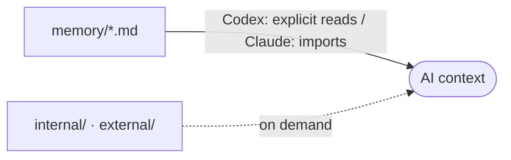

# memory/ - Project Memory

Structured context the AI assistant reads at the start of a session, so it does not rediscover the project each time.

## How it loads

In Codex, the root-file links in `AGENTS.md` are an index: explicitly open and read
task-relevant files and their authoritative references. A Markdown link alone does
not establish that its target was loaded.

In Claude Code, the managed `@` imports in `CLAUDE.md` expand the root files into
context; `@AGENTS.md` imports shared instructions. Keep these imports and markers.
This follows [Claude's documented import behavior](https://code.claude.com/docs/en/memory#import-additional-files);
loading in the installed client has not been runtime-tested here.
Read `internal/` when relevant and `external/` only when explicitly requested.

## Files

Refreshed automatically by the memory hook. Do not edit by hand.
Automatic synchronization may stage changed context/index files; see [vcs.md](vcs.md).
Do not run, enable or modify hooks without approval.

<!-- files:start -->
- [architecture.md](architecture.md)
- [codebase-map.md](codebase-map.md)
- [coding-assertions.md](coding-assertions.md)
- [ecosystem.md](ecosystem.md)
- [project-brief.md](project-brief.md)
- [testing.md](testing.md)
- [vcs.md](vcs.md)
<!-- files:end -->

## Maintaining it

The AI writes and refreshes these files. When you edit one by hand:

- One file per concern (architecture, database, vcs, ...).
- Capture the macro and the non-derivable. Point to the code, never copy it.
- Current state only, kept small. No personal notes, no future TODOs.

## Subdirectories

- `internal/`: AIDD workflow traces (the capability profile, audit notes, learn captures).
- `external/`: external references the project pulls in (specs, design docs).
