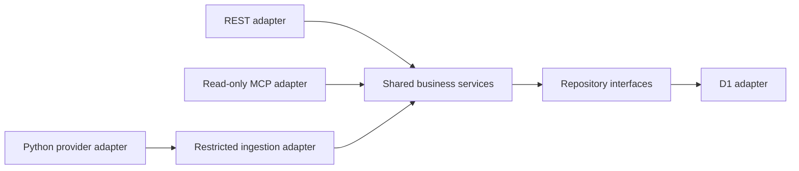

# Architecture

## Stack

- Approved baseline: Cloudflare Workers, Hono, strict TypeScript and D1; separate Python/yfinance collection through GitHub Actions.
- The local diagnostic Worker implements Hono REST and official SDK stateless MCP adapters only. D1, collection, portfolio services and OAuth remain baseline decisions, not implemented services. See [INSTALL.md](../INSTALL.md).

## How it fits together

## Key decisions

- Modular application boundaries, one owner, no speculative tenancy or dashboard.
- OAuth selection remains open between Workers OAuth Provider and Auth0 until ChatGPT interoperability, security, maintenance, CPU and cost are evaluated.
- Synthetic MCP initialization/ping may precede D1, ledger, calculations, backups and collection infrastructure. It is not a production acceptance test.
- Production security and applicable release gates are mandatory before introducing real financial data, regardless of environment name.
- Exact decimal strings and arbitrary-precision arithmetic are required; preserve the precision/rounding contract in INSTALL.md. Never use binary floating point for monetary calculations.
- After the initial MCP ping implementation and successful local tests, evaluate Docker Compose for reproducible local development/testing: one Node.js/TypeScript/Wrangler container for the Worker and MCP tests, and one Python container for the yfinance collector and pytest. This is an evaluation decision, not adoption or authorization to create Docker files; keep the current MCP implementation task unchanged.
- Docker is development/testing tooling only, never a production hosting requirement. Production remains Cloudflare Workers with GitHub Actions automation.

## Gotchas

- Architecture validation is not evidence of runtime tests and does not authorize implementation or deployment.
- Protocol POST does not grant mutation permission; MCP remains read-only, with separately authorized administrative REST and quotation ingestion.
- €0 is a target, not permission to weaken security or activate paid plans.
