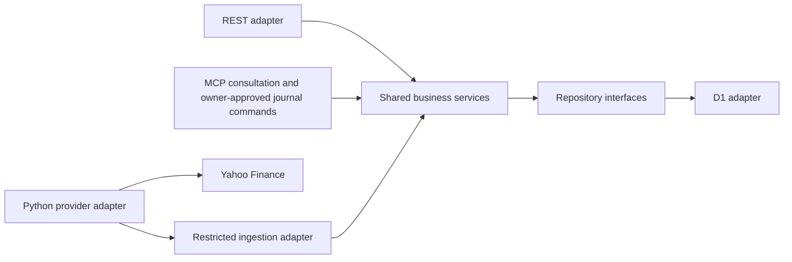

# Architecture

## V2 production accepted — 25 November 2026

Remote 0008 then 0009 preserved all original rows and exact anchors. Owner confirmed
fresh independent backup/key custody, authenticated REST and refreshed V2 MCP state.
Nominal Worker 4f34eb21-29b3-4e7f-bf4d-f1e5ec4019f7 matches original bindings/protections;
writes and original ingestion restored. Expected catalogue 26 tools (15 reads);
nominal count reuses source/acquired tests, not a fresh hosted enumeration.
Yahoo primary, EODHD observation only, unchanged scheduler at 30 minutes. No financial
test write or repeated qualification. First post-resume ordinary cycle awaits its
next scheduled window. Manual backup/capacity and hosted failure-case limits remain.
[Production evidence](../releases/v2.0.0-production-validation.md).

## Qualified local restore ordering — 25 November 2026

Owner-authorized encrypted backup and isolated local restoration of the captured
D1 snapshot passed. Full row/schema fidelity and sequential 0008/0009 adoption
preserve financial projections, approvals and receipts. Restore requires whole
CREATE TABLE statements before data, with original literals retained and checked.
Key remains in macOS Keychain; qualification plaintext/logs removed. Second-device
recovery and actual cutover checks remain open. Owner reports whole-Worker Access
coverage; no Access/OAuth change expected, hosted V2 reads still pending.
[New proof and limits](../releases/v2.0.0-recovery-validation.md).
Owner accepted this evidence. Documentary closure repeated no test or migration.
Off-Mac ciphertext/key escrow remains manual; the 30-minute initial 12-month
sizing fits, with continuing capacity oversight and no automatic purge.

## V2.0.0 licensing and rollout boundary — 25 November 2026

PolyForm Noncommercial 1.0.0 applies to project-owned new changes prepared for V2.0.0;
prior MIT grants and third-party terms remain. Repository stays public/source-available.
Integration evidence is accepted; delivery is not executed. Backup/isolated restore,
actual anchor adoption, hosted V2 Access/read checks and capacity/retention gates
remain open. No business code or active collection changed; default cadence is 30.
[Delivery sequence and GO/NO-GO](../releases/v2.0.0-delivery.md),
[draft English notes](../releases/v2.0.0.md), [RETEX](../releases/v2.0.0-retex.md).

## V2.0 integrated composition — 25 November 2026

Separate `integration/v2.0` combines V1.1.5 and A–E locally. Registry discovery
replaces singleton registration only when present; legacy discovery and independent
browser approval remain. TypeScript and 85 distinct targeted synthetic local cases
passed. Isolated Linux Actions passed 118 TypeScript and 91 Python checks, plus
TypeScript compilation. Yahoo stays primary,
EODHD observation only, default cadence 30 minutes; no production change.
[Commands, revisions, validation limits and later rollout gates](../tasks/2026_11/2026_11_25_v2-integration/evidence.md).

## Owner-approved D closure — 2026-11-24

D is closed in observation mode with response evidence on 19/20; TNO remains
excluded for ISIN divergence. Campaign measured 17/20 units, bonus 500 unchanged;
80 acquired and 55 complementary passing cases retained. Yahoo stays primary,
EODHD isolated, unadjusted `last_trade` equivalence not demonstrated. Owner authorizes
three commits and D branch push only; no main merge, deployment or activation.
E is to be inspected read-only from branch objects, without modifying its branch
or the independently used main worktree.
[Accepted closure](../tasks/2026_11/2026_11_21_eodhd-http/finalization.md).
Earlier same-day sections below retain their original checkpoint boundaries.

## D real observation checkpoint — 2026-11-24

The authorized isolated capture returned 16/16 with measured per-symbol cost,
campaign within 18 units and no bonus spend. Existing source catalogue metadata
resolved the 15 MIC links offline; one ISIN conflict stays excluded, giving response
evidence on 19/20 including acquired samples. Stored Yahoo observations were read
through MCP without supplier fetch or D1 mutation. Identity/context compatibility
does not establish vendor latest-delayed-price equivalence to unadjusted last trade:
quote body omits currency/unit/adjustment semantics. Keep semantic admission closed,
Yahoo primary, no fallback or production wiring. Local observation finalization is
complete with documented limits; cloud orchestration/activation remains separate.
[Current evidence](../tasks/2026_11/2026_11_21_eodhd-http/finalization.md).

## V2.0-D local finalization — 2026-11-24

[Finalization](../tasks/2026_11/2026_11_21_eodhd-http/finalization.md) connects the
existing provider layers in an isolated observation composition with a `QuotaStore`
port. Local adapter reuses account-wide private journal locking/atomic fsync writes,
caps the qualification campaign at 18 recurring units including observed prior use,
and never refunds uncertain attempts. UTC rollover requires fresh evidence and
does not erase operation claims. Exact reference ISIN/code/currency still needs
separate venue proof; no approximate ALXP admission. Offline CLI evaluates freshness
at capture time and emits sanitized diagnostics only. No active collector/financial
wiring or deployment. Ephemeral runner storage is not a shared quota authority;
E owns shared persistence/orchestration/monitor injection via D's ports. Local work
complete; full qualification remains blocked on real reference, request authority
and account/semantic evidence. No automatic paid fallback or Marketstack/Alpha gate.

## EODHD coverage capture preparation — 2026-11-24

[Coverage readiness and prepared command](../tasks/2026_11/2026_11_21_eodhd-http/coverage-readiness.md):
one supervised group costs 17 published symbol units, not one; actual charging
needs dashboard before/after evidence. Public candidate pages do not establish
full ISIN/listing identity. Private mapping remains outside Git. Reuse local runner
lock/atomic-write primitives for one fixed persistent attempt claim, retaining the
reservation on uncertain failures and forbidding automatic retries. This is a
prepared recipe, not an installed shared quota service. Current scheduler day/job
partition and two-day deletion cannot supply monthly account accounting unchanged.
No active provider/collector change, authenticated vendor call or deployment.

## Local V2.0-D6 shadow selection — 2026-11-24

Pure `collector/pea_collector/provider_shadow.py`, no active runtime import. Reuses
D2 mappings/normalized observations for Yahoo-first selection, gated delayed EODHD
and conditional close-only Marketstack/Alpha. Preserves source-time nonregression,
quarantines equal-time divergent prices, reports stale/unavailable states and emits
only fixed/allowlisted diagnostic fields. Cached eligibility is independent of new
fetch quota. Free-budget proposals require trusted current-period counters, never
infer reset from stale state, and distinguish symbol costs from HTTP request counts.
Coverage planning deduplicates portfolio needs, skips acquired samples and defers
unknown metadata/budget. No atomic durable quota executor is implemented or implied.
No live collector, financial service, authentication, migration or cloud change.
[D6 decisions, 35 synthetic tests and remaining gates](../tasks/2026_11/2026_11_21_eodhd-http/shadow-selection.md).

## Captured feed qualification / Free-only direction — 2026-11-24

Nine owner-authorized JSON bodies inspected offline, no detected secret pattern,
no original data copied into public fixtures. D5 accepts all three captured EODHD
bodies; nine rows pass normalization under explicit assumed context, not qualified
identity/venue/adjustment. Filename clocks are collection proxies, not exact receipt
times; per-symbol timestamps and same-time price revisions must be preserved.
Marketstack/Alpha bodies are historical daily closes, not current intraday data.
Free limits rule out full-catalogue recurring intraday backup: retain Yahoo primary,
budget selective EODHD use and occasional Marketstack closes; Alpha EOD coverage and
retention remain conditional. No paid upgrade, provider activation or runtime edit.
[Captured evidence, official limits, rights and zero-cost next steps](../tasks/2026_11/2026_11_21_eodhd-http/captured-json-qualification.md).

## Local V2.0-D5 response parser — 2026-11-24

Isolated `collector/pea_collector/eodhd_response.py` connects bounded raw D4 JSON
to existing D2 normalization using caller-supplied mapping/provenance. Decimal
decoding preserves price precision; code matching, source time and per-symbol
failure boundaries are explicit. No invented delay, venue or adjustment. Only
synthetic tests import it; Yahoo, live CLI, financial services and fixture adapter
are unchanged. Actual response/context/rights qualification still precedes live use.
[Scope, 42 new local tests and remaining gates](../tasks/2026_11/2026_11_21_eodhd-http/response-parser.md).

## External multi-provider evidence — recorded 2026-11-24

Owner-reported 23 November tests outside the repository support a three-symbol
EODHD delayed intraday candidate, three-symbol Marketstack historical closes and
one-symbol Alpha Vantage historical close. No production admission follows.
Yahoo stays primary; D4 raw HTTP and D2 neutral normalization are reusable, but
the fixture adapter is synthetic-only and the live runner remains Yahoo-shaped.
No active generic router/fallback is implemented. Date-only closes cannot satisfy
the current timestamped observation contract or replace recent last-trade data.
Complete catalogue/ISIN/venue, exact semantics, rights, budgets and capacity gates
before a separate shadow/activation decision. No provider calls or runtime changes
were made to integrate this evidence; V1.1 authentication is untouched.
[Evidence, limits and proposed continuation](../tasks/2026_11/2026_11_21_eodhd-http/external-poc-2026-11-23.md).

## V2.0-E bounded closure — 2026-11-25

The isolated session experiment is live-qualified on three public samples/two
rounds: native persistent count 52/80 HTTP attempts and 12/12 get_info, all
observations valid. Shared-session setup reuse measured 15→11 requests per round;
no active-provider composition or production cadence change. Source age about
15–17 minutes, delay metadata still null. Five equal-time pairs match; one
advancing-source-time pair is inconclusive. Actual round spacing about 18m17s
limits cadence inference. E is closed for this bounded delivery, default 30,
Linux deferred to global integration on GitHub Actions without production writes.
Retain the used private campaign journal, never automatically recapture/replenish
its budget. [RETEX and remaining runtime/activation obligations](../tasks/2026_11/2026_11_24_collector-finalization/retex.md).

## V2.0-E bounded qualification harness — 2026-11-24

Isolated `collector/experiments/yahoo_session_capture.py`, default dry-run; no
active CLI/workflow import. Parent-owned persistent 12-get_info/80-HTTP-attempt
campaign budget reuses runner journal/lock/fsync, charges before permission, and
refuses resume after interruption. Synchronous Curl.perform plus native libcurl
PREREQFUNCTION bounds internal request reissues; redirects, alternate transports,
async and proxies are denied, unsupported library versions fail closed. Private
receipts contain only selected sample observations/timing, never cookie/header
contents; third-party output suppressed. Shared session lives only within a round.
Six D modules imported byte-identical from `763d9f9`, without history merge or
commit; E reuses D mapping/selection and does not implement another EODHD budget.
Native Mac loopback/synthetic recovery and local D1 sizing were qualified; real
Yahoo results were still open at this checkpoint. The 25 November campaign was authorized within 12
get_info/80 cumulative HTTP attempts, without automatic retry or remote D1 writes.
Owner deferred Linux qualification to global V2.0 integration via GitHub Actions,
without production writes; it is not an E closure gate. Local Docker qualification
is abandoned, without image/dependency download or further configuration.
Yahoo stays primary; EODHD observation only.
[Current evidence and operator protocol](../tasks/2026_11/2026_11_24_collector-finalization/plan.md).

## V2.0-E finalization preparation — 2026-11-24

At initial preparation, D accepted at `763d9f9` was inspected read-only, not merged.
Keep D's provider selection/normalization/quota ports authoritative; E owns process
lifetimes, executor timing and scheduling, without a second router or budget store.
The D private quota ledger is a bounded local qualification campaign, not shared
state for independent Actions runners. Yahoo stays primary, EODHD observation only.
Repository and GitHub repository variable use 30-minute cadence; no collector-live
override found. Eight workflow metadata entries corroborate half-hour spacing,
not quotation freshness. Fifteen minutes would double current workload. Retain
default 30 and backend 45/60-minute successful-fetch freshness thresholds; market
age/publication delay remain separate. A local candidate now supports 15 minutes,
with base :02/:17/:32/:47 crons and unchanged 30-minute default/slot identities.
Python and TS align strict Cloudflare slots; closing monitoring requires four final
slots at 15 minutes. No deployment or remote setting change; extra base triggers
at default 30 skip before dispatch. Source changes are locally tested, not active.
Existing runner journals after whole-cycle collection: child recovery preserves
parent observations, but parent loss before journaling is not per-symbol durable
recovery. [Prepared phases, live cap and outstanding gates](../tasks/2026_11/2026_11_24_collector-finalization/plan.md).

## Local V2.0-E / E2 — 2026-11-21

Installed yfinance 1.8.0/curl_cffi 0.17.0 exercised behind mandatory mocked HTTP
and blocked Python/native network exits in spawned experiment workers. A fresh
Ticker per attempt shares one Session; no cached info object crosses attempts.
Parent-owned observations survive worker errors/deadlines. A controlled native
POSIX wait ignoring SIGTERM was killed/reaped and following work resumed in a new
worker/session/cache. This does not qualify curl deadlocks or real market freshness.
Existing regularMarketPrice/Time normalization/journal replay is reused unchanged;
no previous-close/bar replacement or live collection activation. Shared state must
be discarded on timeout and upstream rate limits must not be bypassed.
[E2's 14 checks, limits and intraday NO-GO criteria](../tasks/2026_11/2026_11_21_yfinance-offline/plan.md).

## Local V2.0-E / E1 — 2026-11-21

Offline session-lifetime experiment under `collector/experiments`, outside the
installed collector package. Compares fresh-session attempts with cycle-shared
synthetic sessions using existing collection/normalization/journal code. Only
session state is reused; no intercycle price cache. Broken simulated sessions reset
without recollecting successes. Logical calls, attempts and simulated request events
are separate. The assumed setup/quote trace does not measure yfinance HTTP or
qualify a performance improvement. Yahoo and active composition are unchanged.
Actual library state, global rate limits and native hangs remain E2 offline gates.
[E1 scope, 19 tests and model limits](../tasks/2026_11/2026_11_21_yahoo-cycle-poc/plan.md).

## Local V2.0-D / D4 — 2026-11-21

Isolated raw `EodhdHttpClient`, not active: fixed-origin GET with environment token,
bounded socket timeout/body, no proxies/redirects/retries. Returns unparsed bytes,
HTTP status and content type for success/errors; transport failures use sanitized
codes. Shared `NoRedirect`/User-Agent conventions reused without changing ingestion.
No synthetic adapter call, financial normalization/provenance, quota claim or Yahoo
behavior change. Real price/time/venue/adjustment, licence and quota qualification
remain open. [D4 reduced scope and 39 simulated HTTP checks](../tasks/2026_11/2026_11_21_eodhd-http/plan.md).

## Local V2.0-D ingestion grants — 2026-11-21

Locally tested, not deployed: configuration uniqueness now covers the explicit
`(provider, instrument_id)` pair rather than the instrument alone. Distinct provider
grants may share an instrument; exact duplicates still fail closed. Existing
subject/provider/instrument checks, Access verification, deny-all empty grants and
ingestion/read isolation are unchanged. No actual grants or supplier activation
changed. The earlier configuration blocker is resolved in local code only; the
shared collector subject remains the security model.
[Targeted tests, limits and separate change scope](../tasks/2026_11/2026_11_21_multi-provider-grants/plan.md).

## Local V2.0-D / D3 — 2026-11-21

Offline-only `EodhdFixtureProvider` implements the structural fetch interface with
in-memory synthetic snapshots and separately declared context. Its neutral output
is normalized by D2; it is incompatible with the current Yahoo raw normalizer and
is not wired to the operational runner. Only synthetic unadjusted last-price
semantics are admitted; snapshot `close` never implies session-close data. Optional
`previousClose`/`change` cannot reconstruct missing prices. No network transport,
credential handling, routing, fallback or ingestion grant changes. **This is not
EODHD qualification.** Real venue/timestamp/price semantics, licence and quotas
remain gates. [D3 fixtures, 68 local checks and D1/D2 commit proposal](../tasks/2026_11/2026_11_21_eodhd-fixture-adapter/plan.md).

## Local V2.0-D / D2 — 2026-11-21

Prepared, **not activated or deployed**: `provider_mapping.py` reuses the legacy
instrument-mapping validation for explicit provider/symbol/exchange/data-kind/
adjustment streams. Multiple providers may map one canonical UUID; inconsistent
local canonical metadata and ambiguous associations fail. Neutral normalization
preserves exact prices, units, provenance and independent clocks for the existing
unadjusted last-trade/session-close observation contract only. OHLCV bars and
adjusted streams can be declared but are rejected for emission; date-only prices
never acquire invented market timestamps. No live imports, new ingestion grants,
schema changes, supplier activation or financial selection changes. Yahoo's
existing chain and the D1 interface remain unchanged.
[D2 decisions, 91 targeted tests and D3 limits](../tasks/2026_11/2026_11_21_provider-mappings/plan.md).

## Local V2.0-D / D1 — 2026-11-21

Minimal Python `QuotationProvider` protocol in the existing provider module;
Yahoo implements its unchanged `fetch(symbol)` raw-field contract and the runner
uses protocol annotations. No batch/session optimization, fallback, provider router,
adaptive cadence or secondary feed. Live CLI remains Yahoo-only; the additional
synthetic provider exists only in tests. Normalization/provenance remain explicitly
Yahoo-specific, not a generic secondary-feed admission mechanism. Supplier results
are recorded with measured Yahoo versus owner-reported external-provider evidence.
Locally tested, not deployed; [D1 scope, tests and remaining gates](../tasks/2026_11/2026_11_21_provider-abstraction/plan.md).

## V2.0-D feasibility — 2026-11-21

Study only, **not implemented or deployed**. C finalized locally at `5264794`;
successor branch `feat/v2.0d-multi-provider` inherits A/B/C. Conditional GO for
adaptive collection and N-provider routing using existing Cron/DO/GitHub/Python/D1.
Provider-scoped immutable storage exists; selection/fallback and per-instrument
planning do not. Keep yfinance and historical explicit-provider valuation unchanged.
EODHD delayed quotes merit a bounded PoC, subject to its indicative-data disclaimer;
Twelve Data's XPAR page specifies EOD, not demonstrated Paris intraday. Exact
catalogue sample, licensed retention/private MCP, data equivalence, quota budgets
and monotonic market timestamps remain gates. No quote API PoC or remote change.
[Evidence, official sources, cost bounds and proposed slices](../backlog/spikes/adaptive-multi-provider-feasibility.md).

## Local V2.0-C — 2026-11-21

Implemented and locally tested, **not deployed**: shared `PortfolioContextService`
resolves B/C read/write/browser contexts. V2 proposals bind version 2 and real/
simulated kind; the existing transaction engine is reused. Real operations retain
independent browser approval; simulated operations need explicit MCP confirmation.
Four new tools bring the full catalogue to 26. V1 hashes/proposals/receipts remain
compatible and fixed to the PEA. Additive migration 0009 extends journal anchors
and atomically refuses archived/mismatched event appends without rewriting rows.
Consumed proposals without receipts require reconciliation, not automatic retry.
[Contract, 55 local tests and limits](../tasks/2026_11/2026_11_21_portfolio-writes/plan.md).

## Local V2.0-B — 2026-11-21

Implemented and locally tested, **not deployed**: `PortfolioReadService` resolves
owner-scoped registry/openings and constructs existing projection/valuation services
for N real/simulated portfolios. Active and archived states are readable without
reactivation; no new financial writes. Separate `/api/v2/portfolios` reads and four
read-only MCP tools leave the old 18 tools and V1/V1.1 chains intact (22 total when
fully enabled). Shared stored quotations; server-selected performance references
are keyed and checked against portfolio/kind/opening, with explicit unavailability
otherwise. The Worker reuses only its configured historical PEA reference.
[Contract, tests, limits and C prerequisites](../tasks/2026_11/2026_11_21_portfolio-reads/plan.md).

## Local V2.0-A — 2026-11-21

Implemented and locally tested, **not deployed**: additive migration 0008 creates
`portfolios` with explicit owner/kind/status, immutable opening reference and
atomic independent-opening JSON. N real/simulated portfolios are supported by the
internal registry service; no new REST/MCP surface or financial writes are enabled.
Existing operational references/journals are adopted by their stored UUID/owner,
including populated journals, without rewriting V1/V1.1 data or canonical receipts.
Historical global opening revisions remain dedicated to V1. Registry metadata
version is separate from journal/opening versions; archive does not affect V1.1
services until future resolution/status enforcement. New journal anchors, financial
approval routing and multi-provider work remain future slices.
[Decisions, tests and migration/rollback limits](../tasks/2026_11/2026_11_21_portfolio-registry/plan.md).

## Authentication incident — recovery and normal admission, 2026-11-24

The [v1.1.4 release record](../releases/v1.1.4.md) consolidates the corrections
and owner-reported nominal acceptance below. Earlier checkpoints retain their
then-pending validation boundaries.

Signed assertions containing both configured financial audiences were rejected by
the singleton-AUD guard. The issuer/session reason for this pair remains unresolved.
Rollback, cookie-path enforcement and moving/parking the browser Access destination
did not establish recovery in the observed attempts. Do not infer a Worker collision.

After explicit owner authorization, recovery Worker
`805050ee-3965-49de-b1a2-b7f57c584d8f` accepted only that exact audience pair on the
owner MCP read channel, still requiring signature, issuer, expiry and owner checks.
The opt-in recovery flag cannot coexist with financial writes. At that stage writes
and approval were disabled, and the approval Access destination was parked temporarily.
Default validation and the browser audience check remain strict. D1, calculations,
proposal fingerprints and idempotence formats are unchanged.

At the recovery checkpoint, the separate browser relay and optional
`FINANCIAL_CONFIRMATION_ORIGIN` were deployed, but independent browser approval
was not yet production-qualified. Local evidence:
14 targeted isolation tests and 13 recovery tests; typecheck and dry-runs passed.
The owner supplied a successful ChatGPT ping at `2026-11-24T05:55:35.873Z`, then a
successful direct `get_current_portfolio_valuation` at 06:56:54 Europe/Paris, using
Yahoo unadjusted last-trade data and all 20 expected positions. This supports those
production read calls, not all-tool acceptance or independent calculation reconciliation.
No private IDs/values are retained and no real write was performed.

Git baseline: V1.1.3 (`22e3bba`), corrective branch `fix/v1.1-mcp-approval`; the
V1.1.0 rollback was temporary. Retained write-disabled rollback Worker:
`7ed4aa14-d545-4e78-b692-dfd1abf8c9a1`. See the
[incident chronology, tests and recovery limits](../tasks/2026_11/2026_11_21_financial-mcp/authentication-incident-2026-11-24.md).

Next phase is implemented locally after checkpoint `fc280f6`: an opt-in GET
`/financial-confirmation/auth-check` verifies only strict browser identity, without
permissions, D1, proposals or approval. It is unavailable when writes are enabled.
43 targeted tests, TypeScript and two dry-runs passed. After explicit owner approval,
diagnostic Worker `5004ace9-dce2-405b-8a1f-c0a932e87c41` and relay
`04c8f314-b275-44a3-8520-28bbab7cb207` were deployed with reads/recovery retained,
writes false and diagnostics true. Restoring the browser Access destination and live
browser qualification were initially pending; no financial write or new commit was performed.

The owner then restored that destination and supplied a successful live
`browser_identity` diagnostic. The backend accepted strict browser-only audience and
owner identity without D1 access or approval. A normal MCP known-pair policy was
prepared behind `MCP_KNOWN_AUDIENCE_PAIR_ENABLED` (default false), retaining
strict browser validation and the existing read-only recovery guard. 47 targeted
tests passed, including native D1/SDK with mixed MCP and independent browser approval.
After explicit owner approval, source commit `caeb627` was deployed as Worker
`3cdf9216-04ee-462e-bbda-6d8697172ef0`: normal known-pair MCP admission and financial
writes enabled; read-only recovery and browser diagnostics disabled. The relay
remains `04c8f314-b275-44a3-8520-28bbab7cb207`. A direct connector ping succeeded at
`2026-11-24T06:33:32.734Z`, with the deployed version observed in the Worker tail.
No financial operation was prepared, approved or recorded by deployment/checks.
At that deployment checkpoint, the real browser/write journey had not yet been
validated. See
the [updated financial contract](../tasks/2026_11/2026_11_21_financial-mcp/contract.md).

Subsequent real preparation/confirmation GET succeeded (owner report), but native
POST failed. The Worker trace showed Origin null with same-origin Fetch Metadata.
The confirmation page's no-referrer policy caused the browser's null Origin; an
installed Chrome loopback test reproduced it. A local one-header correction uses
strict-origin, without accepting null/missing/foreign origins or changing CSRF,
Access, proposal/financial rules. One actual browser test and eight targeted
financial tests passed, plus typecheck. After explicit owner authorization, source
`71bc299` was deployed as Worker `de09bec2-6596-415d-8ffb-c447c3f2b6e5`, retaining
the normal financial flags and unchanged bindings. A technical connector ping
succeeded at `2026-11-24T06:50:10.988Z`; no financial operation was performed.
At that header-deployment checkpoint, real approval/write validation was still pending. An expired
proposal must be prepared anew, and the owner must load a fresh form after deployment.

The owner subsequently supplied successful real preparation, independent browser
approval, explicit MCP confirmation and portfolio/journal rereads on 24 November.
The first real nominal journey is now owner-reported production-validated, with one
event and expected portfolio/cash/cost updates. No private values/IDs are retained.
The API result is event/balances, with no separate receipt identifier. Production
replay/concurrency/negative cases and independent internal receipt inspection are
not established by this report. Preserve local evidence for those separate gates.

## V1.1.3 recovery interface — deployed 2026-11-23

Worker `c2178996-c949-4c05-b96b-73d80c734abc`, source `bbf6d0f879fbfeaae1400d9a04ffc01985150787`.
The `invalid_token` page offers a user-initiated Access logout/return link only for
same-origin GET and a UUID proposal path. Its warning covers other Access sessions,
including possible MCP reconnection. No automatic logout, authentication relaxation
or financial approval. The root cause and actual recovery remain unverified.
See [v1.1.3](../releases/v1.1.3.md).

## V1.1.2 presentation patch — deployed 2026-11-23

Worker `47055795-4856-45d6-91d8-dd6c4a1f7d48`, source `e11e65bc1b9b9b03cbf67481ad99191e12712cce`.
The REST confirmation adapter delegates markup to `financial-confirmation-page.ts`.
Static native JavaScript uses a per-response CSP nonce for an absolute expiry
countdown; the server remains authoritative. No financial service, identity,
proposal format, database, dependency or V2 change. See [v1.1.2](../releases/v1.1.2.md).

## V1.1.1 patch — deployed 2026-11-23

Financial Worker `aef16740-0557-4d8d-a080-0bb182e33342` deploys source commit
`98872bbc3682ca05f8e0d39d719ec310b5d5f4e4`: allowlisted tracking parameters only on
confirmation GET, query-free POST and responsive nonce-protected styling. D1,
financial rules, Access/secret configuration and independent approval are unchanged.
Anonymous availability checks passed; no real financial write was performed.
See [release and deployment evidence](../releases/v1.1.1.md).

## Published V1.1.0 baseline — reviewed 2026-11-22

The real PEA remains the priority. One TypeScript/Hono application uses shared
hexagonal services/ports, D1 adapters and separate REST/MCP transports. Python/yfinance
supplies quotes through a distinct ingestion Worker; Cloudflare Cron/DO receipts
schedule protected GitHub workflow_dispatch jobs. Diagnostic PoCs stay separate.

- V1.1.0 was published on 21 November at tag `v1.1.0`, merge `c6e7dee`.
  Financial composition: `src/entrypoints/access-financial.ts`; release Worker
  `84f0d820-dd10-4f81-9c60-6c83e48e591d`, write flag true. Published reference,
  portfolio/owner, D1 and Access bindings matched the approved configuration.
- Historical V1 opening/positions/valuation remain intact. Current V1.1 reads use
  the separately selected immutable operational reference plus subsequent journal.
  The broker-verified operational start is dated 20 November; intervening operations
  were deliberately not reconstructed. Journal was verified empty at initialization.
- Journal: EUR trades/cash movements, actual fees/dividends, traceable reversals,
  exact weighted cost/PRU, realized/unrealized gains and dated external flows.
- Performance: a distinct owner-confirmed broker closing market-value reference
  at 20 November initializes EUR economic gain and estimated Modified Dietz returns,
  adjusted for dated deposits/withdrawals. Exact fractions, half-even representation,
  source/freshness caveats and unavailable statuses are preserved. No pre-reference
  history is reconstructed; the return is not annualized or an exact historical TWR.
- Security: exact-owner Access/Managed OAuth identity receives explicit financial
  `portfolio:write`; browser-only approval receives `portfolio:approve` under a
  separate signed AUD. Preparation persists an expiring immutable intent; confirmation
  requires its exact single-use server approval. No brokerage order, implicit
  technical administration or reuse of quotation-ingestion grants.
- MCP has 18 tools: 11 reads/diagnostics, six preparations and one confirmation.
  Browser approval is not an MCP tool or a client flag. The old 300-second JWT
  lifetime cap is removed; signatures, issuer/audience, time/identity checks remain.
- Migration 0007 adds the operational reference and adapts the empty journal anchor
  with guarded schema replacement. Original V1 data is not changed; nonempty
  journals prevent the one-time migration/reinitialization. Configuration/source
  artifacts stay private, with no paths or financial values stored in context.
- Evidence: earlier local financial/MCP suites plus 11 targeted operational checks
  and typecheck. Production D1/import/config comparisons, historical MCP reads/ping
  and anonymous refusals passed. Owner reports current ChatGPT reads and financial
  tool discovery. Real browser approval → write → immutable receipt/replay has
  **not** been validated in production; no transaction was created for acceptance.
- Calendar: 19 XPAR assignments recognize only known full-day venue closures in
  2026–2027. Individual continuous/fixing modes are unqualified; intraday phases
  and ALXP remain unknown. No MIC-based trading-mode inference is admitted.
- Closing monitoring at 20:09 Paris was observed successful on 20 November.
  Independent alerting, recovery/runtime-budget evidence and the first real
  approved write/receipt/replay remain open. Owner ChatGPT confirmation of current
  reads and EUR/Modified Dietz is distinct from direct legacy-client checks.

[Published release](../releases/v1.1.0.md),
[consolidated production/test evidence](../releases/v1.1.0-validation.md),
[earlier operational-reference deployment](../tasks/2026_11/2026_11_21_operational-start/production.md),
[security contract](../tasks/2026_11/2026_11_21_financial-mcp/contract.md),
[delivery scope and remaining decisions](../roadmap.md).

The dated local-increment records below retain their original evidence scope.
Claims there about inactive deployment or absent later calculations are historical,
not a reason to restart completed development or a fresh remote authorization.

## Historical implementation checkpoints

- Current local monetary-performance increment: exact dated external flows (including effective corrections, excluding trades/dividends/fees), opening cash, and optional selected-market-reference economic gain in EUR. Initial market value is recomputed from evidenced quotes/cash, never PRU; dates/identity/selection/backdating checked. No real reference selected/persisted: economic gain stays unavailable by default; no percentage return implemented. One captured portfolio/journal snapshot feeds valuation/flows; no new repository, migration, provider or remote activation. [Rules/evidence](../tasks/2026_11/2026_11_19_financial-journal/performance.md). Earlier statements about absent global performance remain true for percentage returns and actual-reference activation.

- Current local gains increment: one exact cost replay also derives realized sale gains, excluding reversed sales once and marking unknown/ambiguous cost unavailable. Unrealized gains reuse stored-quote market values minus remaining cost; percentages use securities cost, complete totals require complete price/cost coverage. Signed exact fractions share the existing 18-place half-even representation; historical V1 and valuation amounts unchanged. No global return or new persistence/provider. [Rules/evidence](../tasks/2026_11/2026_11_19_financial-journal/gains.md). Earlier exclusions of gains below describe prior phases; cash-flow-adjusted performance remains undefined/unavailable.

- Current local dividend increment: received EUR cash, optional catalogue instrument, existing date/provenance/reference, immutable counterposts and no quantity/cost/PRU movement. One captured journal version also supplies a `dividends` received/reversed/net summary since opening; this is not performance. Cost policy v3 describes cash-only dividends without changing the weighted-average method. Memory/D1 adapters and schema unchanged; no remote activation. [Rules/evidence](../tasks/2026_11/2026_11_19_financial-journal/dividends.md). Earlier exclusions of dividends below describe prior phases.

- Current local fee extension (20 November): optional explicit trade fees debit/capitalize purchase gross + fees; sales credit nonnegative gross − fees without changing remaining PRU. `cost_basis_policy.version=2` identifies unknown opening fees and undeclared historic fees, never a global fee-exclusive/inclusive PRU. Existing no-fee canonical receipts/results remain unchanged; storage needs no new migration. [Rules/evidence](../tasks/2026_11/2026_11_19_financial-journal/fees.md). The prior cost-only description below is historical regarding excluded fees; dividends/performance remain unavailable.

- Local V1.1 projected reads reuse `PortfolioService.current` and `ValuationService.current` at one journal version. The authorized 20 November increment adds weighted-average remaining cost/PRU through `src/domain/cost-basis.ts`: exact BigInt fractions, decimal representation rounded only at 18 places, declared-opening provenance, explicit unknown/conflicting-cost states, fees/dividends excluded. Performance remains unavailable. Historical V1 contracts/valuation and deployed compositions unchanged. See [cost rules](../tasks/2026_11/2026_11_19_financial-journal/cost-basis.md) and [connection evidence](../tasks/2026_11/2026_11_19_financial-journal/phase-2.md).

- Approved baseline: Cloudflare Workers, Hono, strict TypeScript and D1; separate Python/yfinance collection through GitHub Actions.
- One TypeScript application and a separate Python package in one repository; no monorepo refactor. The default diagnostic Worker is separate from the current financial reader and ingestion compositions. See [INSTALL.md](../INSTALL.md) for current evidence and the abbreviated layout.
- Developed: instruments, immutable opening state/positions/cash, quotations/status/history and exact EUR valuation on shared application/domain services with Memory/native D1 ports. REST/MCP call those services directly. Python retrieves Yahoo data separately and delivers HTTPS batches; it has no D1 or portfolio access.
- `src/entrypoints/access-financial.ts` now composes owner REST/MCP consultation and protected journal commands; `access-read.ts` retains the preceding read-only composition. `access-collector.ts` serves only machine ingestion. Exact identities/audiences and financial write/browser approval/ingestion permissions remain separate.
- Local checks and production observations are distinct. V1 automation acceptance is recorded in [the release evidence](../releases/v1.0.0-validation.md); the old pending 16 November checkpoint is historical. No new remote verification was performed for this documentary consolidation.
- Local V1.1 transaction journal implemented under the owner's 2026-11-19 rules: EUR deposits/withdrawals, buys/sells and traceable counterposting, exact signed cash/quantity movements, Memory/native local D1, portfolio-scoped idempotence and CAS. An explicit owner/portfolio/kind/opening-revision binding preserves V1's global revisions. The isolated REST composition is not imported by any deployed Worker or MCP; migration 0005 is local-test-only until separately authorized. That initial journal increment did not calculate PRU; the separately authorized cost-read extension is described above. Gains/returns remain unavailable. See [journal contract](../tasks/2026_11/2026_11_19_financial-journal/contract.md).
- Freshness context is injectable; the reader retains unknown when its optional calendar assignment is absent. Valuation still pins an opening revision, not an atomic cross-instrument quote snapshot. Existing valuation arithmetic remains unchanged; the new journal uses bounded exact signed integer-backed movements, not general division or financial-return formulas.
- Calendar delivery is implemented and tested locally, not activated remotely: a generated, reviewed two-year reference supplies the existing MarketContext only for explicitly assigned XPAR continuous-core instruments. Never infer the profile from MIC/type or alias ALXP. Unestablished phases, half-day hours and out-of-range dates stay unknown; calendar configuration is isolated from strict authentication configuration. No domain freshness policy, runtime network call, D1 schema or collector schedule changes. See [scope, provenance and local evidence](../tasks/2026_11/2026_11_14_market-calendar/reference-validation.md); annual renewal requires review, not automatic extrapolation.
- Portfolio revision selection/sequence remains global in V1. V1.1 adds explicit portfolio identity on the separate journal without rewriting old keys, cursors or replay outcomes. This is not a full multi-portfolio registry or API; future activation, anchor reconciliation, PRU/gain/return conventions remain separately scoped. The [roadmap](../roadmap.md) preserves the real PEA priority and isolates future Trading Lab use.

## How it fits together

## Historical decisions and slice evidence

The entries below retain the decisions and limits recorded at each earlier stage.
Local-only, inactive-schedule and open-OAuth statements describe those stages, not
current V1 operation. Subsequent deployment/collection evidence is summarized above
and in the runbook; earlier approvals do not authorize repeating those operations.

- 2026-11-11: [machine ingestion slice](../tasks/2026_11/2026_11_11_remote-ingestion/plan.md) reuses Cloudflare Access Service Tokens/Service Auth with a dedicated application AUD and signed empty-sub/common_name identity. Owner and machine policies share Access JWT/JWKS verification; only the machine policy grants quotes:ingest to a stable internal subject, with existing provider/instrument grants. Python sends the service credential pair, never the interactive MCP identity or an assumed OAuth token endpoint. Opt-in ingestion composition has no MCP/health/financial read/admin routes. Remote setup, actual assertion lifetime <=300 seconds, lifecycle and deployment remain approval-gated; stateless revocation is bounded, not instantaneous. Existing deployed entrypoints and MCP policy are unchanged.
- 2026-11-12: A separate `src/entrypoints/access-collector.ts` now composes machine-authenticated ingestion with the existing D1 schema. Its Wrangler fixture is local-only, synthetic and has no remote database ID, hostname or production audience. It exposes no MCP/health/financial-read/admin routes and fails closed on invalid configuration. Local D1, Python-client, access-denial and dry-run evidence is recorded in the [remote-ingestion contract](../tasks/2026_11/2026_11_11_remote-ingestion/contract.md); deployment and remote setup remain approval-gated.

- 2026-11-11: owner definitively selects Python + yfinance + GitHub Actions in the **already public** repository. The [local collector slice](../tasks/2026_11/2026_11_11_collector/plan.md) normalizes explicit mappings and sends declarations exclusively through machine-authorized ingestion; no Python D1 access or financial engine. Optional collector composition reuses existing JWT policies and mounts ingestion only, without changing deployed entrypoints/Access. Workflows are manual-only with commented schedules, least privileges, protected live gates and no private artifacts. Yahoo rights/full coverage, remote machine setup, monitoring and remote activation remain gated. Private journals replay local cycles; missing journals on fresh GitHub reruns fail closed rather than recollecting under the same key.

- 2026-11-11: owner-approved [valuation rules and local slice](../tasks/2026_11/2026_11_11_valuation/plan.md): explicit provider/kind with no fallback; stale/delayed/unknown quotes support labelled estimates, missing prices exclude positions. Exact quantity × price (÷100 for hundredth units), exact sums before half-even 2-place EUR display; no FX. Complete totals require all positions and known cash; unknown cash never becomes zero. Shared read-only REST/MCP services reuse immutable opening revisions and Memory/native D1 quotations without new migrations or OAuth/deployed entrypoint changes. Declared PRU stays separate; no historical cost/gain/performance derivation. Reads pin source IDs, not an atomic cross-instrument market snapshot.

- 2026-11-11: [quotation slice](../tasks/2026_11/2026_11_11_quotations/plan.md) implements local immutable provider observations, separate retrieval failures, shared status/history services and read-only MCP adapters. Declared exact price/source precision, market/fetch/record clocks and provider delay stay distinct from calculated freshness. INSTALL's >45-minute warning / >60-minute stale thresholds require trusted coverage context; unknown calendar stays unknown and no realtime guarantee is issued. Independent collector subject/provider/instrument grants default deny; existing OAuth/Access mappings and deployed entrypoints are unchanged. No yfinance collector or valuation is added.

- 2026-11-10: opening-state [owner decisions and slice](../tasks/2026_11/2026_11_10_opening-positions/plan.md): supplied Bourse Direct unit PRU is authoritative; never reconstruct historical total cost/fees from it. Corrections append complete immutable revisions at the original reference time, not trades. The local synthetic slice adds shared portfolio services, Memory/native D1 adapters, revision-pinned position reads and explicit read/admin capabilities without extending Access grants or changing deployed entrypoints. See the [contract](../tasks/2026_11/2026_11_10_opening-positions/contract.md); OAuth lifecycle tests and private-data gates remain separate.

- 2026-11-09: owner prioritizes Access Managed OAuth for the synthetic PoC; Free/Beta availability confirmed by owner. Local Access assertions map only to MCP read capability after issuer/AUD/signature/expiry/exact-owner checks. REST financial routes are absent from this composition; no delegated scopes/azp are fabricated. The approved initial closed deployment returned only 503; DEV was unchanged. Owner subsequently reported Access configured. See [Access evidence](../tasks/2026_11/2026_11_08_oauth-authentication/access-implementation.md); activation approval and hosted client interoperability remain pending.

- Modular application boundaries, one owner, no speculative tenancy or dashboard.
- One evolving PEA Tracker application, one GitHub repository and shared codebase. REST health and MCP ping are its first features; extend them with D1, portfolio, collection and OAuth rather than creating a disposable server or duplicated project.
- Owner-confirmed API-first decision: reusable REST under `/api/v1`, documented with OpenAPI; Streamable HTTP MCP stays at `/mcp` as the AI-facing adapter. REST and MCP call the same TypeScript application/domain services directly; no duplicated calculations, repository logic or internal MCP-to-REST HTTP requests.
- Keep service contracts independent of transport objects so a future extracted MCP adapter could use an HTTP client of the versioned REST API. No extraction or speculative client abstraction is required now. MCP read, REST administration and quotation-ingestion grants remain distinct at adapter and service boundaries.
- The [financial backend PRD](../tasks/2026_11/2026_11_08-financial-backend-prd.md) was approved on 2026-11-08. Distinguish cost basis/PRU, unrealized gains and total portfolio performance. Weighted-average cost basis is preferred; fee treatment and detailed accounting conventions remain pending explicit approval. Dated opening state must not fabricate transactions; incomplete source history makes historical performance unavailable.
- Deliver incremental vertical slices; instrument metadata is independent of advanced performance, dividend and corporate-action decisions. The [Financial Instruments plan](../tasks/2026_11/2026_11_08_financial-instruments/plan.md) implements the [REST contract](../api/openapi.json); the [D1 increment](../tasks/2026_11/2026_11_08_d1-instruments/plan.md) adds local persistence. Memory/replay state disappears on restart. D1 stores original create snapshots atomically with rows and uses batched conditional UPDATE + SELECT for CAS; zero changed rows commit no dependent writes. No TTL or deletion path for outcomes.
- Two versioned SQL migrations enforce nullable unique ISIN (including inactive), safe versions, restricted FK, immutable identity/outcomes and bounded pagination indexes. The fixture is ID-free with remote:false; getPlatformProxy uses remoteBindings:false/envFiles:[]. Wrangler --persist-to uses an owned .wrangler directory while the proxy uses its v3 subdirectory. Default root config has no binding. Local restart evidence is not cloud/backup/power-loss evidence.
- Before approved authentication/authorization, no private financial REST or MCP endpoint may be publicly exposed. createApp requires explicit service and trusted verifier dependencies to mount instruments; src/index.ts provides neither. The separate scripts/dev-instruments.mjs harness binds only 127.0.0.1 with fixed synthetic principals and Host/Origin guards. OAuth remains open; this harness must never be published/tunneled or used with real data.
- One Wrangler config defines named dev (pea-tracker-dev) and production (pea-tracker) deployments sharing the entrypoint. The default local name matches dev; remote operations require explicit environment selection. Development workers.dev exposure is prepared, production exposure and preview URLs remain disabled; configuration preparation does not authorize deployment.
- Future remote bindings, variables and secrets are environment-specific, with separate development/production resources. No remote resources are provisioned or bound; the only D1 binding is an isolated local test fixture. Private-data gates apply in every environment.
- OAuth selection remains open between Workers OAuth Provider and Auth0 until ChatGPT interoperability, security, maintenance, CPU and cost are evaluated.
- OAuth phases 1/2 implement isolated local JWT verification and resource/client/scope policies using existing pinned jose. `createProtectedApp` explicitly mounts protected REST, read-only MCP and resource metadata; src/index.ts still exports only diagnostic composition. Exact owner identity maps to a stable internal idempotency subject. Real Auth0 discovery/profile, code/PKCE/refresh/revocation, recovery and hosted-client evidence remain pending; no remote auth configuration or public financial endpoint is active.
- Phase-3 local preparation adds a separate fail-closed `src/entrypoints/oauth-poc.ts`, closed Wrangler template, trusted Auth0 configuration/discovery assessment and synthetic Memory seed. Hosted execution is blocked on owner-selected tenant/host, entitlements, abuse controls and specific approval; see [interop evidence](../tasks/2026_11/2026_11_08_oauth-authentication/interop-evidence.md). No real Auth0/client connection is claimed.
- Synthetic MCP initialization/ping may precede D1, ledger, calculations, backups and collection infrastructure. It is not a production acceptance test.
- Connected MCP ping returned `ok` / `pea-tracker` / `0.1.0` at `2026-11-06T22:25:54.342Z` in the owner conversation. This establishes diagnostic connectivity only; it does not validate authentication, financial functionality or deployed CPU budgets.
- Production security and applicable release gates are mandatory before introducing real financial data, regardless of environment name.
- Exact decimal strings and arbitrary-precision arithmetic are required; preserve the precision/rounding contract in INSTALL.md. Never use binary floating point for monetary calculations.
- Optional Docker Compose development wraps the existing diagnostic Worker in Node/TypeScript/Wrangler; it does not change the completed MCP increment. Source/test mounts are selective and read-only, Linux node_modules use a named volume, and only host loopback port 8787 is published. See the root README for lifecycle and validation commands.
- A separate Python/yfinance/pytest container remains deferred until collector implementation; it is not part of active Compose services.
- Docker is development/testing tooling only, never a production hosting requirement. Production remains Cloudflare Workers with GitHub Actions automation.

## Gotchas

- Architecture validation is not evidence of runtime tests and does not authorize implementation or deployment.
- Protocol POST does not grant mutation permission. Preserve V1 historical reads and require explicit financial `portfolio:write` plus independent exact-intent browser approval for V1.1 journal writes; technical administration and quotation ingestion stay separate.
- €0 is a target, not permission to weaken security or activate paid plans.
