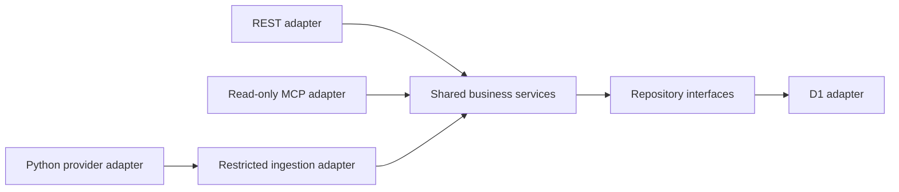

# Architecture

## Stack

- Approved baseline: Cloudflare Workers, Hono, strict TypeScript and D1; separate Python/yfinance collection through GitHub Actions.
- Default Worker implements public REST health and official SDK stateless MCP ping only. Synthetic instrument CRUD uses shared services/repository port with Memory and native D1 adapters, reachable only in isolated tests and separate loopback harnesses. Local JWT security composition is implemented; D1 is local-only, and ledger/financial calculations, collection and hosted OAuth remain unimplemented. See [INSTALL.md](../INSTALL.md).

## How it fits together

## Key decisions

- 2026-11-11: [quotation slice](../tasks/2026_11/2026_11_11_quotations/plan.md) implements local immutable provider observations, separate retrieval failures, shared status/history services and read-only MCP adapters. Declared exact price/source precision, market/fetch/record clocks and provider delay stay distinct from calculated freshness. INSTALL's >45-minute warning / >60-minute stale thresholds require trusted coverage context; unknown calendar stays unknown and no realtime guarantee is issued. Independent collector subject/provider/instrument grants default deny; existing OAuth/Access mappings and deployed entrypoints are unchanged. No yfinance collector or valuation is added.

- 2026-11-10: opening-state [owner decisions and slice](../tasks/2026_11/2026_11_10_opening-positions/plan.md): supplied Bourse Direct unit PRU is authoritative; never reconstruct historical total cost/fees from it. Corrections append complete immutable revisions at the original reference time, not trades. The local synthetic slice adds shared portfolio services, Memory/native D1 adapters, revision-pinned position reads and explicit read/admin capabilities without extending Access grants or changing deployed entrypoints. See the [contract](../tasks/2026_11/2026_11_10_opening-positions/contract.md); OAuth lifecycle tests and private-data gates remain separate.

- 2026-11-09: owner prioritizes Access Managed OAuth for the synthetic PoC; Free/Beta availability confirmed by owner. Local Access assertions map only to MCP read capability after issuer/AUD/signature/expiry/exact-owner checks. REST financial routes are absent from this composition; no delegated scopes/azp are fabricated. The approved initial closed deployment returned only 503; DEV was unchanged. Owner subsequently reported Access configured. See [Access evidence](../tasks/2026_11/2026_11_08_oauth-authentication/access-implementation.md); activation approval and hosted client interoperability remain pending.

- Modular application boundaries, one owner, no speculative tenancy or dashboard.
- One evolving PEA Tracker application, one GitHub repository and shared codebase. REST health and MCP ping are its first features; extend them with D1, portfolio, collection and OAuth rather than creating a disposable server or duplicated project.
- Owner-confirmed API-first decision: reusable REST under `/api/v1`, documented with OpenAPI; Streamable HTTP MCP stays at `/mcp` as the AI-facing adapter. REST and MCP call the same TypeScript application/domain services directly; no duplicated calculations, repository logic or internal MCP-to-REST HTTP requests.
- Keep service contracts independent of transport objects so a future extracted MCP adapter could use an HTTP client of the versioned REST API. No extraction or speculative client abstraction is required now. MCP read, REST administration and quotation-ingestion grants remain distinct at adapter and service boundaries.
- The [financial backend PRD](../tasks/2026_11/2026_11_08-financial-backend-prd.md) was approved on 2026-11-08. Distinguish cost basis/PRU, unrealized gains and total portfolio performance. Weighted-average cost basis is preferred; fee treatment and detailed accounting conventions remain pending explicit approval. Dated opening state must not fabricate transactions; incomplete source history makes historical performance unavailable.
- Deliver incremental vertical slices; instrument metadata is independent of advanced performance, dividend and corporate-action decisions. The [Financial Instruments plan](../tasks/2026_11/2026_11_08_financial-instruments/plan.md) implements the [REST contract](../api/openapi.json); the [D1 increment](../tasks/2026_11/2026_11_08_d1-instruments/plan.md) adds local persistence. Memory/replay state disappears on restart. D1 stores original create snapshots atomically with rows and uses batched conditional UPDATE + SELECT for CAS; zero changed rows commit no dependent writes. No TTL or deletion path for outcomes.
- Two versioned SQL migrations enforce nullable unique ISIN (including inactive), safe versions, restricted FK, immutable identity/outcomes and bounded pagination indexes. The fixture is ID-free with remote:false; getPlatformProxy uses remoteBindings:false/envFiles:[]. Wrangler --persist-to uses an owned .wrangler directory while the proxy uses its v3 subdirectory. Default root config has no binding. Local restart evidence is not cloud/backup/power-loss evidence.
- Before approved authentication/authorization, no private financial REST or MCP endpoint may be publicly exposed. createApp requires explicit service and trusted verifier dependencies to mount instruments; src/index.ts provides neither. The separate scripts/dev-instruments.mjs harness binds only 127.0.0.1 with fixed synthetic principals and Host/Origin guards. OAuth remains open; this harness must never be published/tunneled or used with real data.
- One Wrangler config defines named dev (pea-tracker-dev) and production (pea-tracker) deployments sharing the entrypoint. The default local name matches dev; remote operations require explicit environment selection. Development workers.dev exposure is prepared, production exposure and preview URLs remain disabled; configuration preparation does not authorize deployment.
- Future remote bindings, variables and secrets are environment-specific, with separate development/production resources. No remote resources are provisioned or bound; the only D1 binding is an isolated local test fixture. Private-data gates apply in every environment.
- OAuth selection remains open between Workers OAuth Provider and Auth0 until ChatGPT interoperability, security, maintenance, CPU and cost are evaluated.
- OAuth phases 1/2 implement isolated local JWT verification and resource/client/scope policies using existing pinned jose. `createProtectedApp` explicitly mounts protected REST, read-only MCP and resource metadata; src/index.ts still exports only diagnostic composition. Exact owner identity maps to a stable internal idempotency subject. Real Auth0 discovery/profile, code/PKCE/refresh/revocation, recovery and hosted-client evidence remain pending; no remote auth configuration or public financial endpoint is active.
- Phase-3 local preparation adds a separate fail-closed `src/entrypoints/oauth-poc.ts`, closed Wrangler template, trusted Auth0 configuration/discovery assessment and synthetic Memory seed. Hosted execution is blocked on owner-selected tenant/host, entitlements, abuse controls and specific approval; see [interop evidence](../tasks/2026_11/2026_11_08_oauth-authentication/interop-evidence.md). No real Auth0/client connection is claimed.
- Synthetic MCP initialization/ping may precede D1, ledger, calculations, backups and collection infrastructure. It is not a production acceptance test.
- Connected MCP ping returned `ok` / `pea-tracker` / `0.1.0` at `2026-11-06T22:25:54.342Z` in the owner conversation. This establishes diagnostic connectivity only; it does not validate authentication, financial functionality or deployed CPU budgets.
- Production security and applicable release gates are mandatory before introducing real financial data, regardless of environment name.
- Exact decimal strings and arbitrary-precision arithmetic are required; preserve the precision/rounding contract in INSTALL.md. Never use binary floating point for monetary calculations.
- Optional Docker Compose development wraps the existing diagnostic Worker in Node/TypeScript/Wrangler; it does not change the completed MCP increment. Source/test mounts are selective and read-only, Linux node_modules use a named volume, and only host loopback port 8787 is published. See the root README for lifecycle and validation commands.
- A separate Python/yfinance/pytest container remains deferred until collector implementation; it is not part of active Compose services.
- Docker is development/testing tooling only, never a production hosting requirement. Production remains Cloudflare Workers with GitHub Actions automation.

## Gotchas

- Architecture validation is not evidence of runtime tests and does not authorize implementation or deployment.
- Protocol POST does not grant mutation permission; MCP remains read-only, with separately authorized administrative REST and quotation ingestion.
- €0 is a target, not permission to weaken security or activate paid plans.
