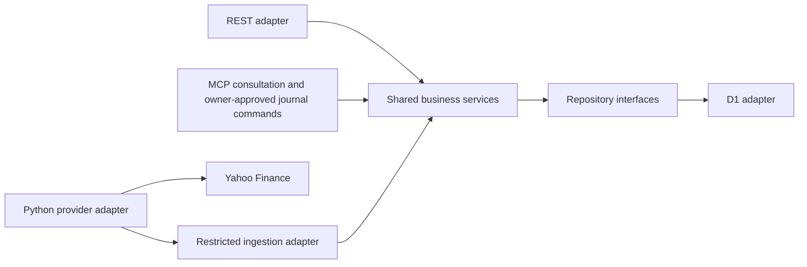

# Architecture

## Local V2.0-D / D3 — 2026-11-21

Offline-only `EodhdFixtureProvider` implements the structural fetch interface with
in-memory synthetic snapshots and separately declared context. Its neutral output
is normalized by D2; it is incompatible with the current Yahoo raw normalizer and
is not wired to the operational runner. Only synthetic unadjusted last-price
semantics are admitted; snapshot `close` never implies session-close data. Optional
`previousClose`/`change` cannot reconstruct missing prices. No network transport,
credential handling, routing, fallback or ingestion grant changes. **This is not
EODHD qualification.** Real venue/timestamp/price semantics, licence and quotas
remain gates. [D3 fixtures, 68 local checks and D1/D2 commit proposal](../tasks/2026_11/2026_11_21_eodhd-fixture-adapter/plan.md).

## Local V2.0-D / D2 — 2026-11-21

Prepared, **not activated or deployed**: `provider_mapping.py` reuses the legacy
instrument-mapping validation for explicit provider/symbol/exchange/data-kind/
adjustment streams. Multiple providers may map one canonical UUID; inconsistent
local canonical metadata and ambiguous associations fail. Neutral normalization
preserves exact prices, units, provenance and independent clocks for the existing
unadjusted last-trade/session-close observation contract only. OHLCV bars and
adjusted streams can be declared but are rejected for emission; date-only prices
never acquire invented market timestamps. No live imports, new ingestion grants,
schema changes, supplier activation or financial selection changes. Yahoo's
existing chain and the D1 interface remain unchanged.
[D2 decisions, 91 targeted tests and D3 limits](../tasks/2026_11/2026_11_21_provider-mappings/plan.md).

## Local V2.0-D / D1 — 2026-11-21

Minimal Python `QuotationProvider` protocol in the existing provider module;
Yahoo implements its unchanged `fetch(symbol)` raw-field contract and the runner
uses protocol annotations. No batch/session optimization, fallback, provider router,
adaptive cadence or secondary feed. Live CLI remains Yahoo-only; the additional
synthetic provider exists only in tests. Normalization/provenance remain explicitly
Yahoo-specific, not a generic secondary-feed admission mechanism. Supplier results
are recorded with measured Yahoo versus owner-reported external-provider evidence.
Locally tested, not deployed; [D1 scope, tests and remaining gates](../tasks/2026_11/2026_11_21_provider-abstraction/plan.md).

## V2.0-D feasibility — 2026-11-21

Study only, **not implemented or deployed**. C finalized locally at `5264794`;
successor branch `feat/v2.0d-multi-provider` inherits A/B/C. Conditional GO for
adaptive collection and N-provider routing using existing Cron/DO/GitHub/Python/D1.
Provider-scoped immutable storage exists; selection/fallback and per-instrument
planning do not. Keep yfinance and historical explicit-provider valuation unchanged.
EODHD delayed quotes merit a bounded PoC, subject to its indicative-data disclaimer;
Twelve Data's XPAR page specifies EOD, not demonstrated Paris intraday. Exact
catalogue sample, licensed retention/private MCP, data equivalence, quota budgets
and monotonic market timestamps remain gates. No quote API PoC or remote change.
[Evidence, official sources, cost bounds and proposed slices](../backlog/spikes/adaptive-multi-provider-feasibility.md).

## Local V2.0-C — 2026-11-21

Implemented and locally tested, **not deployed**: shared `PortfolioContextService`
resolves B/C read/write/browser contexts. V2 proposals bind version 2 and real/
simulated kind; the existing transaction engine is reused. Real operations retain
independent browser approval; simulated operations need explicit MCP confirmation.
Four new tools bring the full catalogue to 26. V1 hashes/proposals/receipts remain
compatible and fixed to the PEA. Additive migration 0009 extends journal anchors
and atomically refuses archived/mismatched event appends without rewriting rows.
Consumed proposals without receipts require reconciliation, not automatic retry.
[Contract, 55 local tests and limits](../tasks/2026_11/2026_11_21_portfolio-writes/plan.md).

## Local V2.0-B — 2026-11-21

Implemented and locally tested, **not deployed**: `PortfolioReadService` resolves
owner-scoped registry/openings and constructs existing projection/valuation services
for N real/simulated portfolios. Active and archived states are readable without
reactivation; no new financial writes. Separate `/api/v2/portfolios` reads and four
read-only MCP tools leave the old 18 tools and V1/V1.1 chains intact (22 total when
fully enabled). Shared stored quotations; server-selected performance references
are keyed and checked against portfolio/kind/opening, with explicit unavailability
otherwise. The Worker reuses only its configured historical PEA reference.
[Contract, tests, limits and C prerequisites](../tasks/2026_11/2026_11_21_portfolio-reads/plan.md).

## Local V2.0-A — 2026-11-21

Implemented and locally tested, **not deployed**: additive migration 0008 creates
`portfolios` with explicit owner/kind/status, immutable opening reference and
atomic independent-opening JSON. N real/simulated portfolios are supported by the
internal registry service; no new REST/MCP surface or financial writes are enabled.
Existing operational references/journals are adopted by their stored UUID/owner,
including populated journals, without rewriting V1/V1.1 data or canonical receipts.
Historical global opening revisions remain dedicated to V1. Registry metadata
version is separate from journal/opening versions; archive does not affect V1.1
services until future resolution/status enforcement. New journal anchors, financial
approval routing and multi-provider work remain future slices.
[Decisions, tests and migration/rollback limits](../tasks/2026_11/2026_11_21_portfolio-registry/plan.md).

## Current baseline — 2026-11-21

The real PEA remains the priority. One TypeScript/Hono application uses shared
hexagonal services/ports, D1 adapters and separate REST/MCP transports. Python/yfinance
supplies quotes through a distinct ingestion Worker; Cloudflare Cron/DO receipts
schedule protected GitHub workflow_dispatch jobs. Diagnostic PoCs stay separate.

- Financial composition: `src/entrypoints/access-financial.ts`; active Worker version
  `20f6a0fb-25cb-4d51-94bf-d7cb22ea5ec1`, write flag true. Published reference, real
  portfolio/owner, D1 and Access bindings match the preceding verified deployment.
- Historical V1 opening/positions/valuation remain intact. Current V1.1 reads use
  the separately selected immutable operational reference plus subsequent journal.
  The broker-verified operational start is dated 20 November; intervening operations
  were deliberately not reconstructed. Journal was verified empty at initialization.
- Journal: EUR trades/cash movements, actual fees/dividends, traceable reversals,
  exact weighted cost/PRU, realized/unrealized gains and dated external flows.
- Security: exact-owner Access/Managed OAuth identity receives explicit financial
  `portfolio:write`; browser-only approval receives `portfolio:approve` under a
  separate signed AUD. Preparation persists an expiring immutable intent; confirmation
  requires its exact single-use server approval. No brokerage order, implicit
  technical administration or reuse of quotation-ingestion grants.
- Migration 0007 adds the operational reference and adapts the empty journal anchor
  with guarded schema replacement. Original V1 data is not changed; nonempty
  journals prevent the one-time migration/reinitialization. Configuration/source
  artifacts stay private, with no paths or financial values stored in context.
- Evidence: earlier local financial/MCP suites plus 11 targeted operational checks
  and typecheck. Production D1/import/config comparisons, historical MCP reads/ping
  and anonymous refusals passed. Owner reports current ChatGPT reads and financial
  tool discovery. Real browser approval → write → immutable receipt/replay has
  **not** been validated in production; no transaction was created for acceptance.
- Remaining: bounded calendar assignments/activation not attested; freshness may
  remain unknown; closing-monitor operational proof and advanced alerts incomplete.
  Global economic gain requires a selected market-value reference, currently absent;
  no global percentage return or fabricated prior performance.

[Production evidence](../tasks/2026_11/2026_11_21_operational-start/production.md),
[security contract](../tasks/2026_11/2026_11_21_financial-mcp/contract.md),
[delivery scope and remaining decisions](../roadmap.md).

The dated local-increment records below retain their original evidence scope.
Claims there about inactive deployment or absent later calculations are historical,
not a reason to restart completed development or a fresh remote authorization.

## Stack

- Current local monetary-performance increment: exact dated external flows (including effective corrections, excluding trades/dividends/fees), opening cash, and optional selected-market-reference economic gain in EUR. Initial market value is recomputed from evidenced quotes/cash, never PRU; dates/identity/selection/backdating checked. No real reference selected/persisted: economic gain stays unavailable by default; no percentage return implemented. One captured portfolio/journal snapshot feeds valuation/flows; no new repository, migration, provider or remote activation. [Rules/evidence](../tasks/2026_11/2026_11_19_financial-journal/performance.md). Earlier statements about absent global performance remain true for percentage returns and actual-reference activation.

- Current local gains increment: one exact cost replay also derives realized sale gains, excluding reversed sales once and marking unknown/ambiguous cost unavailable. Unrealized gains reuse stored-quote market values minus remaining cost; percentages use securities cost, complete totals require complete price/cost coverage. Signed exact fractions share the existing 18-place half-even representation; historical V1 and valuation amounts unchanged. No global return or new persistence/provider. [Rules/evidence](../tasks/2026_11/2026_11_19_financial-journal/gains.md). Earlier exclusions of gains below describe prior phases; cash-flow-adjusted performance remains undefined/unavailable.

- Current local dividend increment: received EUR cash, optional catalogue instrument, existing date/provenance/reference, immutable counterposts and no quantity/cost/PRU movement. One captured journal version also supplies a `dividends` received/reversed/net summary since opening; this is not performance. Cost policy v3 describes cash-only dividends without changing the weighted-average method. Memory/D1 adapters and schema unchanged; no remote activation. [Rules/evidence](../tasks/2026_11/2026_11_19_financial-journal/dividends.md). Earlier exclusions of dividends below describe prior phases.

- Current local fee extension (20 November): optional explicit trade fees debit/capitalize purchase gross + fees; sales credit nonnegative gross − fees without changing remaining PRU. `cost_basis_policy.version=2` identifies unknown opening fees and undeclared historic fees, never a global fee-exclusive/inclusive PRU. Existing no-fee canonical receipts/results remain unchanged; storage needs no new migration. [Rules/evidence](../tasks/2026_11/2026_11_19_financial-journal/fees.md). The prior cost-only description below is historical regarding excluded fees; dividends/performance remain unavailable.

- Local V1.1 projected reads reuse `PortfolioService.current` and `ValuationService.current` at one journal version. The authorized 20 November increment adds weighted-average remaining cost/PRU through `src/domain/cost-basis.ts`: exact BigInt fractions, decimal representation rounded only at 18 places, declared-opening provenance, explicit unknown/conflicting-cost states, fees/dividends excluded. Performance remains unavailable. Historical V1 contracts/valuation and deployed compositions unchanged. See [cost rules](../tasks/2026_11/2026_11_19_financial-journal/cost-basis.md) and [connection evidence](../tasks/2026_11/2026_11_19_financial-journal/phase-2.md).

- Approved baseline: Cloudflare Workers, Hono, strict TypeScript and D1; separate Python/yfinance collection through GitHub Actions.
- One TypeScript application and a separate Python package in one repository; no monorepo refactor. The default diagnostic Worker is separate from the current financial reader and ingestion compositions. See [INSTALL.md](../INSTALL.md) for current evidence and the abbreviated layout.
- Developed: instruments, immutable opening state/positions/cash, quotations/status/history and exact EUR valuation on shared application/domain services with Memory/native D1 ports. REST/MCP call those services directly. Python retrieves Yahoo data separately and delivers HTTPS batches; it has no D1 or portfolio access.
- `src/entrypoints/access-financial.ts` now composes owner REST/MCP consultation and protected journal commands; `access-read.ts` retains the preceding read-only composition. `access-collector.ts` serves only machine ingestion. Exact identities/audiences and financial write/browser approval/ingestion permissions remain separate.
- Local checks and production observations are distinct. V1 automation acceptance is recorded in [the release evidence](../releases/v1.0.0-validation.md); the old pending 16 November checkpoint is historical. No new remote verification was performed for this documentary consolidation.
- Local V1.1 transaction journal implemented under the owner's 2026-11-19 rules: EUR deposits/withdrawals, buys/sells and traceable counterposting, exact signed cash/quantity movements, Memory/native local D1, portfolio-scoped idempotence and CAS. An explicit owner/portfolio/kind/opening-revision binding preserves V1's global revisions. The isolated REST composition is not imported by any deployed Worker or MCP; migration 0005 is local-test-only until separately authorized. That initial journal increment did not calculate PRU; the separately authorized cost-read extension is described above. Gains/returns remain unavailable. See [journal contract](../tasks/2026_11/2026_11_19_financial-journal/contract.md).
- Freshness context is injectable; the reader retains unknown when its optional calendar assignment is absent. Valuation still pins an opening revision, not an atomic cross-instrument quote snapshot. Existing valuation arithmetic remains unchanged; the new journal uses bounded exact signed integer-backed movements, not general division or financial-return formulas.
- Calendar delivery is implemented and tested locally, not activated remotely: a generated, reviewed two-year reference supplies the existing MarketContext only for explicitly assigned XPAR continuous-core instruments. Never infer the profile from MIC/type or alias ALXP. Unestablished phases, half-day hours and out-of-range dates stay unknown; calendar configuration is isolated from strict authentication configuration. No domain freshness policy, runtime network call, D1 schema or collector schedule changes. See [scope, provenance and local evidence](../tasks/2026_11/2026_11_14_market-calendar/reference-validation.md); annual renewal requires review, not automatic extrapolation.
- Portfolio revision selection/sequence remains global in V1. V1.1 adds explicit portfolio identity on the separate journal without rewriting old keys, cursors or replay outcomes. This is not a full multi-portfolio registry or API; future activation, anchor reconciliation, PRU/gain/return conventions remain separately scoped. The [roadmap](../roadmap.md) preserves the real PEA priority and isolates future Trading Lab use.

## How it fits together

## Historical decisions and slice evidence

The entries below retain the decisions and limits recorded at each earlier stage.
Local-only, inactive-schedule and open-OAuth statements describe those stages, not
current V1 operation. Subsequent deployment/collection evidence is summarized above
and in the runbook; earlier approvals do not authorize repeating those operations.

- 2026-11-11: [machine ingestion slice](../tasks/2026_11/2026_11_11_remote-ingestion/plan.md) reuses Cloudflare Access Service Tokens/Service Auth with a dedicated application AUD and signed empty-sub/common_name identity. Owner and machine policies share Access JWT/JWKS verification; only the machine policy grants quotes:ingest to a stable internal subject, with existing provider/instrument grants. Python sends the service credential pair, never the interactive MCP identity or an assumed OAuth token endpoint. Opt-in ingestion composition has no MCP/health/financial read/admin routes. Remote setup, actual assertion lifetime <=300 seconds, lifecycle and deployment remain approval-gated; stateless revocation is bounded, not instantaneous. Existing deployed entrypoints and MCP policy are unchanged.
- 2026-11-12: A separate `src/entrypoints/access-collector.ts` now composes machine-authenticated ingestion with the existing D1 schema. Its Wrangler fixture is local-only, synthetic and has no remote database ID, hostname or production audience. It exposes no MCP/health/financial-read/admin routes and fails closed on invalid configuration. Local D1, Python-client, access-denial and dry-run evidence is recorded in the [remote-ingestion contract](../tasks/2026_11/2026_11_11_remote-ingestion/contract.md); deployment and remote setup remain approval-gated.

- 2026-11-11: owner definitively selects Python + yfinance + GitHub Actions in the **already public** repository. The [local collector slice](../tasks/2026_11/2026_11_11_collector/plan.md) normalizes explicit mappings and sends declarations exclusively through machine-authorized ingestion; no Python D1 access or financial engine. Optional collector composition reuses existing JWT policies and mounts ingestion only, without changing deployed entrypoints/Access. Workflows are manual-only with commented schedules, least privileges, protected live gates and no private artifacts. Yahoo rights/full coverage, remote machine setup, monitoring and remote activation remain gated. Private journals replay local cycles; missing journals on fresh GitHub reruns fail closed rather than recollecting under the same key.

- 2026-11-11: owner-approved [valuation rules and local slice](../tasks/2026_11/2026_11_11_valuation/plan.md): explicit provider/kind with no fallback; stale/delayed/unknown quotes support labelled estimates, missing prices exclude positions. Exact quantity × price (÷100 for hundredth units), exact sums before half-even 2-place EUR display; no FX. Complete totals require all positions and known cash; unknown cash never becomes zero. Shared read-only REST/MCP services reuse immutable opening revisions and Memory/native D1 quotations without new migrations or OAuth/deployed entrypoint changes. Declared PRU stays separate; no historical cost/gain/performance derivation. Reads pin source IDs, not an atomic cross-instrument market snapshot.

- 2026-11-11: [quotation slice](../tasks/2026_11/2026_11_11_quotations/plan.md) implements local immutable provider observations, separate retrieval failures, shared status/history services and read-only MCP adapters. Declared exact price/source precision, market/fetch/record clocks and provider delay stay distinct from calculated freshness. INSTALL's >45-minute warning / >60-minute stale thresholds require trusted coverage context; unknown calendar stays unknown and no realtime guarantee is issued. Independent collector subject/provider/instrument grants default deny; existing OAuth/Access mappings and deployed entrypoints are unchanged. No yfinance collector or valuation is added.

- 2026-11-10: opening-state [owner decisions and slice](../tasks/2026_11/2026_11_10_opening-positions/plan.md): supplied Bourse Direct unit PRU is authoritative; never reconstruct historical total cost/fees from it. Corrections append complete immutable revisions at the original reference time, not trades. The local synthetic slice adds shared portfolio services, Memory/native D1 adapters, revision-pinned position reads and explicit read/admin capabilities without extending Access grants or changing deployed entrypoints. See the [contract](../tasks/2026_11/2026_11_10_opening-positions/contract.md); OAuth lifecycle tests and private-data gates remain separate.

- 2026-11-09: owner prioritizes Access Managed OAuth for the synthetic PoC; Free/Beta availability confirmed by owner. Local Access assertions map only to MCP read capability after issuer/AUD/signature/expiry/exact-owner checks. REST financial routes are absent from this composition; no delegated scopes/azp are fabricated. The approved initial closed deployment returned only 503; DEV was unchanged. Owner subsequently reported Access configured. See [Access evidence](../tasks/2026_11/2026_11_08_oauth-authentication/access-implementation.md); activation approval and hosted client interoperability remain pending.

- Modular application boundaries, one owner, no speculative tenancy or dashboard.
- One evolving PEA Tracker application, one GitHub repository and shared codebase. REST health and MCP ping are its first features; extend them with D1, portfolio, collection and OAuth rather than creating a disposable server or duplicated project.
- Owner-confirmed API-first decision: reusable REST under `/api/v1`, documented with OpenAPI; Streamable HTTP MCP stays at `/mcp` as the AI-facing adapter. REST and MCP call the same TypeScript application/domain services directly; no duplicated calculations, repository logic or internal MCP-to-REST HTTP requests.
- Keep service contracts independent of transport objects so a future extracted MCP adapter could use an HTTP client of the versioned REST API. No extraction or speculative client abstraction is required now. MCP read, REST administration and quotation-ingestion grants remain distinct at adapter and service boundaries.
- The [financial backend PRD](../tasks/2026_11/2026_11_08-financial-backend-prd.md) was approved on 2026-11-08. Distinguish cost basis/PRU, unrealized gains and total portfolio performance. Weighted-average cost basis is preferred; fee treatment and detailed accounting conventions remain pending explicit approval. Dated opening state must not fabricate transactions; incomplete source history makes historical performance unavailable.
- Deliver incremental vertical slices; instrument metadata is independent of advanced performance, dividend and corporate-action decisions. The [Financial Instruments plan](../tasks/2026_11/2026_11_08_financial-instruments/plan.md) implements the [REST contract](../api/openapi.json); the [D1 increment](../tasks/2026_11/2026_11_08_d1-instruments/plan.md) adds local persistence. Memory/replay state disappears on restart. D1 stores original create snapshots atomically with rows and uses batched conditional UPDATE + SELECT for CAS; zero changed rows commit no dependent writes. No TTL or deletion path for outcomes.
- Two versioned SQL migrations enforce nullable unique ISIN (including inactive), safe versions, restricted FK, immutable identity/outcomes and bounded pagination indexes. The fixture is ID-free with remote:false; getPlatformProxy uses remoteBindings:false/envFiles:[]. Wrangler --persist-to uses an owned .wrangler directory while the proxy uses its v3 subdirectory. Default root config has no binding. Local restart evidence is not cloud/backup/power-loss evidence.
- Before approved authentication/authorization, no private financial REST or MCP endpoint may be publicly exposed. createApp requires explicit service and trusted verifier dependencies to mount instruments; src/index.ts provides neither. The separate scripts/dev-instruments.mjs harness binds only 127.0.0.1 with fixed synthetic principals and Host/Origin guards. OAuth remains open; this harness must never be published/tunneled or used with real data.
- One Wrangler config defines named dev (pea-tracker-dev) and production (pea-tracker) deployments sharing the entrypoint. The default local name matches dev; remote operations require explicit environment selection. Development workers.dev exposure is prepared, production exposure and preview URLs remain disabled; configuration preparation does not authorize deployment.
- Future remote bindings, variables and secrets are environment-specific, with separate development/production resources. No remote resources are provisioned or bound; the only D1 binding is an isolated local test fixture. Private-data gates apply in every environment.
- OAuth selection remains open between Workers OAuth Provider and Auth0 until ChatGPT interoperability, security, maintenance, CPU and cost are evaluated.
- OAuth phases 1/2 implement isolated local JWT verification and resource/client/scope policies using existing pinned jose. `createProtectedApp` explicitly mounts protected REST, read-only MCP and resource metadata; src/index.ts still exports only diagnostic composition. Exact owner identity maps to a stable internal idempotency subject. Real Auth0 discovery/profile, code/PKCE/refresh/revocation, recovery and hosted-client evidence remain pending; no remote auth configuration or public financial endpoint is active.
- Phase-3 local preparation adds a separate fail-closed `src/entrypoints/oauth-poc.ts`, closed Wrangler template, trusted Auth0 configuration/discovery assessment and synthetic Memory seed. Hosted execution is blocked on owner-selected tenant/host, entitlements, abuse controls and specific approval; see [interop evidence](../tasks/2026_11/2026_11_08_oauth-authentication/interop-evidence.md). No real Auth0/client connection is claimed.
- Synthetic MCP initialization/ping may precede D1, ledger, calculations, backups and collection infrastructure. It is not a production acceptance test.
- Connected MCP ping returned `ok` / `pea-tracker` / `0.1.0` at `2026-11-06T22:25:54.342Z` in the owner conversation. This establishes diagnostic connectivity only; it does not validate authentication, financial functionality or deployed CPU budgets.
- Production security and applicable release gates are mandatory before introducing real financial data, regardless of environment name.
- Exact decimal strings and arbitrary-precision arithmetic are required; preserve the precision/rounding contract in INSTALL.md. Never use binary floating point for monetary calculations.
- Optional Docker Compose development wraps the existing diagnostic Worker in Node/TypeScript/Wrangler; it does not change the completed MCP increment. Source/test mounts are selective and read-only, Linux node_modules use a named volume, and only host loopback port 8787 is published. See the root README for lifecycle and validation commands.
- A separate Python/yfinance/pytest container remains deferred until collector implementation; it is not part of active Compose services.
- Docker is development/testing tooling only, never a production hosting requirement. Production remains Cloudflare Workers with GitHub Actions automation.

## Gotchas

- Architecture validation is not evidence of runtime tests and does not authorize implementation or deployment.
- Protocol POST does not grant mutation permission; MCP remains read-only, with separately authorized administrative REST and quotation ingestion.
- €0 is a target, not permission to weaken security or activate paid plans.
