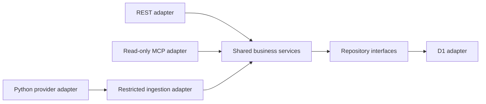

# Architecture

## Stack

- Approved baseline: Cloudflare Workers, Hono, strict TypeScript and D1; separate Python/yfinance collection through GitHub Actions.
- Default Worker implements public REST health and official SDK stateless MCP ping only. Synthetic instrument CRUD is implemented through shared services/repository port and per-app memory storage, reachable in isolated tests and the separate loopback harness. D1, ledger/financial calculations, collection and OAuth remain unimplemented. See [INSTALL.md](../INSTALL.md).

## How it fits together

## Key decisions

- Modular application boundaries, one owner, no speculative tenancy or dashboard.
- One evolving PEA Tracker application, one GitHub repository and shared codebase. REST health and MCP ping are its first features; extend them with D1, portfolio, collection and OAuth rather than creating a disposable server or duplicated project.
- Owner-confirmed API-first decision: reusable REST under `/api/v1`, documented with OpenAPI; Streamable HTTP MCP stays at `/mcp` as the AI-facing adapter. REST and MCP call the same TypeScript application/domain services directly; no duplicated calculations, repository logic or internal MCP-to-REST HTTP requests.
- Keep service contracts independent of transport objects so a future extracted MCP adapter could use an HTTP client of the versioned REST API. No extraction or speculative client abstraction is required now. MCP read, REST administration and quotation-ingestion grants remain distinct at adapter and service boundaries.
- The [financial backend PRD](../tasks/2026_11/2026_11_08-financial-backend-prd.md) was approved on 2026-11-08. Distinguish cost basis/PRU, unrealized gains and total portfolio performance. Weighted-average cost basis is preferred; fee treatment and detailed accounting conventions remain pending explicit approval. Dated opening state must not fabricate transactions; incomplete source history makes historical performance unavailable.
- Deliver incremental vertical slices; instrument metadata is independent of advanced performance, dividend and corporate-action decisions. The approved [Financial Instruments plan](../tasks/2026_11/2026_11_08_financial-instruments/plan.md) implements the [REST contract](../api/openapi.json) with synthetic memory storage only; D1/persistence evidence follows later. Memory/replay state disappears on restart and is not shared across isolates.
- Before approved authentication/authorization, no private financial REST or MCP endpoint may be publicly exposed. createApp requires explicit service and trusted verifier dependencies to mount instruments; src/index.ts provides neither. The separate scripts/dev-instruments.mjs harness binds only 127.0.0.1 with fixed synthetic principals and Host/Origin guards. OAuth remains open; this harness must never be published/tunneled or used with real data.
- One Wrangler config defines named dev (pea-tracker-dev) and production (pea-tracker) deployments sharing the entrypoint. The default local name matches dev; remote operations require explicit environment selection. Development workers.dev exposure is prepared, production exposure and preview URLs remain disabled; configuration preparation does not authorize deployment.
- Future bindings, variables and secrets are environment-specific, with separate development/production resources. No resources are provisioned or bound yet; private-data gates apply in every environment.
- OAuth selection remains open between Workers OAuth Provider and Auth0 until ChatGPT interoperability, security, maintenance, CPU and cost are evaluated.
- Synthetic MCP initialization/ping may precede D1, ledger, calculations, backups and collection infrastructure. It is not a production acceptance test.
- Connected MCP ping returned `ok` / `pea-tracker` / `0.1.0` at `2026-11-06T22:25:54.342Z` in the owner conversation. This establishes diagnostic connectivity only; it does not validate authentication, financial functionality or deployed CPU budgets.
- Production security and applicable release gates are mandatory before introducing real financial data, regardless of environment name.
- Exact decimal strings and arbitrary-precision arithmetic are required; preserve the precision/rounding contract in INSTALL.md. Never use binary floating point for monetary calculations.
- Optional Docker Compose development wraps the existing diagnostic Worker in Node/TypeScript/Wrangler; it does not change the completed MCP increment. Source/test mounts are selective and read-only, Linux node_modules use a named volume, and only host loopback port 8787 is published. See the root README for lifecycle and validation commands.
- A separate Python/yfinance/pytest container remains deferred until collector implementation; it is not part of active Compose services.
- Docker is development/testing tooling only, never a production hosting requirement. Production remains Cloudflare Workers with GitHub Actions automation.

## Gotchas

- Architecture validation is not evidence of runtime tests and does not authorize implementation or deployment.
- Protocol POST does not grant mutation permission; MCP remains read-only, with separately authorized administrative REST and quotation ingestion.
- €0 is a target, not permission to weaken security or activate paid plans.
