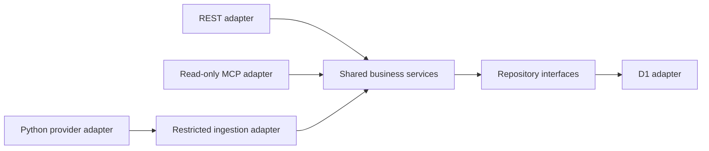

# Architecture

## Stack

- Approved baseline: Cloudflare Workers, Hono, strict TypeScript and D1; separate Python/yfinance collection through GitHub Actions.
- The local diagnostic Worker implements Hono REST and official SDK stateless MCP adapters only. D1, collection, portfolio services and OAuth remain baseline decisions, not implemented services. See [INSTALL.md](../INSTALL.md).

## How it fits together

## Key decisions

- Modular application boundaries, one owner, no speculative tenancy or dashboard.
- One evolving PEA Tracker application, one GitHub repository and shared codebase. REST health and MCP ping are its first features; extend them with D1, portfolio, collection and OAuth rather than creating a disposable server or duplicated project.
- One Wrangler config defines named dev (pea-tracker-dev) and production (pea-tracker) deployments sharing the entrypoint. The default local name matches dev; remote operations require explicit environment selection. Development workers.dev exposure is prepared, production exposure and preview URLs remain disabled; configuration preparation does not authorize deployment.
- Future bindings, variables and secrets are environment-specific, with separate development/production resources. No resources are provisioned or bound yet; private-data gates apply in every environment.
- OAuth selection remains open between Workers OAuth Provider and Auth0 until ChatGPT interoperability, security, maintenance, CPU and cost are evaluated.
- Synthetic MCP initialization/ping may precede D1, ledger, calculations, backups and collection infrastructure. It is not a production acceptance test.
- Production security and applicable release gates are mandatory before introducing real financial data, regardless of environment name.
- Exact decimal strings and arbitrary-precision arithmetic are required; preserve the precision/rounding contract in INSTALL.md. Never use binary floating point for monetary calculations.
- Optional Docker Compose development wraps the existing diagnostic Worker in Node/TypeScript/Wrangler; it does not change the completed MCP increment. Source/test mounts are selective and read-only, Linux node_modules use a named volume, and only host loopback port 8787 is published. See the root README for lifecycle and validation commands.
- A separate Python/yfinance/pytest container remains deferred until collector implementation; it is not part of active Compose services.
- Docker is development/testing tooling only, never a production hosting requirement. Production remains Cloudflare Workers with GitHub Actions automation.

## Gotchas

- Architecture validation is not evidence of runtime tests and does not authorize implementation or deployment.
- Protocol POST does not grant mutation permission; MCP remains read-only, with separately authorized administrative REST and quotation ingestion.
- €0 is a target, not permission to weaken security or activate paid plans.
