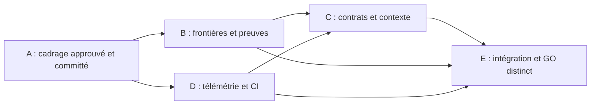

# Orchestration manuelle supervisée

Le propriétaire a validé A et autorisé le pilote à committer/pousser le cadrage et préparer B/D depuis le même commit. Les worktrees de mission sont siblings. Il lance lui-même les sessions ; chaque agent est autorisé à terminer son périmètre, documenter et committer localement après critères satisfaits. Push et intégration restent au pilote. Main et production restent hors scope.

**Parallélisme réel : B + D seulement, deux sessions maximum.** C attend D car ses tests de catalogue peuvent dépendre des wrappers modifiés. E attend les livrables acceptés. Ni rebase ni cherry-pick automatique ; arbitrage du pilote pour les fichiers communs.

| Lot | Branche / worktree envisagés | Propriété des fichiers et conflits | Preuves acquises / validation ciblée | Livrable et réduction possible |
| --- | --- | --- | --- | --- |
| B | feat/v2.1b-mcp-boundaries / pea-tracker-v2.1b | Nouveaux tests boundaries dédiés et sous-dossier mission B ; auth et contrats existants en lecture seulement ; ne pas modifier handler ni les workflows de D | JWT/AUD/owner/CSRF déjà acquis ; borne SDK vérifiée ; compléter seulement une lacune de preuve précise, test sans réseau | Rapport invariants et cas manquants ; lot documentaire seul ou supprimé si tout existe ; aucune refonte de scopes |
| D | feat/v2.1d-mcp-observability / pea-tracker-v2.1d | handler.ts et adaptateurs mcp financial-tools/portfolio-reads/portfolio-financial si nécessaire pour nommer callbacks ; nouveau module de télémétrie, tests dédiés ; nouveau workflow validation V2.1, doc sécurité/inventaire. Ne pas éditer scheduler, collector live, calculs, migrations, README/roadmap racine | Refus d'auth et journal existants ; absence observée d'audit par tool et CI branchée V2.0 ; nouveaux tests allowlist/redaction/logger défaillant ; inspection CI et test ciblé des nouveaux contrats | Événements structurés minimaux et gate synthétique, politique dépendances et inventaire local ; pas de nouvelle infrastructure ni upgrade aveugle |
| C | feat/v2.1c-mcp-context-contracts / pea-tracker-v2.1c | Nouveaux tests de catalogue/contexte, doc champ→finalité ; descriptions dans adaptateurs MCP seulement si justifiées après D. Pas de suppression de champs ni changement digest/valeurs | Intent/digest/approval et isolation déjà acquis ; corpus synthétique non fiable, stabilité 15/26 et unicité ; aucune preuve d'immunité du modèle revendiquée | Contrat + tests ; documentation seule acceptable ; changement de métadonnées soumis à compatibilité |
| E | integration/v2.1 / pea-tracker-v2.1 | README/roadmap/mémoires/proofs/notes et intégration autorisée des lots ; revue des fichiers partagés C/D ; aucun changement métier opportuniste | Suites historiques ; seulement nouvelles assertions et régressions affectées, Linux ultérieur si autorisé ; pas de rerun général réflexe | Matrice actualisée, notes, ordre d'intégration et GO/NO-GO ; livraison distinctement autorisée |

## Contrat minimal D

Événement technique : nom d'événement fixe, outil issu du catalogue connu, succès/refus/échec, code de résultat allowlisté, corrélation aléatoire serveur et durée bornée. Aucun argument/résultat, corps, cookie, assertion, sujet, montant, UUID de portefeuille/opération ni texte d'erreur libre. Émettre après décision ; un logger cassé ne modifie jamais la réponse ni la transaction. Ne pas faire un second parsing JSON non borné, ni conserver un contexte global entre requêtes.

Vérifier les API/hook réels du SDK avant implémentation ; privilégier les callbacks déjà présents. Pas d'écriture D1 pour cet audit, pas de stockage d'arguments ni de stacktrace fournisseur.

## Ordre d'intégration envisagé

A committé et approuvé → B et D depuis cette référence commune → intégration B puis D après autorisation → C depuis leur base intégrée → E. Une mission ne fusionne pas elle-même dans main/integration. Les installations éventuelles requièrent toujours une autorisation ; pas de node_modules partagé modifié entre sessions.

## Conditions opérationnelles et preuves

D qualifie AVANT implémentation la capacité/quota/coût/rétention des logs Cloudflare applicables, sans modifier les réglages distants. D examine GitHub natif et les audits disponibles avant de proposer un outil nouveau. Une offre générique n'est pas la preuve du forfait ou des réglages du compte ; toute inconnue reste explicite. B et C réutilisent cette qualification, sans dupliquer les appels. Les évaluations LLM sont distinctes des tests serveur ; aucun objectif artificiel 10/10 OWASP.

## Responsabilités et restitution

[Allowlist B/D](ownership.json) : aucun fichier commun en écriture pendant B parallèle à D. Les aides de tests sont également séparées. README, roadmap, mémoire, matrice et politique VCS sont réservés au pilote ; chaque mission documente son propre sous-dossier. Une extension de périmètre doit être arbitrée avant modification. C attend les wrappers acceptés de D.

Utiliser [le compte rendu standard](report-template.md) et [le RETEX vivant](retex.md). Le SHA final est fourni après commit dans la restitution, pas inscrit dans son propre commit. Les prompts suivis sont des gabarits ; les enveloppes définitives du pilote portent le SHA A résolu après création du commit, sans créer de dépendance circulaire.

Pour B/D, aucune écriture D1 même locale ; les nouveaux tests utilisent des repositories en mémoire ou des mocks de transport. Aucun environnement partagé n’est modifié. Les seules lectures distantes D portent sur métadonnées techniques accessibles avec les droits existants.
